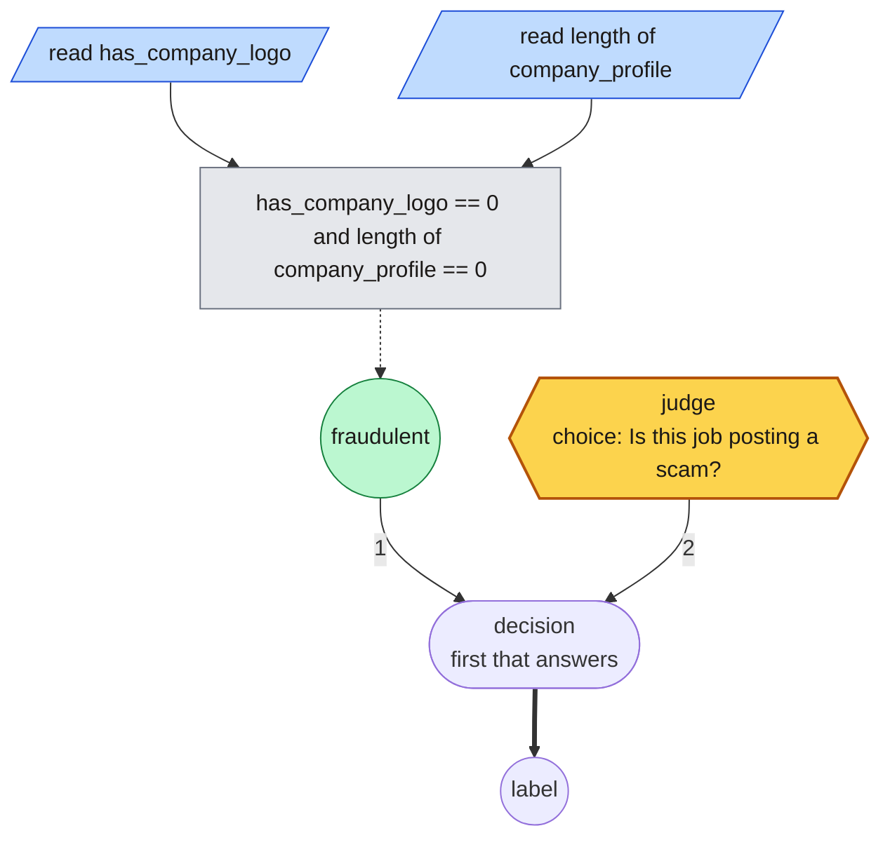

# rulesmith


**rulesmith lets DSPy build decision graphs for you.** Give it a
classification task and examples, labeled or graded by a stronger model. It
searches for a small program of rules: cheap tests on the input's fields settle
the cases they can, and a local Ruling or hosted Jev judge is asked typed
questions (Choice, Score, and Noul, a probability that a statement is true)
about the rest. A generative model proposes each revision,
[GEPA](https://github.com/gepa-ai/gepa) decides which to keep by how they score
on your examples, and the best program is saved as rules or JSON you can run,
read, and edit. Graphs compose: a decision can hand a case to another graph,
so many decisions become one map, searched a unit at a time.

This is an independent research prototype, not affiliated with TypeSafe. Jev is
TypeSafe's hosted judge, selected with `--backend typesafe`. rulesmith optimizes
graphs and question instructions, not model weights.

## When to use rulesmith, and when DSPy

rulesmith is built on DSPy and solves a narrower problem. It fits when:

- the answer must be one of a fixed set of labels, not free text;
- the input is structured, so cheap rules over its fields settle many cases and
  the judge is asked only about the rest;
- a calibrated probability matters, or an unsure case should go to a person
  rather than be guessed;
- a small local judge should be enough, and a large model per decision is more
  than the task is worth.

Use DSPy directly for open-ended generation, programs of several steps,
retrieval, and tasks where worked examples in the prompt carry the accuracy.
rulesmith searches over rules and questions, not demonstrations, so it has
nothing to add there.

The [benchmarks](docs/benchmarks.md) bear this out on five public datasets.
Where fields carry the signal, rulesmith ties or beats DSPy with 5% to 68% of
its model calls. Where the input is a single piece of free text, it adds nothing
over one direct question: it ties DSPy on Banking77, and DSPy's chain of thought
beats it on TREC.

## Installation

Requires Python 3.12–3.14.

```sh
pip install rulesmith
```

That covers classification tasks and every command except the games. The games
and the public benchmarks need packages the core leaves out, so they come as
extras:

| Extra | For | Adds |
| --- | --- | --- |
| `doom` | Doom tasks, `arena`, `record` | ViZDoom, NumPy, Pillow, ffmpeg |
| `chess` | Chess tasks | python-chess |
| `bench` | `python -m rulesmith.bench` | pyarrow, scikit-learn, Hugging Face Hub |

```sh
pip install 'rulesmith[doom,chess]'
```

The examples below run from a checkout with [uv](https://docs.astral.sh/uv/),
which installs every extra and the test tools:

```sh
git clone https://github.com/bradAGI/rulesmith.git
cd rulesmith
uv sync --locked
```

## Quickstart

Pick a judge: TypeSafe's hosted Jev (`export TYPESAFE_API_KEY=<your key>`; it is
the default backend), or [Ruling](https://github.com/bradAGI/ruling) on your own
Mac (`uv run --directory ../ruling ruling serve`, then add
`--backend ruling --max-workers 1` to each command below). Point the proposer,
the model that writes graphs, at any OpenAI-compatible server:

```sh
export REFLECTION_MODEL="openai/<served-model-id>"
export REFLECTION_BASE_URL=http://127.0.0.1:8080/v1
export OPENAI_API_KEY=local-no-auth
```

Then search from a labeled task, and run what it finds:

```sh
cp examples/task.json task.json
uv run rulesmith optimize task.json --reflection-model "$REFLECTION_MODEL" \
  --reflection-base-url "$REFLECTION_BASE_URL" --output runs/my-task
uv run rulesmith run runs/my-task/plan.rules examples/state.json
```

`optimize` writes `plan.json`, the same graph as editable `plan.rules`, and
`report.json`; `run` answers with a label, the rule or judgment that decided it,
and how sure it was. The [full walk-through](docs/quickstart.md) has every
command's output, drafting labels for inputs that have none, structured inputs,
and scoring on a held-out split.

## What it builds

Search writes rules, not prompts. On the [job-postings benchmark](docs/benchmarks.md)
it found this program from 100 labeled postings:

```
read has_company_logo in [0, 1]
read length of company_profile in [0, 10000]
when has_company_logo == 0 and length of company_profile == 0: fraudulent
always: ask "Is this job posting a scam?" [fraudulent: "fraudulent"] [genuine: "genuine"]
```

Drawn with `rulesmith draw` (the [legend](docs/graphs.md#looking-at-a-graph)):



Rule 1 reads two fields and, when the posting has no logo and an empty company
profile, answers `fraudulent` without calling any model. Only when it declines
does rule 2 ask the judge (Jev or Ruling), which it did on 60% of test postings.

Rules compile to a validated graph that the runtime executes, and read back as
the rules they came from: `optimize` saves both, and a `.rules` file runs
anywhere a `plan.json` does, so you can edit what search wrote. The language,
with what a judgment can be and how sure a rule is, is in [Rules](docs/rules.md).
Graphs compose: a decision can hand a case to another graph's unit, and many
decisions become one map, validated across its hand-offs and searched a unit
at a time; the first one is in [A map of decisions](docs/map.md).

## Use from Python

A graph runs as a `dspy.Module`:

```python
from pathlib import Path

from typesafe_sdk import TypeSafeClient

from rulesmith.graph import Plan
from rulesmith.runtime import DecisionProgram

plan = Plan.model_validate_json(Path("runs/my-task/plan.json").read_text())
with TypeSafeClient(base_url="http://127.0.0.1:8010", api_key="local-no-auth") as client:
    program = DecisionProgram(plan, client, model="default")
    result = program(state="Please correct the duplicate charge on my invoice.")
    print(result.label, result.answers)
```

Output (probabilities rounded):

```text
billing {'intent': {'type': 'choice', 'value': 'billing', 'probabilities': {'billing': 0.992, 'technical': 0.008, 'sales': 4.5e-05}, 'confidence': 0.989}}
```

Against Jev, the client reads `TYPESAFE_API_KEY` and TypeSafe's endpoint by
itself: `with TypeSafeClient() as client:` and `model="jev-latest"`.

The rest, from loading rules to running search from Python, is in
[Python](docs/python.md).

## Learn more

- [Quickstart](docs/quickstart.md): the full walk-through, with every command's output.
- [Tasks](docs/tasks.md): the task file, drafting labels, structured inputs, costs, and graders.
- [Rules](docs/rules.md): the language search writes, judgments, confidence, calibration, and worked examples.
- [Graph format](docs/graphs.md): the JSON behind each node, execution, composing graphs from graphs, and drawing and ablating one.
- [A map of decisions](docs/map.md): three searched units behind a router, scored end to end on public data.
- [Optimization](docs/optimization.md): how search runs, its settings, reports, testing, and limits.
- [Command line](docs/cli.md): every command, the flags they share, and the backends.
- [Python](docs/python.md): running and building graphs from code.
- [Benchmarks](docs/benchmarks.md): rulesmith against DSPy, TF-IDF and direct calls on five public datasets.
- [Doom](docs/doom.md): a graph that plays, scored by episode reward, and the league it came from.
- [Chess](docs/chess.md): labels as policies, hundreds of games a minute, and the baseline ladder.
- [Related work](docs/related-work.md): what got here first, and what is different.

## Development

`uv sync` installs the project with every extra, so the whole suite runs. CI runs
the same checks on Python 3.12, 3.13 and 3.14.

```sh
uv run pytest -q
uv run ruff check src tests && uv run ruff format --check src tests
```

Output (the last line of pytest):

```text
538 passed, 6 skipped, 1 warning in 317.60s (0:05:17)
All checks passed!
49 files already formatted
```

## License

[MIT](LICENSE).
