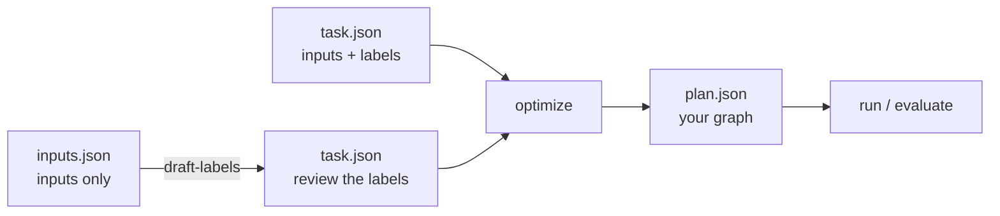
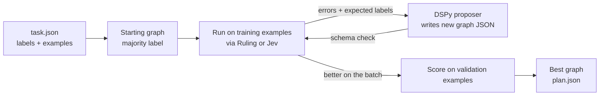
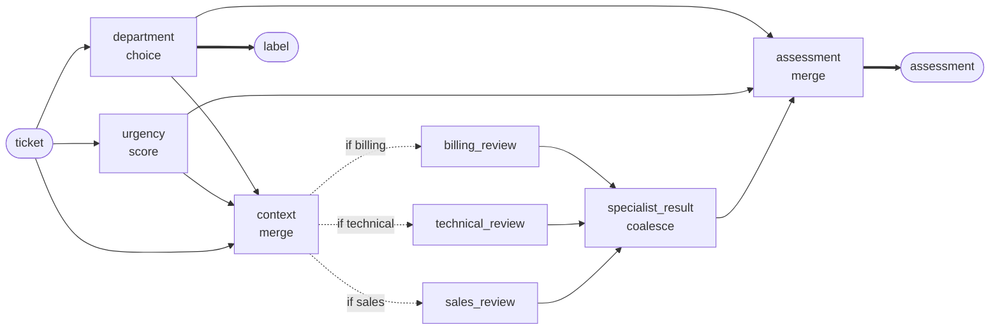
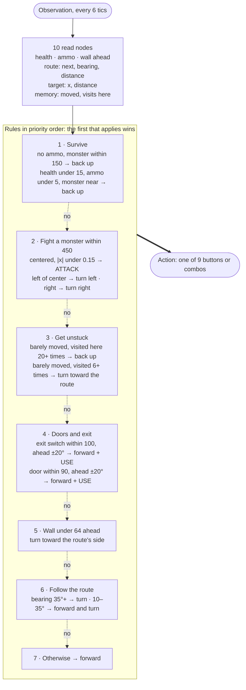
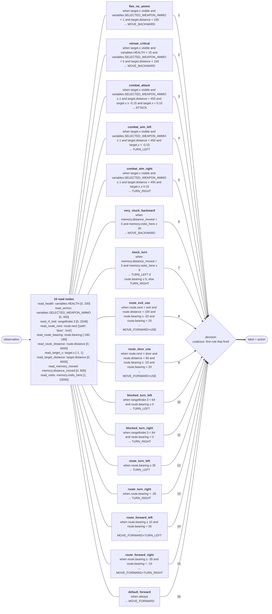

# decision-compose


**decision-compose lets DSPy build decision graphs for you.** Give it a
classification task and labeled examples. A generative model proposes graphs of
small typed judgments (Choice, Score, Noul), [GEPA](https://github.com/gepa-ai/gepa)
scores them against a local Ruling or hosted Jev judge, and the best graph
is saved as plain JSON you can run, inspect, and edit.

This is an independent research prototype, not affiliated with TypeSafe. It
optimizes graphs and question instructions, not model weights.

## Installation

Requires Python 3.12–3.14 and [uv](https://docs.astral.sh/uv/).

```sh
uv sync --locked
```

## Getting started

You need example inputs. Expected outputs (labels) are optional: if you don't
have them, a strong model drafts them for you to review.



**1. Start a judge.** Ruling runs locally and needs no account:

```sh
cd ../ruling && uv sync && uv run ruling serve
```

**2. Configure a proposer.** This is the generative model that writes graphs.
Any [DSPy model identifier](https://dspy.ai/learn/programming/language_models/)
works. For a local OpenAI-compatible server:

```sh
export REFLECTION_MODEL=openai/<served-model-id>
export REFLECTION_BASE_URL=http://127.0.0.1:8080/v1
export OPENAI_API_KEY=local-no-auth
```

**3. Describe the task.** Pick the case that matches your data.

<details open>
<summary><b>I only have inputs</b></summary>

List the allowed labels and your raw inputs in `inputs.json`:

```json
{
  "description": "Route each support ticket to billing, technical, or sales.",
  "labels": ["billing", "technical", "sales"],
  "inputs": ["I was charged twice this month.", "The export button returns a 500 error."]
}
```

Then have the proposer model label them. `--validation` and `--test` set how
many inputs are held out for selection and final scoring:

```sh
uv run decision-compose draft-labels inputs.json --output task.json \
  --labeler-model "$REFLECTION_MODEL" --labeler-base-url "$REFLECTION_BASE_URL" \
  --validation 10 --test 10
```

> [!IMPORTANT]
> Review and correct `task.json` before optimizing. Search learns to agree with
> these labels, including their mistakes.

This is DSPy's teacher–student pattern: a large model labels, and the small
judge is fit to its judgment.

</details>

<details>
<summary><b>I have labeled examples</b></summary>

Write `task.json` directly, like [examples/task.json](examples/task.json):

```json
{
  "description": "Route each support ticket to billing, technical, or sales.",
  "labels": ["billing", "technical", "sales"],
  "train": [{"id": "t1", "state": "I was charged twice.", "label": "billing"}],
  "validation": [...],
  "test": [...]
}
```

`train` drives proposals, `validation` picks the winner, and `test` is scored once at the end.

</details>

**4. Build the graph.**

```sh
uv run decision-compose optimize task.json \
  --backend ruling --max-workers 1 \
  --reflection-model "$REFLECTION_MODEL" \
  --reflection-base-url "$REFLECTION_BASE_URL" \
  --output runs/my-task
```

This writes `runs/my-task/plan.json` (the graph) and `report.json` (scores).
Compare `validation_score` with `seed_validation_score`.

**5. Evaluate and run it.** The proposer is not needed from here on.

```sh
uv run decision-compose evaluate task.json runs/my-task/plan.json \
  --backend ruling --max-workers 1 --split test --output runs/my-task/test.json

uv run decision-compose run runs/my-task/plan.json examples/state.json \
  --backend ruling --max-workers 1
```

## How it works



The proposer sees where the current graph answered wrong and writes a complete
replacement: new calls, rewritten questions, branches, and joins. A proposal is
kept only if it beats its parent on the training batch, and the graph with the
best validation score is saved. The test split never reaches the optimizer.

The proposer can use the full DAG language. This hand-written example
([examples/dag.json](examples/dag.json)), not a search result, asks two questions
in parallel, then runs only the specialist that matches:



See [Graph format](docs/graphs.md) for the JSON behind each node.

## Play Doom

The same search can build a graph that plays [ViZDoom](https://github.com/Farama-Foundation/ViZDoom)
scenarios. Each step, the graph gets the visible objects and game variables as
JSON and outputs the next button. Its score is the episode's reward, not a label
match, so no labeled examples are needed.

```sh
uv run decision-compose optimize examples/doom/basic.json \
  --backend ruling --max-workers 1 \
  --reflection-model "$REFLECTION_MODEL" \
  --reflection-base-url "$REFLECTION_BASE_URL" \
  --output runs/doom

uv run decision-compose evaluate examples/doom/basic.json runs/doom/plan.json \
  --backend ruling --max-workers 1 --split test --visible --output runs/doom/test.json
```

`--visible` opens the game window so you can watch it play. See [Doom](docs/doom.md)
for the task format and scenarios.

## Results


**`basic`**: search started from a graph that only strafes left. Within three
rounds it found a graph that strafes toward the monster and fires once it is
centered. On held-out test seeds it killed every monster:

| Judge | Validation | Test | Test rewards (best possible ≈ 97) |
| --- | --- | --- | --- |
| Qwen3.6-35B-A3B via Ruling (local) | 0.33 → 0.97 | 0.94 | 79, 38, 83 |
| Jev (`jev-1.13.0`, hosted) | 0.33 → 0.97 | 0.94 | 75, 38, 83 |


[All 12 seeds back to back](docs/assets/doom/basic-reel.mp4): 12 of 12 kills.

**E1M1**: search started from a graph that only walks forward, with Claude Sonnet 5
proposing graphs, the local 4B judge, and a route to the exit computed from the map.
The best graph ([examples/doom/graphs/e1m1-exit.json](examples/doom/graphs/e1m1-exit.json))
is 27 nodes of reads and routing with no judge calls, and it **finishes the level**:
[watch it exit in 75 seconds](docs/assets/doom/e1m1-exit.mp4) with 10 kills.
[All five clears back to back](docs/assets/doom/e1m1-reel.mp4).

| Seeds | Exited | Died | Best time |
| --- | --- | --- | --- |
| 1–6 (the task's train, validation, and test seeds) | 3 | 3 | 75 s |
| 7–12 (never used by search) | 2 | 4 | 89 s |

Episodes were capped at 6 minutes. Two of the deaths came within 260 units of the
exit switch; the rest came in the first minute's fights.

The graph search found, drawn as its priority list. Each box stands for the
rule nodes of one kind; the final `coalesce` node takes the first rule whose
conditions hold:



The full graph: every read node with its path and declared range, and every rule
with its exact condition and action. Edge numbers give the order the final
`coalesce` checks them in.



<details>
<summary>The graph as JSON</summary>

```json
{
  "nodes": {
    "read_health": {
      "type": "read",
      "path": [
        "variables",
        "HEALTH"
      ],
      "bounds": [
        0,
        200
      ]
    },
    "read_ammo": {
      "type": "read",
      "path": [
        "variables",
        "SELECTED_WEAPON_AMMO"
      ],
      "bounds": [
        0,
        400
      ]
    },
    "read_rf_mid": {
      "type": "read",
      "path": [
        "rangefinder",
        3
      ],
      "bounds": [
        0,
        2048
      ]
    },
    "read_route_next": {
      "type": "read",
      "path": [
        "route",
        "next"
      ],
      "categories": [
        "path",
        "door",
        "exit"
      ]
    },
    "read_route_bearing": {
      "type": "read",
      "path": [
        "route",
        "bearing"
      ],
      "bounds": [
        -180,
        180
      ]
    },
    "read_route_distance": {
      "type": "read",
      "path": [
        "route",
        "distance"
      ],
      "bounds": [
        0,
        6000
      ]
    },
    "read_target_x": {
      "type": "read",
      "path": [
        "target",
        "x"
      ],
      "bounds": [
        -1,
        1
      ]
    },
    "read_target_distance": {
      "type": "read",
      "path": [
        "target",
        "distance"
      ],
      "bounds": [
        0,
        6000
      ]
    },
    "read_memory_moved": {
      "type": "read",
      "path": [
        "memory",
        "distance_moved"
      ],
      "bounds": [
        0,
        600
      ]
    },
    "read_visits": {
      "type": "read",
      "path": [
        "memory",
        "visits_here"
      ],
      "bounds": [
        1,
        10000
      ]
    },
    "flee_no_ammo": {
      "type": "value",
      "when": {
        "type": "all",
        "conditions": [
          {
            "type": "present",
            "node": "read_target_x"
          },
          {
            "type": "compare",
            "node": "read_ammo",
            "op": "lt",
            "value": 1
          },
          {
            "type": "compare",
            "node": "read_target_distance",
            "op": "lt",
            "value": 150
          }
        ]
      },
      "value": "MOVE_BACKWARD"
    },
    "retreat_critical": {
      "type": "value",
      "when": {
        "type": "all",
        "conditions": [
          {
            "type": "present",
            "node": "read_target_x"
          },
          {
            "type": "compare",
            "node": "read_health",
            "op": "lt",
            "value": 15
          },
          {
            "type": "compare",
            "node": "read_ammo",
            "op": "lt",
            "value": 5
          },
          {
            "type": "compare",
            "node": "read_target_distance",
            "op": "lt",
            "value": 150
          }
        ]
      },
      "value": "MOVE_BACKWARD"
    },
    "combat_attack": {
      "type": "value",
      "when": {
        "type": "all",
        "conditions": [
          {
            "type": "present",
            "node": "read_target_x"
          },
          {
            "type": "compare",
            "node": "read_ammo",
            "op": "ge",
            "value": 1
          },
          {
            "type": "compare",
            "node": "read_target_distance",
            "op": "lt",
            "value": 450
          },
          {
            "type": "compare",
            "node": "read_target_x",
            "op": "ge",
            "value": -0.15
          },
          {
            "type": "compare",
            "node": "read_target_x",
            "op": "lt",
            "value": 0.15
          }
        ]
      },
      "value": "ATTACK"
    },
    "combat_aim_left": {
      "type": "value",
      "when": {
        "type": "all",
        "conditions": [
          {
            "type": "present",
            "node": "read_target_x"
          },
          {
            "type": "compare",
            "node": "read_ammo",
            "op": "ge",
            "value": 1
          },
          {
            "type": "compare",
            "node": "read_target_distance",
            "op": "lt",
            "value": 450
          },
          {
            "type": "compare",
            "node": "read_target_x",
            "op": "lt",
            "value": -0.15
          }
        ]
      },
      "value": "TURN_LEFT"
    },
    "combat_aim_right": {
      "type": "value",
      "when": {
        "type": "all",
        "conditions": [
          {
            "type": "present",
            "node": "read_target_x"
          },
          {
            "type": "compare",
            "node": "read_ammo",
            "op": "ge",
            "value": 1
          },
          {
            "type": "compare",
            "node": "read_target_distance",
            "op": "lt",
            "value": 450
          },
          {
            "type": "compare",
            "node": "read_target_x",
            "op": "ge",
            "value": 0.15
          }
        ]
      },
      "value": "TURN_RIGHT"
    },
    "very_stuck_backward": {
      "type": "value",
      "when": {
        "type": "all",
        "conditions": [
          {
            "type": "compare",
            "node": "read_memory_moved",
            "op": "lt",
            "value": 3
          },
          {
            "type": "compare",
            "node": "read_visits",
            "op": "ge",
            "value": 20
          }
        ]
      },
      "value": "MOVE_BACKWARD"
    },
    "stuck_turn": {
      "type": "threshold",
      "when": {
        "type": "all",
        "conditions": [
          {
            "type": "compare",
            "node": "read_memory_moved",
            "op": "lt",
            "value": 3
          },
          {
            "type": "compare",
            "node": "read_visits",
            "op": "ge",
            "value": 6
          }
        ]
      },
      "source": "read_route_bearing",
      "cutoff": 0,
      "below": "TURN_RIGHT",
      "above": "TURN_LEFT"
    },
    "route_exit_use": {
      "type": "value",
      "when": {
        "type": "all",
        "conditions": [
          {
            "type": "compare",
            "node": "read_route_next",
            "op": "eq",
            "value": "exit"
          },
          {
            "type": "compare",
            "node": "read_route_distance",
            "op": "lt",
            "value": 100
          },
          {
            "type": "compare",
            "node": "read_route_bearing",
            "op": "ge",
            "value": -20
          },
          {
            "type": "compare",
            "node": "read_route_bearing",
            "op": "lt",
            "value": 20
          }
        ]
      },
      "value": "MOVE_FORWARD+USE"
    },
    "route_door_use": {
      "type": "value",
      "when": {
        "type": "all",
        "conditions": [
          {
            "type": "compare",
            "node": "read_route_next",
            "op": "eq",
            "value": "door"
          },
          {
            "type": "compare",
            "node": "read_route_distance",
            "op": "lt",
            "value": 90
          },
          {
            "type": "compare",
            "node": "read_route_bearing",
            "op": "ge",
            "value": -20
          },
          {
            "type": "compare",
            "node": "read_route_bearing",
            "op": "lt",
            "value": 20
          }
        ]
      },
      "value": "MOVE_FORWARD+USE"
    },
    "blocked_turn_left": {
      "type": "value",
      "when": {
        "type": "all",
        "conditions": [
          {
            "type": "compare",
            "node": "read_rf_mid",
            "op": "lt",
            "value": 64
          },
          {
            "type": "compare",
            "node": "read_route_bearing",
            "op": "ge",
            "value": 0
          }
        ]
      },
      "value": "TURN_LEFT"
    },
    "blocked_turn_right": {
      "type": "value",
      "when": {
        "type": "all",
        "conditions": [
          {
            "type": "compare",
            "node": "read_rf_mid",
            "op": "lt",
            "value": 64
          },
          {
            "type": "compare",
            "node": "read_route_bearing",
            "op": "lt",
            "value": 0
          }
        ]
      },
      "value": "TURN_RIGHT"
    },
    "route_turn_left": {
      "type": "value",
      "when": {
        "type": "compare",
        "node": "read_route_bearing",
        "op": "ge",
        "value": 35
      },
      "value": "TURN_LEFT"
    },
    "route_turn_right": {
      "type": "value",
      "when": {
        "type": "compare",
        "node": "read_route_bearing",
        "op": "lt",
        "value": -35
      },
      "value": "TURN_RIGHT"
    },
    "route_forward_left": {
      "type": "value",
      "when": {
        "type": "all",
        "conditions": [
          {
            "type": "compare",
            "node": "read_route_bearing",
            "op": "ge",
            "value": 10
          },
          {
            "type": "compare",
            "node": "read_route_bearing",
            "op": "lt",
            "value": 35
          }
        ]
      },
      "value": "MOVE_FORWARD+TURN_LEFT"
    },
    "route_forward_right": {
      "type": "value",
      "when": {
        "type": "all",
        "conditions": [
          {
            "type": "compare",
            "node": "read_route_bearing",
            "op": "ge",
            "value": -35
          },
          {
            "type": "compare",
            "node": "read_route_bearing",
            "op": "lt",
            "value": -10
          }
        ]
      },
      "value": "MOVE_FORWARD+TURN_RIGHT"
    },
    "default_forward": {
      "type": "value",
      "value": "MOVE_FORWARD"
    },
    "decision": {
      "type": "coalesce",
      "sources": [
        "flee_no_ammo",
        "retreat_critical",
        "combat_attack",
        "combat_aim_left",
        "combat_aim_right",
        "very_stuck_backward",
        "stuck_turn",
        "route_exit_use",
        "route_door_use",
        "blocked_turn_left",
        "blocked_turn_right",
        "route_turn_left",
        "route_turn_right",
        "route_forward_left",
        "route_forward_right",
        "default_forward"
      ]
    }
  },
  "outputs": {
    "label": {
      "type": "node",
      "node": "decision",
      "view": "value"
    }
  }
}
```

</details>

## Use from Python

A graph runs as a `dspy.Module`:

```python
from pathlib import Path

from typesafe_sdk import TypeSafeClient

from decision_compose.graph import Plan
from decision_compose.runtime import DecisionProgram

plan = Plan.model_validate_json(Path("runs/my-task/plan.json").read_text())
with TypeSafeClient(base_url="http://127.0.0.1:8010", api_key="local-no-auth") as client:
    program = DecisionProgram(plan, client, model="default")
    result = program(state="Please correct the duplicate charge on my invoice.")
    print(result.label, result.answers)
```

## Backends

| Backend | Flag | Endpoint | Credential |
| --- | --- | --- | --- |
| Ruling (local) | `--backend ruling` | `RULING_BASE_URL`, default `http://127.0.0.1:8010` | `RULING_API_KEY` if auth is on |
| Jev (hosted) | `--backend typesafe` (default) | `TYPESAFE_BASE_URL` | `TYPESAFE_API_KEY` |

Ruling serializes requests, so use `--max-workers 1`. Hosted calls may incur
charges; the search budget counts examples, not requests or dollars.

## Learn more

- [Graph format](docs/graphs.md): nodes, inputs, conditions, execution, and writing graphs by hand.
- [Optimization](docs/optimization.md): search settings, reports, testing, and limits.
- [Doom](docs/doom.md): task format, observations, scoring, and watching a graph play.

## Development

```sh
uv run pytest -q
uv run ruff check src tests && uv run ruff format --check src tests
```
