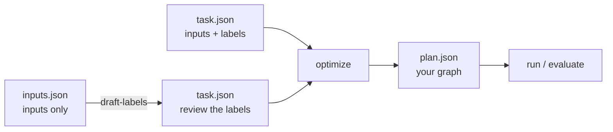
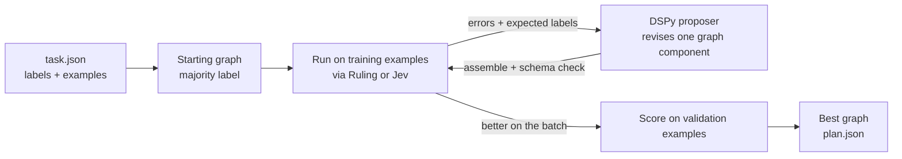
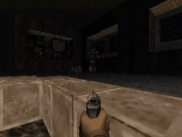

# decision-compose


**decision-compose lets DSPy build decision graphs for you.** Give it a
classification task and labeled examples. A generative model proposes graphs of
small typed judgments (Choice, Score, Noul), [GEPA](https://github.com/gepa-ai/gepa)
scores them against a local Ruling or hosted Jev judge, and the best graph
is saved as plain JSON you can run, inspect, and edit.

This is an independent research prototype, not affiliated with TypeSafe. It
optimizes graphs and question instructions, not model weights.

## Installation

Requires Python 3.12–3.14 and [uv](https://docs.astral.sh/uv/).

```sh
uv sync --locked
```

## Getting started

You need example inputs. Expected outputs (labels) are optional: if you don't
have them, a strong model drafts them for you to review.



**1. Start a judge.** [Ruling](https://github.com/bradAGI/ruling) runs locally
on an Apple Silicon Mac and needs no account. In a separate terminal, starting
from your `decision-compose` checkout:

```sh
git clone https://github.com/bradAGI/ruling.git ../ruling
uv sync --directory ../ruling
uv run --directory ../ruling ruling serve
```

Leave that server running. Run the remaining commands from `decision-compose`
in your original terminal. Ruling downloads its model on first use. On other
hardware, use a remote Ruling server or the [hosted Jev backend](#backends).

**2. Configure a proposer**, the model that writes graphs, using a
[DSPy model identifier](https://dspy.ai/learn/programming/language_models/).
The example below assumes you have separately started an OpenAI-compatible
model server at `http://127.0.0.1:8080/v1`. Replace `<served-model-id>` with its
model ID; Ruling provides the judge, not this generative endpoint:

```sh
export REFLECTION_MODEL="openai/<served-model-id>"
export REFLECTION_BASE_URL=http://127.0.0.1:8080/v1
export OPENAI_API_KEY=local-no-auth
```

**3. Describe the task.** Pick the case that matches your data.

<details open>
<summary><b>I only have inputs</b></summary>

List the allowed labels and your raw inputs in `inputs.json`:

```json
{
  "description": "Route each support ticket to billing, technical, or sales.",
  "labels": ["billing", "technical", "sales"],
  "inputs": [
    "I was charged twice this month.",
    "The export button returns a 500 error.",
    "Can I get a quote for twenty seats?",
    "Please refund the charge after my cancellation.",
    "The app crashes when I open a project.",
    "Can we schedule a product demo before buying?"
  ]
}
```

Then have the proposer model label them. `--validation` and `--test` set how
many inputs are held out for selection and final scoring:

```sh
uv run decision-compose draft-labels inputs.json --output task.json \
  --labeler-model "$REFLECTION_MODEL" --labeler-base-url "$REFLECTION_BASE_URL" \
  --validation 1 --test 1
```

This leaves four training inputs, one validation input, and one test input: a
workflow example, too small to measure model quality reliably. For real work,
use more examples and larger held-out splits.

> [!IMPORTANT]
> Review and correct `task.json` before optimizing. Search learns to agree with
> these labels, including their mistakes.

This is DSPy's teacher–student pattern: a large model labels, and the small
judge is fit to its judgment.

</details>

<details>
<summary><b>My inputs are more than text</b></summary>

An input may be a string, a JSON object, or an array. Structure is worth giving
it: a rule can only `read` what has a path, so on a bare string every read is
missing and the graph has nothing to go on but judgements.

```json
{
  "description": "Route each refund request.",
  "labels": ["auto_refund", "review", "decline"],
  "inputs": [
    {"charge": {"amount": 40, "days_ago": 2}, "account": {"plan": "pro", "chargebacks": 0},
     "message": "Charged twice for the same seat."},
    {"charge": {"amount": 900, "days_ago": 60}, "account": {"plan": "free", "chargebacks": 2},
     "message": "I want all of it back."},
    {"charge": {"amount": 12, "days_ago": 1}, "account": {"plan": "enterprise", "chargebacks": 0},
     "message": "Wrong seat count on this invoice."}
  ]
}
```

Rules then mix what is known with what must be judged:

```
read charge.amount in [0, 100000]
read account.chargebacks in [0, 100]
ask genuine = "The message describes a mistake the customer did not cause."
when account.chargebacks >= 1: review
when charge.amount < 50 and genuine >= 0.8: auto_refund
always: review
```

</details>

<details>
<summary><b>I have labeled examples</b></summary>

Start with the complete labeled sample:

```sh
cp examples/task.json task.json
```

Or write `task.json` directly. This minimal example shows the required shape:

```json
{
  "description": "Route each support ticket to billing, technical, or sales.",
  "labels": ["billing", "technical", "sales"],
  "train": [{"id": "t1", "state": "I was charged twice.", "label": "billing"}],
  "validation": [{"id": "v1", "state": "The app crashes.", "label": "technical"}],
  "test": [{"id": "e1", "state": "Can I get a price quote?", "label": "sales"}]
}
```

`train` drives proposals, `validation` picks the winner, and `test` is scored once at the end.

</details>

**4. Build the graph.**

```sh
uv run decision-compose optimize task.json \
  --backend ruling --max-workers 1 \
  --reflection-model "$REFLECTION_MODEL" \
  --reflection-base-url "$REFLECTION_BASE_URL" \
  --output runs/my-task
```

This writes `runs/my-task/plan.json` (the graph) and `report.json` (scores).
Compare `validation_score` with `seed_validation_score`.

**5. Evaluate and run it.** The proposer is not needed from here on.

```sh
uv run decision-compose evaluate task.json runs/my-task/plan.json \
  --backend ruling --max-workers 1 --split test --output runs/my-task/test.json

uv run decision-compose run runs/my-task/plan.json examples/state.json \
  --backend ruling --max-workers 1
```

## How it works



The proposer sees where the graph answered wrong and revises one part: the
readings it may look at, or the rules that decide. The revision is compiled with
the part it did not touch and validated as a complete graph. A proposal is kept
only if it beats its parent on the training batch; the best validation score
wins. The test split never reaches the optimizer.

The full DAG language is available. This hand-written example
([examples/dag.json](examples/dag.json)) asks two questions in parallel, then
runs only the specialist that matches:


Search does not write that JSON. It writes rules, which compile to it:

```
read target.x in [-1, 1]
ask threat = "Is this worth fighting?" [fight: "A live opponent is in view."] [clear: "Nothing is."]
when target.x and threat == "fight": ATTACK
always: MOVE_FORWARD
```

Rules are tried in order and the first whose condition holds decides. A judgement
can sit behind a cheap read, so the judge is asked only where a number cannot
settle it. Conditions join with `and` and `or`, group with parentheses, invert
with `not`, name a reading to test that it has a value, or compare one with `>=`,
`>`, `<=`, `<` or `==`. Programs that rules cannot express, such as two judgements
merged into one input, are proposed as whole-graph JSON instead.

### What a judgement can be

A judge answers three kinds of question, and only the first is classification:

| Kind | Answer | Written as | Tested with |
| --- | --- | --- | --- |
| `choice` | one of the labels you name | `ask route = "Which team?" [billing: "..."] [technical: "..."]` | `route == "billing"` |
| `score` | a position on the rubric, ordered | `ask severity = "How bad is this?" [minor] [major] [critical]` | `severity >= 2` |
| `noul` | the probability its statement is true | `ask grounded = "The reply follows from the context."` | `grounded >= 0.85` |

Two things a rule can say about a judgement besides what it answered.

**How sure it was.** A choice or a score comes back with a confidence, and
`<name>.confidence` puts it where a condition can test it, so an answer the judge
hedged on falls through to the cheap rule instead of being acted on:

```
ask threat = "Fight or fall back?" [ATTACK: "Ammo and health allow it."] [MOVE_BACKWARD: "They do not."]
when threat.confidence >= 0.7 and threat == "ATTACK": ATTACK
always: MOVE_FORWARD
```

**What several of them agree on.** A vote settles two or more judgements into
one value: `agree` reports whether they all said the same, which is how a second
opinion verifies the first, and `majority` takes the answer most of them gave.

```
ask first = "Is this order fraudulent?" [yes: "It is."] [no: "It is not."]
ask second = "Reading it again, is this order fraudulent?" [yes: "It is."] [no: "It is not."]
vote checked = agree of [first, second]
when checked == "yes" and first == "yes": review
always: accept
```

Each judgement in a vote is a separate model call, so a second opinion costs a
second question. Everything measured in this repo says calls are the expensive
part and rarely the deciding one, so reach for this where being wrong is costly,
not by default.

A probability is a number, so it composes like any read:

```
ask grounded = "The reply follows from the retrieved context."
when grounded >= 0.85: send
when grounded < 0.4: escalate
always: ask_for_review
```

That covers uses a classifier has no form for: gating an action on confidence,
verifying a generated answer before it goes out, ranking candidates by asking
which is better, or serving as the metric a search optimises against rather than
the policy it searches. What a judge will not do is extract or compute: if the
answer is already a value in the input, read it.

One worked example of each, runnable from
[examples/rules](examples/rules):

**Route a ticket** ([routing.rules](examples/rules/routing.rules)) — a choice is
a label, and the rules act on it:

```
# choice: pick one of the labels you named, the classic classification.
ask team = "Which team should answer this ticket?" [billing: "Charges, invoices, refunds."] [technical: "Errors, outages, anything broken."] [sales: "Pricing, plans, buying more."]
when team == "billing": billing
when team == "technical": technical
always: sales
```

**Triage by how blocked the customer is**
([triage.rules](examples/rules/triage.rules)) — a score is ordered, so one
judgement feeds several thresholds, and a read decides who jumps the queue:

```
# score: a position on a rubric, so it can be compared and thresholded.
read variables.customer_tier in [0, 3]
ask severity = "How badly is this customer blocked?" [annoyance] [degraded] [blocked] [outage]
when severity >= 3: page_oncall
when severity >= 2 and variables.customer_tier >= 2: escalate
when severity >= 2: queue_urgent
always: queue_normal
```

**Spend the judge only where it decides something**
([gating.rules](examples/rules/gating.rules)) — readings settle the clear cases,
and the question is asked only about orders big enough to matter:

```
# Cheap readings decide the clear cases; the judge is asked only about the rest.
read order.total in [0, 1000000]
read order.country one of [domestic, eu, rest]
read customer.orders in [0, 10000]
ask suspicious = "This order reads like card testing or resale fraud." when order.total >= 500
when customer.orders >= 5 and order.total < 500: ship
when order.total < 50: ship
when suspicious >= 0.7: hold_for_review
when suspicious >= 0.3 and order.country == "rest": hold_for_review
always: ship
```

**Check a draft reply before sending it**
([grounding.rules](examples/rules/grounding.rules)) — probabilities compose, so
two judgements set a floor and a ceiling with a human in between:

```
# noul: a probability, so the decision is a threshold on confidence.
ask grounded = "Every claim in the draft reply follows from the retrieved context."
ask harmful = "The draft reply would embarrass us if a customer read it."
when harmful >= 0.2: rewrite
when grounded >= 0.85: send
when grounded < 0.4: escalate
always: ask_for_review
```

See [Graph format](docs/graphs.md) for the JSON behind each node, and
[Optimization](docs/optimization.md) for the rule surface search writes.

## Play Doom

The same search builds graphs that play [ViZDoom](https://github.com/Farama-Foundation/ViZDoom).
Each step the graph reads the visible objects and game variables as JSON and
outputs the next button, scored by episode reward rather than labels, so no
labeled examples are needed.

```sh
uv run decision-compose optimize examples/doom/basic.json \
  --backend ruling --max-workers 1 \
  --reflection-model "$REFLECTION_MODEL" \
  --reflection-base-url "$REFLECTION_BASE_URL" \
  --output runs/doom

uv run decision-compose evaluate examples/doom/basic.json runs/doom/plan.json \
  --backend ruling --max-workers 1 --split test --visible --output runs/doom/test.json
```

`--visible` opens the game window. See [Doom](docs/doom.md) for task format,
observations, and the arena.

## Play chess

A graph cannot name a chess move. There are thousands of them and which ones are
legal changes every ply, so the label names a policy and the board turns it into
a move: `CAPTURE` plays the capture that wins most material, `SAVE` moves a
hanging piece somewhere it is not attacked, `CHECK` gives check and prefers mate
in one, `CASTLE`, `DEVELOP`, `ADVANCE` and `QUIET` do what they say. Every policy
always returns a legal move. The graph sees material, hanging pieces, what the
best capture is worth, whether it can castle: numbers, by path, the same as
Doom's game variables.

```sh
uv run decision-compose evaluate examples/chess/duel.json \
  examples/chess/graphs/hunter.rules \
  --opponent examples/chess/graphs/developer.rules \
  --split test --backend ruling --output runs/chess.json
```

Twelve games take about a second, which is the point of having it. A generation
of search costs minutes; a Doom league generation takes half an hour, and two
thirds of its matches end with the graphs never having found each other.


Search beat the best graph I wrote by hand. Breeding `hunter` against `greedy`
for ten rounds, round 7 proposed a graph scoring 0.602 on validation against the
seed's 0.473, and it holds up where it counts: over 1,680 ladder games it takes
113 wins to `hunter`'s 99 and loses 18 where `hunter` loses 31.

What it changed is a real idea. `hunter` only looked for checks when already
three points ahead. The searched graph checks when the position is level or
close (`material.balance <= 2`), takes material through the middlegame, and goes
back to checking once clearly winning (`>= 6`). That is the split the ladder
shows: a graph that only ever checks wins 75 games while shedding 4,103 points
of material, and a graph that only ever takes material wins 5.

A league runs that loop: breed a challenger from the champion, play it eighty
times against every graph in the pool, refit Elo over every game ever played, and
hand over the title when someone clears the champion by twenty points. Forty
generations and 4,400 games later, six graphs had entered the pool and the title
had not moved:

| Generation | Validation | Challenger's Elo |
| --- | --- | --- |
| 1 | 0.479 → 0.525 | 1533 |
| 2 | 0.463 → 0.472 | 1503 |
| 3 | 0.479 → 0.576 | 1545 |
| 5 | 0.479 → 0.497 | 1482 |
| 7 | 0.479 → 0.508 | 1542 |
| 27 | 0.555 → 0.556 | 1537 |

The other 34 generations returned a graph already in the pool. The final ladder:

```
gen3 1540   gen7 1538   gen27 1537   searched 1526   gen1 1524
hunter 1500   gen2 1498   always-check 1484   gen5 1475   greedy 1450   developer 1429
```

Read the top five together: they are all graphs search wrote, they sit inside
fourteen points of each other, and a few hundred games carry about ten points of
standard error. So search beat every hand-written graph and then converged by
generation 7, producing one more graph at generation 27 that landed in the same
cluster.

Do not read the ladder as a measure of progress, though. Elo is fitted over the
pool, so it is anchored to that pool's average: adding graphs of similar strength
pulls every rating toward the middle. `hunter` is a text file that never changed
and its rating fell from 1518 to 1500 over the run. A plot of the best rating per
generation is flat whatever search does.

Against a reference that never moves, the picture is different. Every graph the
league produced, played 400 games against the five hand-written ones:

| Graph | Entered | Score vs the hand-written set |
| --- | --- | --- |
| searched | before the league | 0.581 |
| gen1 | 1 | 0.573 |
| gen2 | 2 | 0.543 |
| gen3 | 3 | **0.606** |
| gen5 | 5 | 0.521 |
| gen7 | 7 | 0.603 |
| gen27 | 27 | 0.605 |

That is the improvement, and it is small and real: 0.581 to 0.606, found at
generation 3 and matched but never beaten in the thirty-seven generations after
it.

The plateau is not the search failing. The budget is proposer calls, not games:
a generation affords about twelve proposals, two or three of which earn a full
evaluation, and a dozen readings over eight policies run out of good arrangements
quickly. Adding readings at generation 11 (loose enemy pieces, pressure around each
king, passed pawns, a policy that pushes the pawn nearest queening) changed what
the proposer wrote (`pawns.furthest` appeared in seven proposals of one
generation) without changing where it landed.

Be careful reading a single split, though. On the twelve test games the searched
graph scores 0.533 and `hunter` scores 0.531. Twelve games cannot resolve a
17-Elo gap, and the validation jump oversold it. Only the ladder, which is cheap
enough to play hundreds of games, settles it.

Most games are drawn, because a rule list cannot force mate from a winning
position. So the score is not the result alone: a fifth of it comes from the
material on the board at the end, which is what tells a graph holding a won
position apart from one shuffling in a dead equal one. Set `material_weight` to
0 in the task if you want results only.

See [chess](docs/chess.md) for the policies, what a graph sees, and a baseline
ladder of 900 games.

## Look at what a graph does

Two commands for reading a graph rather than running it.

**`draw`** writes it as a Mermaid flowchart, which is the readable form for the
graphs rules cannot express: solid arrows carry values, dashed ones gate, and
each dashed arrow says the condition it carries.

```sh
uv run decision-compose draw examples/rules/routing.rules
```

**`ablate`** answers what each reading and judgement is worth. It replays the
decisions the graph already made with one input switched off and counts how many
change, so it needs no fresh model calls beyond the first pass:

```sh
uv run decision-compose ablate task.json plan.json --split validation \
  --backend ruling --output runs/ablation.json
```

The command reads its states from a task's examples. A Doom or chess task keeps
seeds instead, so for those, record the observations a graph saw and pass them to
`effects(plan, states)` in `decision_compose.ablate`. Run that way against the
best graph the chess league produced, over 116 positions from one game:

```
reading                       changed   share   why not
capture.best_gain                  99     85%
hanging.worst                       9      8%
king.in_check                       3      3%
check.available                     1      1%
king.can_castle                     0      0%   present in 116 of 116 states and changes no decision
```

That last line is a rule the graph carries and never uses: `king.can_castle` is
there in every position, and the two rules above it fire first every time
castling is legal. A zero row means one of three things and the report says
which, because they are different problems: a path the state never has is a
typo, a rule an earlier one always beats is dead weight, and a threshold real
data never trips is a number chosen badly.

Search spends its budget rewriting whatever is in the graph, so rules that
cannot matter are rules the proposer wastes proposals on.

## Commands

| Command | Does |
| --- | --- |
| `validate` | Check a graph against a task's labels and size limits, without running it |
| `run` | Execute a graph once on one input |
| `evaluate` | Score a graph on a task split |
| `optimize` | Search for a better graph, writing `plan.json` and `report.json` |
| `arena` | Rank Doom graphs by Elo from deathmatch duels |
| `record` | Play a Doom episode to `.mp4` or `.gif` |
| `draw` | Write a graph as a Mermaid flowchart |
| `ablate` | Measure what each reading and judgement in a graph is worth |
| `draft-labels` | Label raw inputs with a strong model, for you to review as a task |

Every command that reaches a model takes `--backend`, `--model`, `--base-url`,
`--timeout` and `--max-workers`; see [backends](#backends).

## Results


Each line stops where its run was stopped, and the panels are not comparable:
each is a different task, and the duel panel is drawn on its own scale, where
0.5 is a drawn match. Generation 2 is the jump that produced `duel-hunter`.
Details and caveats: [Doom notes](docs/doom.md).

**`basic`** — kill one monster. From a graph that only strafes left, three
rounds found one that strafes toward the monster and fires when it is centered.
12 of 12 kills on held-out seeds.
[gif](docs/assets/doom/basic-seed12.gif) · [all 12](docs/assets/doom/basic-reel.mp4)

| Judge | Validation | Test |
| --- | --- | --- |
| Qwen3.6-35B-A3B via Ruling (local) | 0.33 → 0.97 | 0.94 |
| Jev (`jev-1.13.0`, hosted) | 0.33 → 0.97 | 0.94 |

**E1M1** — play a full level. Claude Sonnet 5 proposing, local 4B judge, a route
to the exit computed from the map. The winner is 27 nodes of reads, no judge
calls, and it finishes the level.
[exit in 75 s](docs/assets/doom/e1m1-exit.mp4) · [all five clears](docs/assets/doom/e1m1-reel.mp4)
· [rule by rule](docs/doom.md#the-e1m1-exit-graph)

| Seeds | Exited | Died | Best time |
| --- | --- | --- | --- |
| 1–6 (used by search) | 3 | 3 | 75 s |
| 7–12 (held out) | 2 | 4 | 89 s |

**Arena** — graphs play each other, ranked by Elo from round-robin deathmatches.

```sh
uv run decision-compose arena examples/doom/duel.json \
  examples/doom/graphs/duel-hunter.json examples/doom/graphs/e1m1-exit.json \
  examples/doom/graphs/duel-attack.json --max-nodes 40 --max-depth 16 --output runs/arena.json
```



**A league** — search a challenger against the champion, rank it against the
pool, hand over the title only on a winning head-to-head. Run with a local
35B mixture model it never unseated the graph it started from; swapped to a
dense 27B, generation two produced [duel-hunter](examples/doom/graphs/duel-hunter.json),
which beat the champion **12-0, 44 frags to none** on the map it trained on.
What it added is three rules that read the compass bearing to an opponent nobody
can see, and turn onto it.
[the duel](docs/assets/doom/duel-hunter.mp4) · [rule by rule](docs/doom.md#the-duel-hunter)
· [how matches work](docs/doom.md#arena)

That result does not travel. Played across all 32 maps the scenario will load, the
same graph finishes behind the hand-written `duel-attack` it shut out 9-0 at home:
its compass rules hunt across geometry it has never seen, and the level kills it
before an opponent does. A task whose three splits are seeds of one map measures
how well a graph knows that map, so
[duel-maps.json](examples/doom/duel-maps.json) trains on four maps, validates on
three others and tests on four more. Twelve generations on it crowned nobody —
two thirds of matches between evenly matched graphs end 0-0, and a metric that
cannot separate them cannot select between them either.
[what the sweep measured](docs/doom.md#the-league)

```sh
uv run decision-compose optimize examples/doom/duel.json examples/doom/graphs/e1m1-exit.json \
  --opponent examples/doom/graphs/e1m1-exit.json --max-nodes 40 --max-depth 16 \
  --backend ruling --max-workers 1 \
  --reflection-model "$REFLECTION_MODEL" \
  --reflection-base-url "$REFLECTION_BASE_URL" --output runs/challenger
```

The winning graphs reported above read the observation without calling a judge:
`target.x < -0.12` is exact, free and instant, while a call costs a round trip
each step. Candidates that kept calls were scored and dropped on the merits.

[duel-jev.json](examples/doom/graphs/duel-jev.json) is also included for
comparison. It uses a judge call to choose combat actions, so running it requires
a configured [backend](#backends).

Any of them runs as it stands, because a `.rules` file is a graph wherever the
CLI takes one:

```sh
uv run decision-compose validate examples/task.json examples/rules/routing.rules
uv run decision-compose run examples/rules/routing.rules examples/state.json \
  --backend ruling --max-workers 1
```

## Use from Python

A graph runs as a `dspy.Module`:

```python
from pathlib import Path

from typesafe_sdk import TypeSafeClient

from decision_compose.graph import Plan
from decision_compose.runtime import DecisionProgram

plan = Plan.model_validate_json(Path("runs/my-task/plan.json").read_text())
with TypeSafeClient(base_url="http://127.0.0.1:8010", api_key="local-no-auth") as client:
    program = DecisionProgram(plan, client, model="default")
    result = program(state="Please correct the duplicate charge on my invoice.")
    print(result.label, result.answers)
```

`result.answers` holds what each judgement said, so a decision can be logged or
audited, not just acted on. Rules load the same way, and a graph of reads alone
needs no judge at all:

```python
from decision_compose.rules import compile_rules, render_rules

plan = compile_rules(Path("examples/rules/gating.rules").read_text())
print(render_rules(plan))  # and back again: the graph reads as the rules it came from

triage = compile_rules("""
read order.total in [0, 1000000]
when order.total >= 500: hold_for_review
always: ship
""")
print(DecisionProgram(triage, None, "none")(state={"order": {"total": 900}}).label)
```

## Backends

| Backend | Flag | Endpoint | Credential |
| --- | --- | --- | --- |
| Ruling (local) | `--backend ruling` | `RULING_BASE_URL`, default `http://127.0.0.1:8010` | `RULING_API_KEY` if auth is on |
| Jev (hosted) | `--backend typesafe` (default) | `TYPESAFE_BASE_URL` | `TYPESAFE_API_KEY` |

Ruling serializes requests, so use `--max-workers 1`. Hosted calls may incur
charges: the search budget counts examples, not requests or dollars.

## Related work

An LLM rewriting a symbolic policy that is then scored by playing it is not a new
idea, and a couple of these got there first.

- [PolicyEvolve](https://arxiv.org/abs/2509.06053) is the closest in concept: an
  LLM writes rule-based policy code for a two-player game, a pool is ranked by
  Elo from head-to-head matches, and a critic feeds execution failures into the
  next rewrite. Its rules are free-form Python, not a compiled graph; it
  runs on one toy environment, and no code was released.
- [Digital Red Queen](https://github.com/SakanaAI/drq) evolves Core War warrior
  programs by adversarial self-play, each round targeting the champions before
  it. The artifact is assembly, not a rule list, and it scores on win rates.
- [autoevolve](https://github.com/MrTsepa/autoevolve) runs a GEPA-shaped loop
  over free-form strategy code with a self-play league and a Pareto front, which
  is the same optimizer and the same league shape used here.
- [FMSP](https://github.com/aadharna/FMSP) has a foundation model write code
  policies refined by competitive self-play with quality-diversity.
- [From Code to Play](https://arxiv.org/abs/2412.04057) benchmarks eleven models
  on program-policy search across 29 game tasks.

On the runtime side, [decision-circuits](https://github.com/Barneyjm/decision-circuits)
pairs typed questions with deterministic gates, though you build its circuits
in Python instead of declaring them, and [GoRules ZEN](https://github.com/gorules/zen) executes
statically validated JSON decision models with no model in the loop at all.

What none of them do, as far as five sweeps could tell: a rule list that compiles
to a statically validated DAG, calibrated probabilities taken from logits inside
that graph, and a judge that can be called mid-execution and gated behind a cheap
reading. Read the absence claims as unconfirmed, not proven: two of the
"nothing found" calls in that search turned out to be wrong when checked.

## Learn more

- [Graph format](docs/graphs.md): nodes, inputs, conditions, execution, and writing graphs by hand.
- [Optimization](docs/optimization.md): search settings, reports, testing, and limits.
- [Doom](docs/doom.md): task format, observations, scoring, and watching a graph play.
- [Chess](docs/chess.md): policies, what a graph sees, scoring, and the baseline ladder.

## Development

```sh
uv run pytest -q
uv run ruff check src tests && uv run ruff format --check src tests
```

## License

[MIT](LICENSE).
