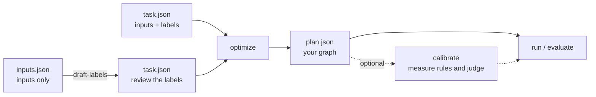
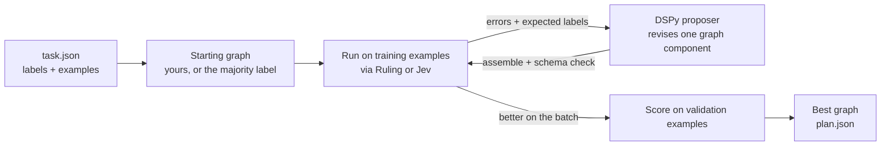
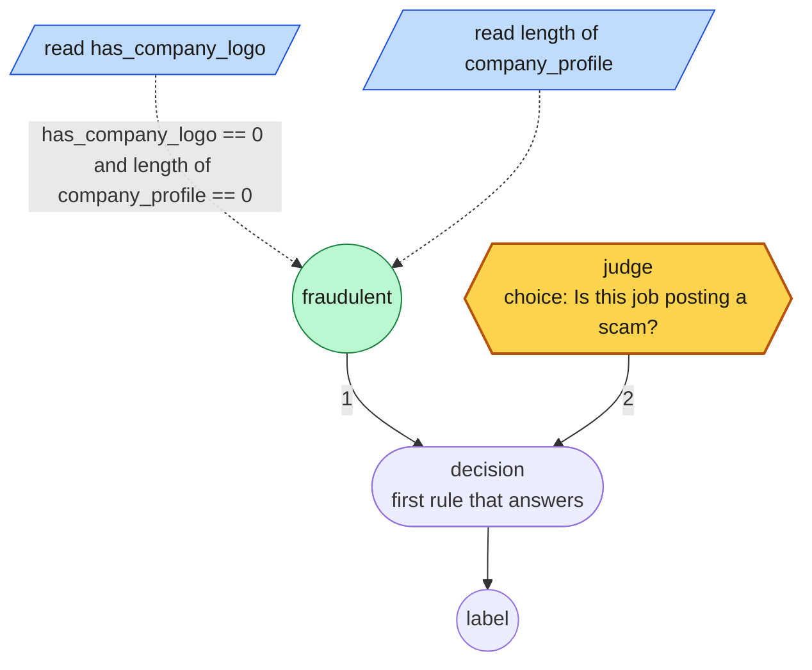
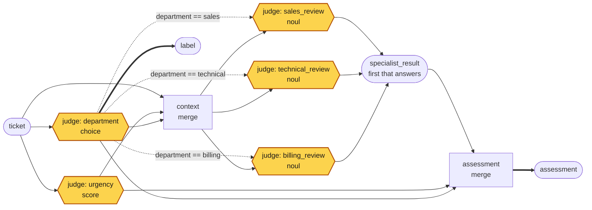
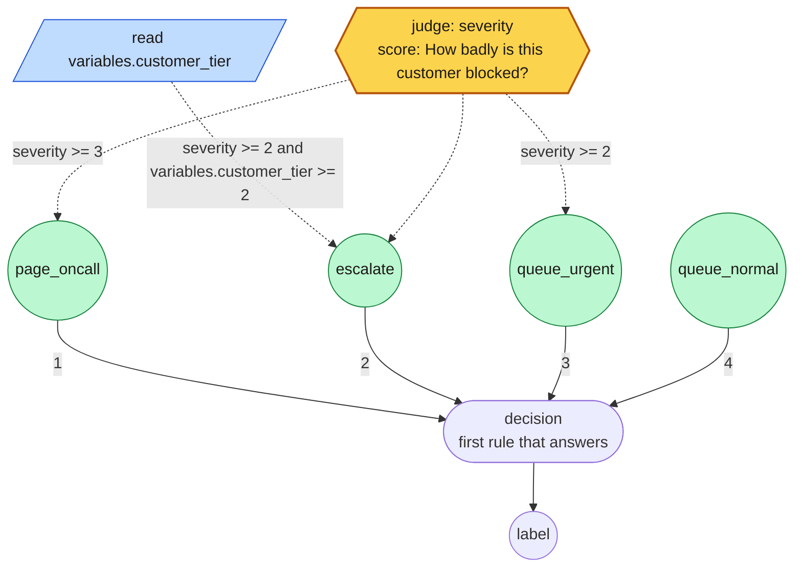
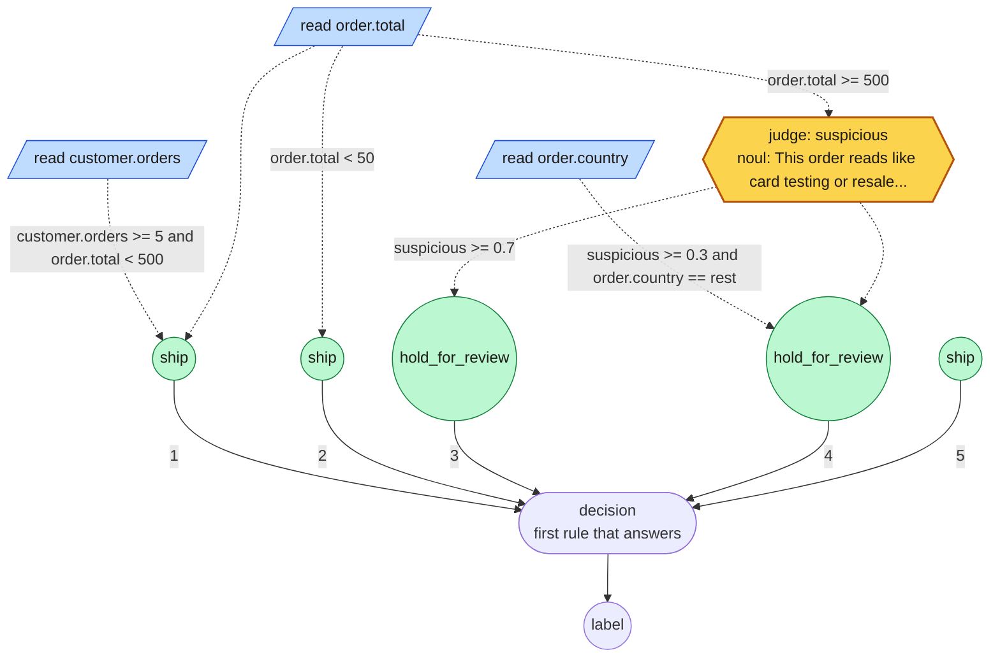
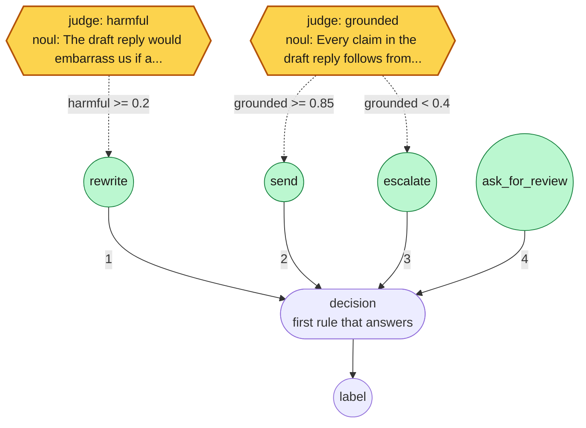
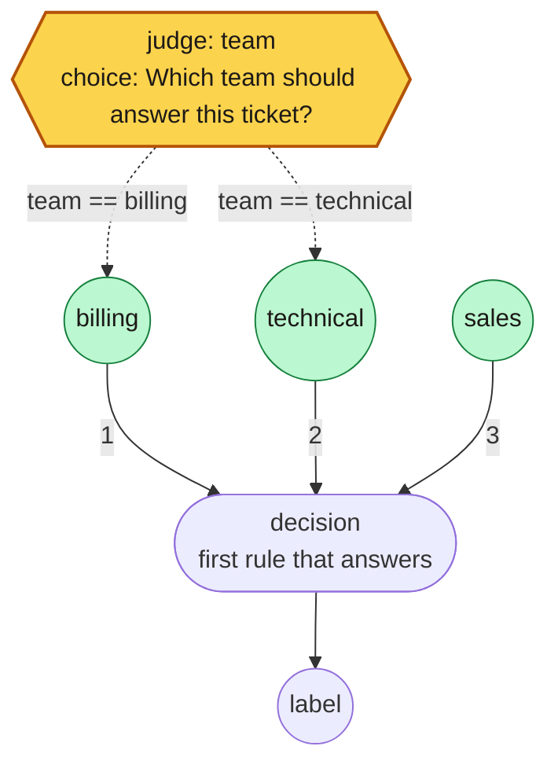

# rulesmith


**rulesmith lets DSPy build decision graphs for you.** Give it a
classification task and examples, labeled or graded by a stronger model. It
searches for a small program of rules: cheap tests on the input's fields settle
the cases they can, and a local Ruling or hosted Jev judge is asked typed
questions (Choice, Score, and Noul, a probability that a statement is true)
about the rest. A generative model proposes each revision,
[GEPA](https://github.com/gepa-ai/gepa) decides which to keep by how they score
on your examples, and the best program is saved as rules or JSON you can run,
read, and edit.

This is an independent research prototype, not affiliated with TypeSafe. Jev is
TypeSafe's hosted judge, selected with `--backend typesafe`. rulesmith optimizes
graphs and question instructions, not model weights.

## When to use rulesmith, and when DSPy

rulesmith is built on DSPy and solves a narrower problem. It fits when:

- the answer must be one of a fixed set of labels, not free text;
- the input is structured, so cheap rules over its fields settle many cases and
  the judge is asked only about the rest;
- a calibrated probability matters, or an unsure case should go to a person
  rather than be guessed;
- a small local judge should be enough, and a large model per decision is more
  than the task is worth.

Use DSPy directly for open-ended generation, programs of several steps,
retrieval, and tasks where worked examples in the prompt carry the accuracy.
rulesmith searches over rules and questions, not demonstrations, so it has
nothing to add there.

The [benchmarks](docs/benchmarks.md) bear this out on five public datasets.
Where fields carry the signal, rulesmith ties or beats DSPy with 5% to 68% of
its model calls. Where the input is a single piece of free text, it adds nothing
over one direct question: it ties DSPy on Banking77, and DSPy's chain of thought
beats it on TREC.

## Installation

Requires Python 3.12–3.14.

```sh
pip install rulesmith
```

That covers classification tasks and every command except the games. The games
and the public benchmarks need packages the core leaves out, so they come as
extras:

| Extra | For | Adds |
| --- | --- | --- |
| `doom` | Doom tasks, `arena`, `record` | ViZDoom, NumPy, Pillow, ffmpeg |
| `chess` | Chess tasks | python-chess |
| `bench` | `python -m rulesmith.bench` | pyarrow, scikit-learn, Hugging Face Hub |

```sh
pip install 'rulesmith[doom,chess]'
```

The examples below run from a checkout with [uv](https://docs.astral.sh/uv/),
which installs every extra and the test tools:

```sh
git clone https://github.com/bradAGI/rulesmith.git
cd rulesmith
uv sync --locked
```

## Getting started

You need example inputs. Expected outputs (labels) are optional: if you don't
have them, a strong model drafts them for you to review.



**1. Pick a judge.** The judge answers the graph's typed questions. Use
TypeSafe's hosted Jev, or run Ruling on your own machine; every command takes
either, and the examples below use Ruling.

<details open>
<summary><b>Jev, hosted</b></summary>

Jev runs on TypeSafe's servers, so it works on any machine and answers many
requests at once. It needs an API key from [TypeSafe](https://typesafe.ai), and
its calls are billed:

```sh
export TYPESAFE_API_KEY=<your key>
```

Jev is the default backend, so with the key set, leave `--backend ruling
--max-workers 1` off the commands below. The model defaults to `jev-latest`;
pass `--model` with a pinned version for results you want to reproduce.

</details>

<details>
<summary><b>Ruling, local</b></summary>

[Ruling](https://github.com/bradAGI/ruling) runs on an Apple Silicon Mac and
needs no account. In a separate terminal, starting from your `rulesmith`
checkout:

```sh
git clone https://github.com/bradAGI/ruling.git ../ruling
uv sync --directory ../ruling
uv run --directory ../ruling ruling serve
```

Leave that server running and run the remaining commands from `rulesmith` in
your original terminal. Ruling downloads its model on first use and answers one
request at a time, hence `--max-workers 1`.

</details>

**2. Configure a proposer**, the model that writes graphs, using a
[DSPy model identifier](https://dspy.ai/learn/programming/language_models/).
The example below assumes you have separately started an OpenAI-compatible
model server at `http://127.0.0.1:8080/v1`. Replace `<served-model-id>` with its
model ID; Ruling provides the judge, not this generative endpoint:

```sh
export REFLECTION_MODEL="openai/<served-model-id>"
export REFLECTION_BASE_URL=http://127.0.0.1:8080/v1
export OPENAI_API_KEY=local-no-auth
```

**3. Describe the task.** Pick the case that matches your data.

<details open>
<summary><b>I only have inputs</b></summary>

List the allowed labels and your raw inputs in `inputs.json`:

```json
{
  "description": "Route each support ticket to billing, technical, or sales.",
  "labels": ["billing", "technical", "sales"],
  "inputs": [
    "I was charged twice this month.",
    "The export button returns a 500 error.",
    "Can I get a quote for twenty seats?",
    "Please refund the charge after my cancellation.",
    "The app crashes when I open a project.",
    "Can we schedule a product demo before buying?"
  ]
}
```

Then have the proposer model label them. `--validation` and `--test` set how
many inputs are held out for selection and final scoring:

```sh
uv run rulesmith draft-labels inputs.json --output task.json \
  --labeler-model "$REFLECTION_MODEL" --labeler-base-url "$REFLECTION_BASE_URL" \
  --validation 1 --test 1
```

Output:

```json
{
  "labels": {
    "technical": 2,
    "billing": 2,
    "sales": 2
  },
  "output": "task.json"
}
```

This leaves four training inputs, one validation input, and one test input: a
workflow example, too small to measure model quality reliably. For real work,
use more examples and larger held-out splits.

> [!IMPORTANT]
> Review and correct `task.json` before optimizing. Search learns to agree with
> these labels, including their mistakes.

This is DSPy's teacher–student pattern: a large model labels, and the small
judge is fit to its judgment.

</details>

<details>
<summary><b>My inputs are more than text</b></summary>

An input may be a string, a JSON object, or an array. Structure is worth giving
it: a rule can only `read` what has a path, so on a bare string every read is
missing and the graph has nothing to go on but judgments.

```json
{
  "description": "Route each refund request.",
  "labels": ["auto_refund", "review", "decline"],
  "inputs": [
    {"charge": {"amount": 40, "days_ago": 2}, "account": {"plan": "pro", "chargebacks": 0},
     "message": "Charged twice for the same seat."},
    {"charge": {"amount": 900, "days_ago": 60}, "account": {"plan": "free", "chargebacks": 2},
     "message": "I want all of it back."},
    {"charge": {"amount": 12, "days_ago": 1}, "account": {"plan": "enterprise", "chargebacks": 0},
     "message": "Wrong seat count on this invoice."}
  ]
}
```

Rules then mix what is known with what must be judged:

```
read charge.amount in [0, 100000]
read account.chargebacks in [0, 100]
ask genuine = "The message describes a mistake the customer did not cause."
when account.chargebacks >= 1: review
when charge.amount < 50 and genuine >= 0.8: auto_refund
always: review
```

</details>

<details>
<summary><b>I have labeled examples</b></summary>

Start with the complete labeled sample:

```sh
cp examples/task.json task.json
```

Or write `task.json` directly. This minimal example shows the required shape:

```json
{
  "description": "Route each support ticket to billing, technical, or sales.",
  "labels": ["billing", "technical", "sales"],
  "train": [{"id": "t1", "state": "I was charged twice.", "label": "billing"}],
  "validation": [{"id": "v1", "state": "The app crashes.", "label": "technical"}],
  "test": [{"id": "e1", "state": "Can I get a price quote?", "label": "sales"}]
}
```

`train` drives proposals, `validation` picks the winner, and `test` is scored once at the end.

</details>

**4. Build the graph.**

```sh
uv run rulesmith optimize task.json \
  --backend ruling --max-workers 1 \
  --reflection-model "$REFLECTION_MODEL" \
  --reflection-base-url "$REFLECTION_BASE_URL" \
  --output runs/my-task
```

Output (trimmed; with `REFLECTION_MODEL=openrouter/qwen/qwen3.8-27b`):

```text
Iteration 0: Base program full valset score: 0.3333333333333333 over 3 / 3 examples
Iteration 1: Proposed new text for readings: ask intent = "Route each support ticket to billing, technical, or sales based on its primary request. ..."
...
{
  "resolved_models": ["mlx-community/Qwen3.5-4B-4bit"],
  ...
  "seed_validation_score": 0.3333333333333333,
  "validation_score": 1.0,
  "improvement_p": 0.25,
  "kept_seed": false,
  "candidates": 2,
  "reflection_calls": 3,
  "metric_calls": 102,
  "backend": "ruling",
  "reflection_model": "openrouter/qwen/qwen3.8-27b",
  "scored_by": "labels"
}
```

This writes `runs/my-task/plan.json` (the graph) and `report.json` (scores).
Compare `validation_score` with `seed_validation_score`.

**5. Evaluate and run it.** The proposer is not needed from here on.

```sh
uv run rulesmith evaluate task.json runs/my-task/plan.json \
  --backend ruling --max-workers 1 --split test --output runs/my-task/test.json

uv run rulesmith run runs/my-task/plan.json examples/state.json \
  --backend ruling --max-workers 1
```

Output (trimmed):

```text
{
  "score": 1.0,
  "output": "runs/my-task/test.json"
}
{
  "outputs": {"label": "billing"},
  ...
  "answers": {
    "intent": {
      "type": "choice",
      "value": "billing",
      "probabilities": {"billing": 0.991, "technical": 0.009, "sales": 0.00007},
      "confidence": 0.987
    }
  },
  "skipped": ["rule_2", "rule_3"],
  ...
  "input_tokens": 166,
  "output_tokens": 0,
  "label": "billing",
  "decided_by": "rule_1",
  "confidence": 0.991
}
```

### How answers are scored

By default an answer scores 1 when it matches the example's label and 0
otherwise. Two additions in `task.json` refine that, and neither calls a model.

**Some mistakes cost more.** `costs[expected][answered]` prices a wrong answer;
anything unlisted costs 1. The dearest mistake scores 0 and a cheaper one scores
in between, so search avoids the expensive ones first:

```json
"costs": {"fraud": {"approve": 10, "review": 1}}
```

Approving fraud is ten times worse than sending it to review. The feedback search
sees names what each mistake cost.

**Some examples have more than one right answer.** `accepted` lists labels that
count as fully right besides `label`:

```json
{"id": "t7", "state": "Refund my duplicate charge and fix the export bug.", "label": "billing", "accepted": ["technical"]}
```

**Passing a case to a person.** Add a label for it and say what it costs, as a
share of the worst mistake, and search can learn to hand over the cases it is
unsure of rather than guess:

```json
"labels": ["approve", "decline", "human"],
"abstain": {"label": "human", "cost": 0.3}
```

No example may expect `human`; it is an answer, not a truth.

**No labels at all.** A stronger model can grade the answers instead. Examples
may then leave out `label`; where one is present, the grader is shown it as a
reference:

```sh
uv run rulesmith optimize task.json \
  --backend ruling --max-workers 1 \
  --reflection-model "$REFLECTION_MODEL" --reflection-base-url "$REFLECTION_BASE_URL" \
  --grader-model "$GRADER_MODEL" --grader-base-url "$GRADER_BASE_URL" \
  --output runs/my-task
```

Output (trimmed; with `GRADER_MODEL=openrouter/qwen/qwen3.8-27b`):

```text
...
{
  ...
  "seed_validation_score": 0.3333333333333333,
  "validation_score": 1.0,
  "improvement_p": 0.25,
  "kept_seed": false,
  "candidates": 2,
  "reflection_calls": 4,
  "metric_calls": 102,
  "backend": "ruling",
  "reflection_model": "openrouter/qwen/qwen3.8-27b",
  "scored_by": "grader openrouter/qwen/qwen3.8-27b"
}
```

The grader scores each answer from 0 to 1 and says why, and search reads the
reason. Each answer to each input is graded once, so a search pays for at most
one grade per distinct answer per example. Use a different, stronger model from
the one your graph asks. Otherwise search finds the graph that asks the grader's
own question and scores perfectly for nothing. rulesmith stops when the grader
and the judge report the same model name, but it cannot tell that two services
serve the same weights under different names, so that part is on you. Reports record `scored_by`, because a graded score is a
model's opinion, not accuracy against labels.

## How it works



A graph search found for the [job-postings benchmark](docs/benchmarks.md), drawn
with `rulesmith draw`:



Rule 1 reads two fields and, when the posting has no logo and an empty company
profile, answers `fraudulent` without calling any model. Only when it declines
does rule 2 ask the judge (Jev or Ruling), which it did on 60% of test postings.

The proposer sees where the graph answered wrong and revises one part: the
readings it may look at, or the rules that decide. The revision is compiled with
the part it did not touch and validated as a complete graph. A proposal is kept
only if it beats its parent on the training batch; the best validation score
wins. The test split never reaches the optimizer.

The full DAG language is available. This hand-written example
([examples/dag.json](examples/dag.json)) asks two questions in parallel, then
runs only the specialist that matches:



The amber hexagons are judge calls, each a question to Jev or Ruling; the rest
runs without a model. Solid arrows carry values and dashed ones gate: each
review is shown the merged `context`, and asked only when `department` answered
its team. Thick arrows are the graph's two outputs.

Search does not write that JSON. It writes rules, which compile to it:

```
read target.x in [-1, 1]
ask threat = "Is this worth fighting?" [fight: "A live opponent is in view."] [clear: "Nothing is."]
when target.x and threat == "fight": ATTACK
always: MOVE_FORWARD
```

Rules are tried in order and the first whose condition holds decides. A judgment
can sit behind a cheap read, so the judge is asked only where a number cannot
settle it. Conditions join with `and` and `or`, group with parentheses, invert
with `not`, name a reading to test that it has a value, or compare one with `>=`,
`>`, `<=`, `<` or `==` against a number, a label, or another reading.

`let` names a condition so the rules can test it by name, or computes a number
from readings with `+`, `-` and a constant weight:

```
read ammo in [0, 50]
read health in [0, 200]
read enemy.health in [0, 200]
let armed = ammo >= 1 and health >= 25
let lead = health - enemy.health
when armed and lead >= 20: ATTACK
when not armed or health < enemy.health: MOVE_BACKWARD
always: MOVE_FORWARD
```

A reading can be named the same way, `read health = variables.HEALTH in [0, 200]`,
and the rules then say `health`. `read length of company_profile in [0, 10000]`
reads how long a text or list is, so `when length of company_profile < 20` can
settle an empty field without asking anyone. A name is a node in the graph, so it survives the
round trip: search reads and rewrites `armed`, not the condition spelled out in
every rule, and `draw` shows it as a box of its own.

Rules decide the label, and `output <name>:` starts another list that decides
something else from the same readings and judgments, asked once for both:

```
read severity in [0, 3]
read account.vip one of [yes, no]
when severity >= 2: review
always: accept
output priority:
when severity >= 3 or account.vip == "yes": high
always: low
```

Programs that rules cannot express, such as two judgments merged into one input,
are proposed as whole-graph JSON instead.

### What a judgment can be

A judge answers three kinds of question, and only the first is classification:

| Kind | Answer | Written as | Tested with |
| --- | --- | --- | --- |
| `choice` | one of the labels you name | `ask route = "Which team?" [billing: "..."] [technical: "..."]` | `route == "billing"` |
| `score` | a position on the rubric, ordered | `ask severity = "How bad is this?" [minor] [major] [critical]` | `severity >= 2` |
| `noul` | the probability its statement is true | `ask grounded = "The reply follows from the context."` | `grounded >= 0.85` |

A judgment reads the whole input unless you say what it is shown. `given` hands
it named values instead, which is less to read and keeps it on the question:

```
read health = variables.HEALTH in [0, 200]
read enemy.distance in [0, 4096]
ask close = "The enemy is close enough to fight." given [enemy.distance, health]
```

`given [observation, first]` shows it the whole input and another judgment's
answer, which is how one judgment checks another's work.

A choice over every label the task has need not list them.
`ask intent = "Which intent is this?" [task labels]` asks over the task's
labels, each described by the task's `descriptions` (`"descriptions":
{"card_arrival": "The customer is waiting for a card to arrive."}`) or, where
it has none, by its own words with underscores read as spaces. Search writes
such a question this way, so a proposer revising a 77-label question rewrites one
line, not 77. The form needs a task, so `rulesmith draw` and `run` refuse it.

Two things a rule can say about a judgment besides what it answered.

**How sure it was.** A choice or a score comes back with a confidence, and
`<name>.confidence` puts it where a condition can test it, so an answer the judge
hedged on falls through to the cheap rule instead of being acted on:

```
ask threat = "Fight or fall back?" [ATTACK: "Ammo and health allow it."] [MOVE_BACKWARD: "They do not."]
when threat.confidence >= 0.7 and threat == "ATTACK": ATTACK
always: MOVE_FORWARD
```

A threshold like that only means something if the judge's probabilities do: a
small model that says 0.97 and is right three times in five is overconfident.
`rulesmith calibrate task.json plan.rules --output calibrated.rules` fits one
temperature per choice question over the task's labels, from its answers on the
training examples, and writes it into the question (`... [ATTACK: "..."]
calibrated 1.8`). The answers stay the same; how sure they read changes.

#### How sure a rule is

Every decision reports `decided_by`, the rule or judgment that settled it, and a
`confidence`: the least sure of the judgments asked and, once the rule is
measured, how often that rule is right. Until then a rule claims nothing, and a
decision it settles without asking reads as 1.0. `calibrate` also measures
every rule on the labeled training and validation examples and writes the count
after it:

```
when rating >= 4: recommended calibrated 37/40 of 100
```

That rule decided 40 of 100 examples and was right on 37, so its decisions read
as (37 + 1) / (40 + 2) = 0.90 sure. The smoothing keeps a rule seen twice from
claiming certainty. These are examples search saw, so the counts flatter a
searched graph; calibrate against a task of fresh examples for an honest figure.

`evaluate` checks the counts against the inputs it scores. A rule that decides
far more or less often than it did when measured (at `--drift`, default 0.01,
by an exact binomial test) is reported under `drift` in the output and warned
about. The inputs have moved, and so may how often the rule is right: a
scam-posting rule measured on balanced data decides 40% of postings, and at the
real scam rate 14%.

Where a rule over a field anyone can set is a way around the judge, as in fraud,
`optimize --keep-judge 0.99` keeps only graphs whose rules, wherever they answer
without the judge, are right at least that often; see
[optimization settings](docs/optimization.md#settings).

**What several of them agree on.** A vote settles two or more judgments into
one value: `agree` reports whether they all said the same, which is how a second
opinion verifies the first, and `majority` takes the answer most of them gave.

```
ask first = "Is this order fraudulent?" [yes: "It is."] [no: "It is not."]
ask second = "Reading it again, is this order fraudulent?" [yes: "It is."] [no: "It is not."]
vote checked = agree of [first, second]
when checked == "yes" and first == "yes": review
always: accept
```

Each judgment in a vote is a separate model call, so a second opinion costs a
second question. Everything measured in this repo says calls are the expensive
part and rarely the deciding one, so reach for this where being wrong is costly,
not by default.

A probability is a number, so it composes like any read:

```
ask grounded = "The reply follows from the retrieved context."
when grounded >= 0.85: send
when grounded < 0.4: escalate
always: ask_for_review
```

That covers uses a classifier has no form for: gating an action on confidence,
verifying a generated answer before it goes out, ranking candidates by asking
which is better, or serving as the metric a search optimizes against rather than
the policy it searches. What a judge will not do is extract or compute: if the
answer is already a value in the input, read it.

One worked example of each, runnable from
[examples/rules](examples/rules):

**Route a ticket** ([routing.rules](examples/rules/routing.rules)) — a choice is
a label, and the rules act on it:

```
# choice: pick one of the labels you named, the classic classification.
ask team = "Which team should answer this ticket?" [billing: "Charges, invoices, refunds."] [technical: "Errors, outages, anything broken."] [sales: "Pricing, plans, buying more."]
when team == "billing": billing
when team == "technical": technical
always: sales
```

**Triage by how blocked the customer is**
([triage.rules](examples/rules/triage.rules)) — a score is ordered, so one
judgment feeds several thresholds, and a read decides who jumps the queue:

```
# score: a position on a rubric, so it can be compared and thresholded.
read variables.customer_tier in [0, 3]
ask severity = "How badly is this customer blocked?" [annoyance] [degraded] [blocked] [outage]
when severity >= 3: page_oncall
when severity >= 2 and variables.customer_tier >= 2: escalate
when severity >= 2: queue_urgent
always: queue_normal
```

<details>
<summary>Drawn with <code>rulesmith draw</code></summary>



</details>

**Spend the judge only where it decides something**
([gating.rules](examples/rules/gating.rules)) — readings settle the clear cases,
and the question is asked only about orders big enough to matter:

```
# Cheap readings decide the clear cases; the judge is asked only about the rest.
read order.total in [0, 1000000]
read order.country one of [domestic, eu, rest]
read customer.orders in [0, 10000]
ask suspicious = "This order reads like card testing or resale fraud." when order.total >= 500
when customer.orders >= 5 and order.total < 500: ship
when order.total < 50: ship
when suspicious >= 0.7: hold_for_review
when suspicious >= 0.3 and order.country == "rest": hold_for_review
always: ship
```

<details>
<summary>Drawn with <code>rulesmith draw</code></summary>



</details>

**Check a draft reply before sending it**
([grounding.rules](examples/rules/grounding.rules)) — probabilities compose, so
two judgments set a floor and a ceiling with a human in between:

```
# noul: a probability, so the decision is a threshold on confidence.
ask grounded = "Every claim in the draft reply follows from the retrieved context."
ask harmful = "The draft reply would embarrass us if a customer read it."
when harmful >= 0.2: rewrite
when grounded >= 0.85: send
when grounded < 0.4: escalate
always: ask_for_review
```

<details>
<summary>Drawn with <code>rulesmith draw</code></summary>



</details>

See [Graph format](docs/graphs.md) for the JSON behind each node, and
[Optimization](docs/optimization.md) for the rule surface search writes.

## Games

Two environments where a graph plays a game instead of labeling an input, and is
scored by how it plays.

**[Doom](docs/doom.md).** Each step a graph reads the visible objects and game
variables and presses a button, scored by episode reward, so no labels are
needed. Search found a graph that kills the monster on all 12 of the task's
seeds, including the 3 held out for test, one that finishes E1M1, and a duelist
that won 12-0 on the map it trained on and, across 32 maps, finished behind the
hand-written graph it had shut out there. [Results](docs/doom.md#results) ·
[the league](docs/doom.md#the-league)

**[Chess](docs/chess.md).** A label names a policy, such as taking the best
capture or saving a hanging piece, and the board picks the move. A game costs
milliseconds, so graphs are ranked over hundreds of games: search beat every
hand-written graph and then converged by generation 7. The league is a record of
past runs: its driver script is not in the repo, but its best graph is,
[league-best.json](examples/chess/graphs/league-best.json).
[Results](docs/chess.md#results)

## Look at what a graph does

Two commands for reading a graph rather than running it.

**`draw`** writes it as a Mermaid flowchart, which is the readable form for the
graphs rules cannot express: solid arrows carry values, dashed ones gate, and
each dashed arrow says the condition it carries.

```sh
uv run rulesmith draw examples/rules/routing.rules
```

Output, as GitHub renders it:



The amber hexagon is the **judge**: the one step that calls a model, Jev or
Ruling, whichever `--backend` runs the graph. The graph itself names no
backend. Its box shows the name the rules test it by, `team`, so the dashed
arrow `team == billing` reads as "the judge answered billing". Green circles
are the answers rules give, and the numbers on the arrows into `decision` are
the order the rules are tried in. The first that answers decides; `sales` has
no condition, so it answers whenever the two before it do not. A graph that
reads fields, like the [job-postings one](#how-it-works) above, draws each
reading as a blue slanted box: a value taken from the input for free.

**`ablate`** answers what each reading, judgment and name is worth. It replays the
decisions the graph already made with one input switched off and counts how many
change, so it needs no fresh model calls beyond the first pass:

```sh
uv run rulesmith ablate task.json plan.json --split validation \
  --backend ruling --output runs/ablation.json
```

Output, for the graph built in the quickstart:

```json
{
  "states": 3,
  "effects": [
    {
      "node": "intent",
      "kind": "ask",
      "changed": 2,
      "share": 0.6667,
      "reason": ""
    }
  ]
}
```

The command reads its states from a task's examples. A Doom or chess task keeps
seeds instead, so for those, record the observations a graph saw and pass them to
`effects(plan, states)` in `rulesmith.ablate`. Run that way against the
best graph the chess league produced,
[league-best.json](examples/chess/graphs/league-best.json), over 116 positions
from one game (a past run; the script that recorded the positions is not in the
repo):

```
reading                       changed   share   why not
capture.best_gain                  99     85%
hanging.worst                       9      8%
king.in_check                       3      3%
check.available                     1      1%
king.can_castle                     0      0%   present in 116 of 116 states and changes no decision
```

That last line is a rule the graph carries and never uses: `king.can_castle` is
there in every position, and the two rules above it fire first every time
castling is legal. A zero row means one of three things and the report says
which, because they are different problems: a path the state never has is a
typo, a rule an earlier one always beats is dead weight, and a threshold real
data never trips is a number chosen badly.

Search spends its budget rewriting whatever is in the graph, so rules that
cannot matter are rules the proposer wastes proposals on.

## Commands

| Command | Does |
| --- | --- |
| `validate` | Check a graph against a task's labels and size limits, without running it |
| `run` | Execute a graph once on one input |
| `evaluate` | Score a graph on a task split |
| `optimize` | Search for a better graph, writing `plan.json` and `report.json` |
| `arena` | Rank Doom graphs by Elo from deathmatch duels |
| `record` | Play a Doom episode to `.mp4` or `.gif` |
| `calibrate` | Fit how sure each judgment should read, and count how often each rule is right, from the labeled examples |
| `draw` | Write a graph as a Mermaid flowchart |
| `ablate` | Measure what each reading, judgment and name in a graph is worth |
| `draft-labels` | Label raw inputs with a strong model, for you to review as a task |

Every command that asks a judge (`run`, `evaluate`, `optimize`, `calibrate`,
`arena`, `record`, `ablate`) takes `--backend`, `--model`, `--base-url`, `--timeout`,
`--retries` and `--max-workers`; see [backends](#backends). `draft-labels` calls
a generative model instead, set with `--labeler-model` and `--labeler-base-url`.

A `.rules` file is a graph wherever the CLI takes one, so the examples run as
they stand:

```sh
uv run rulesmith validate examples/task.json examples/rules/routing.rules
uv run rulesmith run examples/rules/routing.rules examples/state.json \
  --backend ruling --max-workers 1
```

Output (trimmed):

```text
{
  "nodes": 5,
  "labels": ["billing", "technical", "sales"]
}
{
  "outputs": {"label": "billing"},
  ...
  "answers": {
    "team": {
      "type": "choice",
      "value": "billing",
      "probabilities": {"billing": 0.997, "technical": 0.003, "sales": 0.0003},
      "confidence": 0.995
    }
  },
  "skipped": ["rule_2"],
  ...
  "label": "billing",
  "decided_by": "rule_1",
  "confidence": 0.997
}
```

## Use from Python

A graph runs as a `dspy.Module`:

```python
from pathlib import Path

from typesafe_sdk import TypeSafeClient

from rulesmith.graph import Plan
from rulesmith.runtime import DecisionProgram

plan = Plan.model_validate_json(Path("runs/my-task/plan.json").read_text())
with TypeSafeClient(base_url="http://127.0.0.1:8010", api_key="local-no-auth") as client:
    program = DecisionProgram(plan, client, model="default")
    result = program(state="Please correct the duplicate charge on my invoice.")
    print(result.label, result.answers)
```

Output (probabilities rounded):

```text
billing {'intent': {'type': 'choice', 'value': 'billing', 'probabilities': {'billing': 0.992, 'technical': 0.008, 'sales': 4.5e-05}, 'confidence': 0.989}}
```

Against Jev, the client reads `TYPESAFE_API_KEY` and TypeSafe's endpoint by
itself: `with TypeSafeClient() as client:` and `model="jev-latest"`.

`result.answers` holds what each judgment said, so a decision can be logged or
audited, not just acted on. Rules load the same way, and a graph of reads alone
needs no judge at all:

```python
from rulesmith.rules import compile_rules, render_rules

plan = compile_rules(Path("examples/rules/gating.rules").read_text())
print(render_rules(plan))  # and back again: the graph reads as the rules it came from

triage = compile_rules("""
read order.total in [0, 1000000]
when order.total >= 500: hold_for_review
always: ship
""")
print(DecisionProgram(triage, None, "none")(state={"order": {"total": 900}}).label)
```

Output:

```text
read order.total in [0, 1000000]
read order.country one of [domestic, eu, rest]
read customer.orders in [0, 10000]
ask suspicious = "This order reads like card testing or resale fraud." when order.total >= 500
when customer.orders >= 5 and order.total < 500: ship
when order.total < 50: ship
when suspicious >= 0.7: hold_for_review
when suspicious >= 0.3 and order.country == "rest": hold_for_review
always: ship
hold_for_review
```

## Backends

| Backend | Flag | Model | Endpoint | Credential |
| --- | --- | --- | --- | --- |
| Jev (hosted) | `--backend typesafe` (default) | `jev-latest`, or `--model` | `TYPESAFE_BASE_URL`, default `https://api.typesafe.ai` | `TYPESAFE_API_KEY` |
| Ruling (local) | `--backend ruling` | whatever Ruling serves | `RULING_BASE_URL`, default `http://127.0.0.1:8010` | `RULING_API_KEY` if auth is on |

Jev answers requests in parallel, so the default `--max-workers 4` applies;
Ruling serializes them, so use `--max-workers 1`. Jev calls are billed: the
search budget counts examples, not requests or dollars, and `--call-cost` makes
search prefer graphs that ask less. The same search against Jev:

```sh
export TYPESAFE_API_KEY=<your key>
uv run rulesmith optimize task.json \
  --reflection-model "$REFLECTION_MODEL" --reflection-base-url "$REFLECTION_BASE_URL" \
  --output runs/my-task-jev
```

## Related work

An LLM rewriting a symbolic policy that is then scored by playing it is not a new
idea, and a couple of these got there first.

- [PolicyEvolve](https://arxiv.org/abs/2509.06053) is the closest in concept: an
  LLM writes rule-based policy code for a two-player game, a pool is ranked by
  Elo from head-to-head matches, and a critic feeds execution failures into the
  next rewrite. Its rules are free-form Python, not a compiled graph; it
  runs on one toy environment, and no code was released.
- [Digital Red Queen](https://github.com/SakanaAI/drq) evolves Core War warrior
  programs by adversarial self-play, each round targeting the champions before
  it. The artifact is assembly, not a rule list, and it scores on win rates.
- [autoevolve](https://github.com/MrTsepa/autoevolve) runs a GEPA-shaped loop
  over free-form strategy code with a self-play league and a Pareto front, which
  is the same optimizer and the same league shape used here.
- [FMSP](https://github.com/aadharna/FMSP) has a foundation model write code
  policies refined by competitive self-play with quality-diversity.
- [From Code to Play](https://arxiv.org/abs/2412.04057) benchmarks eleven models
  on program-policy search across 29 game tasks.

On the runtime side, [decision-circuits](https://github.com/Barneyjm/decision-circuits)
pairs typed questions with deterministic gates, though you build its circuits
in Python instead of declaring them, and [GoRules ZEN](https://github.com/gorules/zen) executes
statically validated JSON decision models with no model in the loop at all.

None of the projects above combines a rule list that compiles to a statically
validated DAG, calibrated probabilities taken from logits inside that graph, and
a judge that can be called mid-execution and gated behind a cheap reading. That
is a claim about the work listed here, not a survey of the field.

## Learn more

- [Graph format](docs/graphs.md): nodes, inputs, conditions, execution, and writing graphs by hand.
- [Optimization](docs/optimization.md): search settings, reports, testing, and limits.
- [Doom](docs/doom.md): task format, observations, scoring, and watching a graph play.
- [Chess](docs/chess.md): policies, what a graph sees, scoring, and the baseline ladder.
- [Benchmarks](docs/benchmarks.md): rulesmith against DSPy, TF-IDF and direct calls on public datasets.

## Development

`uv sync` installs the project with every extra, so the whole suite runs. CI runs
the same checks on Python 3.12, 3.13 and 3.14.

```sh
uv run pytest -q
uv run ruff check src tests && uv run ruff format --check src tests
```

Output (the last line of pytest):

```text
490 passed, 6 skipped, 1 warning in 278.41s (0:04:38)
All checks passed!
48 files already formatted
```

## License

[MIT](LICENSE).
