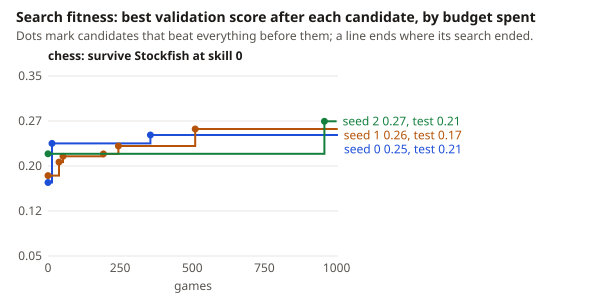
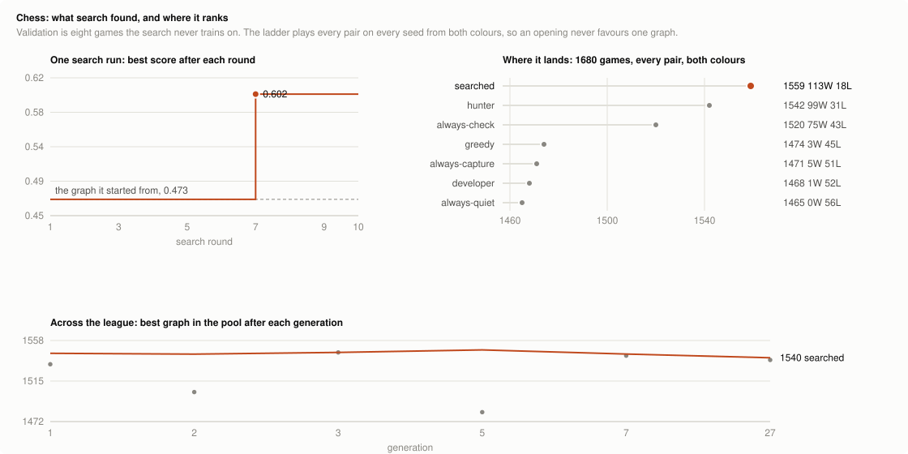

# Chess

A graph plays chess by naming a policy, not a move. There are thousands of moves
and which ones are legal changes every ply, so the label says what kind of move
to make and the board picks it.
Install the `chess` extra first: `pip install 'rulesmith[chess]'`.

## Policies

Each label is a selector over the legal moves. Every one of them always returns a
move, so a graph can never stall.

| Label | Plays |
| --- | --- |
| `CAPTURE` | the capture that wins most material, counting one recapture |
| `CHECK` | a checking move, and mate in one when there is one |
| `SAVE` | the most valuable hanging piece, to a square nobody attacks |
| `CASTLE` | castles |
| `DEVELOP` | a knight or bishop off the back rank, toward the middle |
| `ADVANCE` | a pawn forward: into the middle early, up the board later |
| `PROMOTE` | the passed pawn furthest up the board, promoting when it can |
| `QUIET` | a safe quiet move |

When a policy finds nothing of its kind, the board plays a safe quiet move. That
fallback matters more than it sounds: an earlier version fell back to the
highest-gain move, which made every policy behave like `CAPTURE` and flattened
the whole ladder.

## What a graph sees

White to move after 1. e4 e5 2. Nf3 Nc6 3. Bc4 Nf6:

```json
{
  "ply": 6,
  "phase": "opening",
  "material": {"mine": 39, "theirs": 39, "balance": 0},
  "king": {"in_check": 0, "attackers": 0, "can_castle": 1, "castled": 0},
  "capture": {"best_gain": -2, "count": 2},
  "check": {"available": 1, "gain": -2},
  "hanging": {"count": 1, "worst": 1},
  "target": {"loose_count": 0, "loose_worst": 0, "king_ring": 1},
  "pawns": {"passed": 0, "furthest": 0, "theirs_passed": 0},
  "safety": {"king_ring": 0},
  "development": {"minor_home": 2},
  "moves": {"count": 33}
}
```

Every leaf is a number or a string, so a `read` node takes any of them by path.
All of it is from the side to move's point of view: `target` is the opponent's
loose pieces and the pressure around their king, `safety` the pressure around
the mover's own, and `pawns` the passed pawns on each side.

## Scoring a game

One seed is one game: four random legal opening plies, then the graphs play. A
graph is white on even seeds and black on odd ones, so the same opening is
scored from both chairs.

A rule list cannot force mate from a won position, so games that reach the move
limit are adjudicated: a side a minor piece ahead has won, anything closer is a
draw. The score is mostly the result and partly the final position:

```
score = 0.8 x result + 0.2 x (material edge, clipped at +/- 15, mapped to 0..1)
```

Set `material_weight` to 0 for results only. The split exists because results
alone are nearly flat here: most games between rule lists end drawn, and the
board is what says which graph stood better. It is the opposite problem to
[Doom](doom.md), where the reward moved but the graphs never met.

## The baseline ladder

Six hand-written graphs, every pair, 30 seeds played from both sides. 900 games,
38 seconds on a laptop. The graphs are rule files in
[examples/chess/graphs](../examples/chess/graphs).

| Graph | Elo | W | D | L | Material |
| --- | --- | --- | --- | --- | --- |
| hunter | 1548 | 60 | 230 | 10 | +1518 |
| always-check | 1535 | 52 | 233 | 15 | -2522 |
| greedy | 1483 | 2 | 278 | 20 | +1948 |
| developer | 1480 | 1 | 277 | 22 | -1591 |
| always-capture | 1478 | 1 | 275 | 24 | +2881 |
| always-quiet | 1476 | 0 | 275 | 25 | -2234 |

Material and results pull apart. `always-check` wins 52 games while shedding
2,522 points of material, because a policy that keeps giving check keeps finding
mate. `greedy` gains 1,948 and wins twice, because nothing in it converts a won
position. `hunter` takes material and switches to checks once it is ahead, and
tops both columns.

## Results

### Against Stockfish

The one chess result that can be rerun: `benchmarks/chess.sh` searches from
[greedy.rules](../examples/chess/graphs/greedy.rules) on
[stockfish.json](../examples/chess/stockfish.json), where every game is played as
White against Stockfish at skill level 0 and scored mostly by the result, then by
how long the game lasts and how much material is kept. Three search seeds ran
at once, 1,000 games each, with `openrouter/qwen/qwen3.8-27b` proposing; the
searches' reports are summarized in
[benchmarks/results/games.json](../benchmarks/results/games.json), and the chart
is drawn from them by `benchmarks/fitness.py`: the best validation score found
so far against the games spent finding it, a dot for each candidate that beat
everything before it, and the winner's test score on the label.



| Search seed | Validation, seed → best | Test | Won / drew / lost | Mean plies | Mean material |
| --- | --- | --- | --- | --- | --- |
| greedy, unsearched | | 0.22 | 0 / 1 / 39 | 63 | −8.0 |
| 0 | 0.17 → 0.25 | 0.21 | 0 / 0 / 40 | 63 | −8.9 |
| 1 | 0.18 → 0.26 | 0.17 | 0 / 0 / 40 | 55 | −13.4 |
| 2 | 0.22 → 0.27 | 0.21 | 0 / 0 / 40 | 61 | −7.5 |

Search raised every seed's validation score by 0.05 to 0.08, and two of the
three gains pass the sign test (p = 0.004 and 0.035). None of it carried to the
40 test games: no searched graph scores better there than the graph it started
from, and every graph, searched or not, loses all 40. The three searches agree
on what to change, which says something about the training games rather than
about chess: each moved "save a hanging piece" ahead of "take the best capture",
raised the gain a capture needs (to 2 or 3 points), and replaced developing a
piece as the default with a quiet move, developing only while minor pieces are
still at home. A graph that picks one policy per move from eight is far below
even the weakest Stockfish, and 3,000 games of search did not change that.

### The league

The rest of this section is a record of past runs. The scripts that drove the
1,680-game ladder and the league are not in the repo, and the `arena` command ranks Doom
graphs only, so these tables cannot be regenerated from it. The graphs they
produced are: [searched.json](../examples/chess/graphs/searched.json), found
before the league, and [league-best.json](../examples/chess/graphs/league-best.json),
the league's `gen3`. The league searched on
[examples/chess/league.json](../examples/chess/league.json), a task with 24
training, 40 validation and 60 test seeds.

Twelve games take about a second, which is the point of having it. A generation
of search costs minutes; a Doom league generation takes half an hour, and two
thirds of its matches end with the graphs never having found each other.



Search beat the best graph written by hand. Breeding `hunter` against `greedy`
for ten rounds, round 7 proposed a graph scoring 0.602 on validation against the
seed's 0.473, and it holds up where it counts: over 1,680 ladder games it takes
113 wins to `hunter`'s 99 and loses 18 where `hunter` loses 31.

What it changed is a real idea. `hunter` only looked for checks when already
three points ahead. The searched graph checks when the position is level or
close (`material.balance <= 2`), takes material through the middlegame, and goes
back to checking once clearly winning (`>= 6`). That is the split the 1,680-game
ladder shows, the one that includes the searched graph, not the six-graph table
above: there a graph that only ever checks wins 75 games while shedding 4,103
points of material, and a graph that only ever takes material wins 5.

A league runs that loop: breed a challenger from the champion, play it eighty
times against every graph in the pool, refit Elo over every game ever played, and
hand over the title when someone clears the champion by twenty points. Forty
generations and 4,400 games later, six graphs had entered the pool and the title
had not moved:

| Generation | Validation | Challenger's Elo |
| --- | --- | --- |
| 1 | 0.479 → 0.525 | 1533 |
| 2 | 0.463 → 0.472 | 1503 |
| 3 | 0.479 → 0.576 | 1545 |
| 5 | 0.479 → 0.497 | 1482 |
| 7 | 0.479 → 0.508 | 1542 |
| 27 | 0.555 → 0.556 | 1537 |

The other 34 generations returned a graph already in the pool. The final ladder:

```
gen3 1540   gen7 1538   gen27 1537   searched 1526   gen1 1524
hunter 1500   gen2 1498   always-check 1484   gen5 1475   greedy 1450   developer 1429
```

Read the top five together: they are all graphs search wrote, they sit inside
fourteen points of each other, and a few hundred games carry about ten points of
standard error. So search beat every hand-written graph and then converged by
generation 7, producing one more graph at generation 27 that landed in the same
cluster.

Do not read the ladder as a measure of progress, though. Elo is fitted over the
pool, so it is anchored to that pool's average: adding graphs of similar strength
pulls every rating toward the middle. `hunter` is a text file that never changed
and its rating fell from 1518 to 1500 over the run. A plot of the best rating per
generation is flat whatever search does.

Against a reference that never moves, the picture is different. Every graph the
league produced, played 400 games against a fixed set of five of the
hand-written graphs:

| Graph | Entered | Score vs the hand-written set |
| --- | --- | --- |
| searched | before the league | 0.581 |
| gen1 | 1 | 0.573 |
| gen2 | 2 | 0.543 |
| gen3 | 3 | **0.606** |
| gen5 | 5 | 0.521 |
| gen7 | 7 | 0.603 |
| gen27 | 27 | 0.605 |

That is the improvement, and it is small and real: 0.581 to 0.606, found at
generation 3 and matched but never beaten in the thirty-seven generations after
it.

The plateau is not the search failing. The budget is proposer calls, not games:
a generation affords about twelve proposals, two or three of which earn a full
evaluation, and a dozen readings over eight policies run out of good arrangements
quickly. Adding readings at generation 11 (loose enemy pieces, pressure around each
king, passed pawns, a policy that pushes the pawn nearest queening) changed what
the proposer wrote (`pawns.furthest` appeared in seven proposals of one
generation) without changing where it landed.

Be careful reading a single split, though. On the twelve test games the searched
graph scores 0.533 and `hunter` scores 0.531. Twelve games cannot resolve the
17-Elo gap the 1,680-game ladder put between them, and the validation jump
oversold it. Only a ladder, which is cheap enough to play hundreds of games,
settles it.

## Running it

```sh
uv run rulesmith evaluate examples/chess/duel.json \
  examples/chess/graphs/hunter.rules \
  --opponent examples/chess/graphs/greedy.rules \
  --split test --backend ruling --output runs/chess.json

uv run rulesmith optimize examples/chess/duel.json \
  examples/chess/graphs/hunter.rules \
  --opponent examples/chess/graphs/greedy.rules \
  --backend ruling --max-workers 1 \
  --reflection-model "$REFLECTION_MODEL" \
  --reflection-base-url "$REFLECTION_BASE_URL" --output runs/chess-search
```

`--opponent` is required, as it is for a Doom deathmatch: the task is a game
between two graphs, and a graph's score only means something against a named
opponent.

## Limits

- The policies are the ceiling. A graph chooses among eight kinds of move, so it
  cannot play a move no policy describes, and it cannot search ahead.
- `gain` looks one recapture deep. A real exchange search would value some
  captures differently.
- Draws dominate. Two rule lists that both avoid blunders will shuffle to the
  move limit, which is why the score carries a material term.
- The opening is four random plies, so a seed can hand one side a better start.
  Playing every seed from both colors cancels it across a ladder, not within a
  single game.
