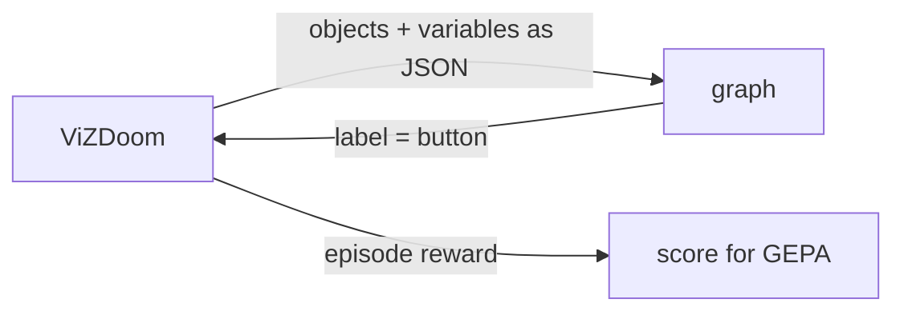
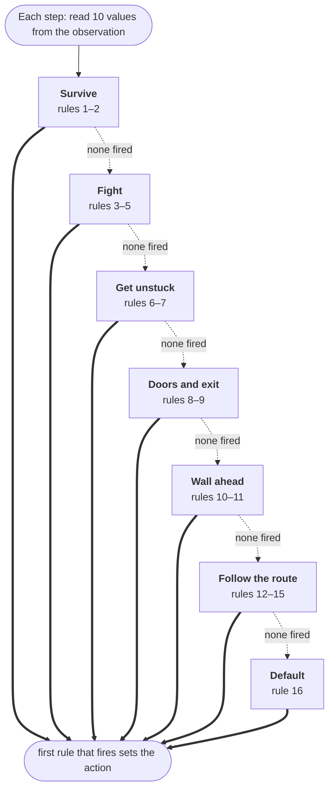
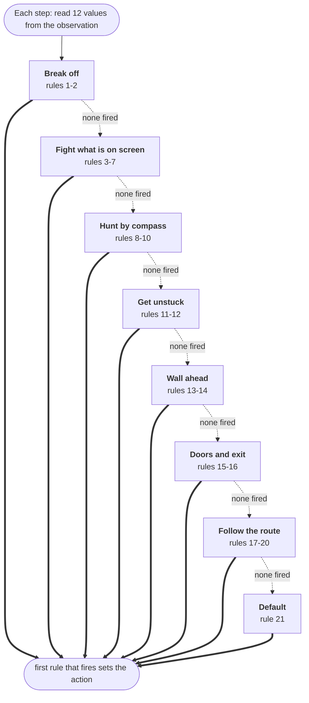

# Doom

rulesmith can optimize graphs that play [ViZDoom](https://github.com/Farama-Foundation/ViZDoom)
scenarios. The graph runs once per action, and search scores it by episode
reward instead of label accuracy.
Install the `doom` extra first: `pip install 'rulesmith[doom]'`.



## Results


The chart is drawn by `benchmarks/fitness.py` from the searches' own reports,
summarized in [benchmarks/results/games.json](../benchmarks/results/games.json).
Every search in it ran with the same proposer, `openrouter/qwen/qwen3.8-27b`,
a local Ruling judge (`Qwen3.5-4B-4bit`, one option ordering per question),
`basic` with 200 episodes a seed and E1M1 with 600 and then up to 1,400 more; the
[chess searches](chess.md#against-stockfish) have a chart of their own from the
same file. A dot is a candidate
that beat everything before it, a line ends where its search's budget ran out,
and the label carries the winner's test score. The panels are not comparable:
each is a different task, and each is scaled to its own scores.

**`basic`** — kill one monster. `benchmarks/doom.sh`, from the task's own
baseline, a graph that only strafes left. Three search seeds found the same
answer, strafe toward the monster and fire when it is centered, after 15, 15
and 39 episodes: 0.33 → 0.97 on validation and 0.94 on the three held-out test
seeds, every time. That is the task's ceiling, since every action costs reward.
[gif](assets/doom/basic-seed12.gif) · [all 12](assets/doom/basic-reel.mp4)

**E1M1** — play a full level. `benchmarks/doom.sh`, from
[e1m1-target.json](../examples/doom/graphs/e1m1-target.json), a hand-written
graph that follows the route and asks the judge only whether a blocked way ahead
is a door. Search seeds with 600 episodes each; a first round of 200 episodes a
seed had stopped while every seed was still improving, so the budget was tripled,
and each winner was then searched further from where it stood:

| Search seed | Validation, seed → best | Test | Exited | Judge calls in the winner | Last candidate kept at |
| --- | --- | --- | --- | --- | --- |
| 0 | 0.22 → 0.29 | 0.24 | 0 of 6 | none | episode 534 |
| 1 | 0.22 → 0.35 | 0.28 | 0 of 6 | none | episode 570 |
| 2 | 0.22 → 0.27 | 0.24 | 0 of 6 | none | episode 596 |

All three seeds were still keeping new candidates past episode 500, seed 2 at its
596th, so 600 is not the ceiling either, though each seed's best validation score
came earlier, at episodes 342, 250 and 414. The 200-episode round scored 0.31, 0.32
and 0.27 on validation; with three times the budget seed 1 went past its
plateau, seed 2 matched its shorter run, and seed 0 landed lower than its own,
since the proposer samples at temperature 1 and the same search seed does not
retrace the same path.

Each 600-episode winner was then made the starting graph of a new search with
1,400 more episodes. Seed 1 spent its whole budget; seeds 0 and 2 were stopped
after their current round, with `gepa.stop`, to leave proposer credits for it,
and can be resumed:

| Search seed | More episodes | Validation, from → best | Test | Exited |
| --- | --- | --- | --- | --- |
| 0 | 182, stopped | 0.29 → 0.29 | 0.24 | 0 of 6 |
| 1 | 1,400 | 0.35 → 0.44 | 0.38 | 2 of 6 |
| 2 | 254, stopped | 0.27 → 0.39 | 0.31 | 0 of 6 |

Seed 1's continuation found its one improvement at its 86th episode, a rewrite
of the stuck rules: declare stuck after 8 visits to a cell instead of 12, turn
onto the route while moving forward instead of backing up, read health, and back
off from a fight below 10. It kept 34 more candidates in the 1,300 episodes
after that and none scored higher. That winner reaches the exit on two of the
six held-out seeds, the first exits from any search here past 200 episodes,
scoring 0.58 on those two and 0.22 to 0.30 on the rest. Seed 2's continuation
traded its strategy: the graph that survived four minutes gave way to one that
runs the route, kills two to five monsters and dies within 200 steps on every
test seed, and scores more for it. Seed 0's 182 episodes kept one candidate, no
better than its start. The continuation of seed 1 took six hours, most of it
proposer time, at about a dollar an hour of proposer calls.

What search found is worth reading with the reward in mind. The starting graph
survives the whole four minutes and scores 0.22. Seeds 0 and 1 found graphs
that run the route, kill several monsters and usually die inside a minute, and
score more, because progress along the route and kills pay better than staying
alive. Seed 2 found the other way to score: a graph that survives the full four
minutes on five of six test seeds and scores its points on the way. None of the
three reaches the exit on a held-out seed; the 200-episode round's winners for
seeds 0 and 1 each did, once, and seed 1's continuation does twice. Exits are counted by the environment, from the
exit bonus paid in an episode's final step, since a fast death after a long run
scores like an exit without being one. All three winners dropped the judge
entirely. How long a search takes turns on how soon
its candidates stop asking the judge on nearly every step: an episode of the
starting graph makes about 1,400 judge calls and takes ten minutes on a local
judge, and one whose graph asks rarely takes seconds, so the same 600-episode
budget ran from two and a half to three and a half hours.

The graph in [the E1M1 exit graph](#the-e1m1-exit-graph) below, which exits
on 5 of 12 seeds, came from an earlier run with Claude Sonnet 5 proposing,
whose logs are not in the repo; it is a past result, not one the driver
reproduces.

**Arena** — graphs play each other, ranked by Elo from round-robin deathmatches;
see [Arena](#arena).

## Task file

A Doom task replaces labeled examples with episode seeds. See
[examples/doom/basic.json](../examples/doom/basic.json):

```json
{
  "description": "Play ViZDoom's basic scenario ... label output is the next button to press ...",
  "scenario": "basic",
  "labels": ["MOVE_LEFT", "MOVE_RIGHT", "ATTACK"],
  "reward_range": [-500, 100],
  "tics_per_action": 4,
  "train": [1, 2, 3, 4, 5, 6],
  "validation": [7, 8, 9],
  "test": [10, 11, 12]
}
```

| Field | Meaning |
| --- | --- |
| `description` | What the proposer is told about the game |
| `scenario` | A scenario bundled with ViZDoom: `basic`, `defend_the_center`, `health_gathering`, `deadly_corridor`, and others |
| `labels` | Actions the graph may choose: a Doom button, or buttons joined with `+` to press together, like `TURN_LEFT+ATTACK`. A button the scenario's own config leaves out is added for the task |
| `reward_range` | Lowest and highest possible episode reward, used to scale scores to 0–1 |
| `tics_per_action` | Game tics each chosen button is held (default 4) |
| `episode_timeout` | Tics before an episode ends (default: the scenario's own). Cap scenarios that otherwise run until death |
| `feedback_steps` | Final steps shown to the proposer per episode (default 8) |
| `map` | Doom map to load, like `E1M1` (default: the scenario's own) |
| `deathmatch` | Episodes are networked duels between graphs; `evaluate` and `optimize` require `--opponent` (default false) |
| `variables` | ViZDoom game variables added to the observation, like `HEALTH` or `AMMO2` |
| `rewards` | Rewards by ViZDoom setter name, like `kill_reward` or `death_penalty`, plus `explore` per newly visited cell and `progress` per map unit the route to the exit shrinks |
| `observe` | Additional observation fields: `pose`, `rangefinder`, `compass`, `memory`, `target`, `route` |
| `rays` | Rangefinder directions across the view (default 7) |
| `rangefinder_range` | Map units a ray reports when no wall is within reach (default 2048) |
| `compass_targets` | Object names the compass tracks anywhere on the map; required with `compass` |
| `compass_size` | Nearest compass targets reported (default 8) |
| `memory_steps` | Recent actions and movement kept by `memory` (default 4) |
| `cell_size` | Map units per cell for visit counts and `explore` (default 64) |
| `train`, `validation`, `test` | Episodes, distinct across splits: a seed, or `{"seed": 7, "scenario": "cig", "map": "MAP32"}` to play that seed on another map or scenario than the task's own |

## Scenarios

[examples/doom](../examples/doom) has a task for each scenario that suits
reactive, object-based play. Reward ranges come from ViZDoom's scenario rules and
configs, and a test plays every example to check them.

| Task | Goal | Reward range |
| --- | --- | --- |
| `basic`, `simpler_basic`, `rocket_basic` | Kill one monster quickly | [-500, 100] / [-500, 110] |
| `defend_the_center` | Kill approaching monsters with 26 rounds | [-1, 26] |
| `defend_the_line` | Kill advancing monsters with 79 rounds, capped at 2100 tics | [-1, 79] |
| `health_gathering`, `health_gathering_supreme` | Survive acid by collecting medkits | [-100, 2100] |
| `take_cover` | Dodge fireballs, capped at 2100 tics | [0, 2100] |
| `predict_position` | Lead a moving target with one slow rocket | [-0.35, 1] |

Navigation tasks can add wall distances, movement history, and an exit route
through `observe`. The [E1M1 example](../examples/doom/e1m1.json) uses these
features for a campaign level; the [duel example](../examples/doom/duel.json)
uses networked multiplayer games. These expose game state beyond the screen's
labels buffer, so results depend on the task's observation settings.

A file with a `scenario` field is treated as a Doom task. The same commands
(`validate`, `evaluate`, `optimize`) work on it.

Write the `description` for the proposer: say what the observation contains and
how actions change it. That is all it knows about the game.

> [!WARNING]
> An episode reward outside `reward_range` stops the run instead of being clipped,
> because clipping would hide real differences between graphs.

## Observations

Each step, the graph's `{"type": "state"}` input is:

```json
{
  "objects": [
    {"name": "Cacodemon", "category": "Monster", "x": 0.203, "y": -0.013, "width": 0.078, "height": 0.129}
  ],
  "variables": {"AMMO2": 50.0}
}
```

`x` runs from -1 (left edge) to 1 (right edge) and `y` from -1 (top) to 1 (bottom),
measured at the object's center. Objects come from ViZDoom's labels buffer, which
lists what is on screen. The player's own weapon is left out. `variables` holds
the scenario's game variables.

`observe` adds more, each under its own key: `target` (the nearest live monster
or opponent on screen, with its map distance), `pose`, `rangefinder` (wall
distances along rays across the view), `memory` (recent actions and movement),
`route` (the way to a level's exit) and `compass`:

```json
{"compass": [{"name": "DoomPlayer", "bearing": -23.2, "distance": 244}]}
```

The compass reaches the whole map, not just the screen, and reports the objects
named in `compass_targets`. `bearing` is degrees from where the player faces,
positive to the left. It lists the nearest of each name first, then fills the
remaining `compass_size` slots by distance, so one distant opponent is never
crowded out by the pickups underfoot. The player's own body is never a bearing.

## Scoring

An episode's score is `(reward - low) / (high - low)`. A graph that fails to
produce a label mid-episode, or an invalid graph, scores 0, below any episode it
could have played. The proposer sees each episode's reward, its action counts,
and its last few steps.

## Watching

```sh
uv run rulesmith evaluate examples/doom/basic.json runs/doom/plan.json \
  --backend ruling --max-workers 1 --split test --visible --output runs/doom/test.json
```

The game waits for each decision, so play runs at the judge's speed.

## Arena

`arena` ranks graphs by playing them against each other:

```sh
uv run rulesmith arena examples/doom/duel.json a.json b.json c.json --output runs/arena.json
```

- Every pair plays one deathmatch per episode in the task's `--split` (default
  `test`). Each graph runs its own ViZDoom instance, joined over a local network
  game. The engines run in lockstep, so a graph that waits on judge calls slows
  the match rather than losing turns.
- The graph with more frags wins; equal frags is a draw. A graph that fails to
  produce an action forfeits. Some maps, ViZDoom's `multi_deathmatch` among
  them, end the round at the first kill, which makes every match first blood;
  others play on to the timeout.
- The joining player sometimes loses a tic to network latency, getting up to
  about 10% fewer turns. Hosting alternates between episodes, so each pair
  shares that handicap evenly when it plays an even number of episodes.
  The same timing makes matches vary slightly from run to run.
- Ratings are a Bradley–Terry fit to all results at once, reported on the Elo
  scale: a 400-point gap means 10:1 odds and the field averages 1500. The fit
  ignores match order. Every pair also shares one virtual draw, which keeps an
  unbeaten graph's rating finite.
- Entrants are named by file stem, so two entrants' files need different names.
- Screen seeds before trusting a ladder. On many of them two graphs never meet,
  and a match nobody turns up to scores the same whatever the graphs do.

Opponents appear in `objects` with category `Player`, and `target` reports the
nearest one on screen. [examples/doom/duel.json](../examples/doom/duel.json)
scores frags minus deaths, plus a smaller reward for damage dealt and taken so that
a graph that lands hits scores above one that never connects, and sets `deathmatch`: deathmatch maps have no
single-player start, so `evaluate` and `optimize` play each episode as a duel
against the graph given by `--opponent`, alternating hosts by seed. Searching
against the arena's current leader breeds a challenger:

```sh
uv run rulesmith optimize examples/doom/duel.json examples/doom/graphs/e1m1-exit.json \
  --opponent examples/doom/graphs/e1m1-exit.json --max-nodes 40 --max-depth 16 \
  --backend ruling --max-workers 1 \
  --reflection-model "$REFLECTION_MODEL" \
  --reflection-base-url "$REFLECTION_BASE_URL" --output runs/challenger
```

The proposer sees each duel's frags, deaths, the opponent's frags, and whether
the graph won. ZDoom's built-in bots are left out: under ViZDoom's
synchronous play they barely fire, even with perfect skill settings.

Split by map, not by seed, for the reason under [Across maps](#across-maps).
A map only earns a place if graphs reliably meet on it; the scenario's other
levels are too big, and matches there end 0-0 whatever the graphs do.

## Limits

- Graphs keep no internal memory between steps. With `observe: ["memory"]`,
  the environment supplies recent actions, movement, and visit counts.
- The judge reads JSON, not pixels. Optional `rangefinder` and `route` fields
  supply wall distances and map-derived navigation hints; `compass` can reveal
  opponents outside the field of view. This is not a screen-only benchmark.
- Graphs with only reads and rules need no judge calls. Active call nodes use
  the judge, with calls sharing identical inputs batched into one request.
- Single-player episodes are evaluated one at a time. Deathmatch searches can
  use `--parallel-examples` because each duel owns its game instances.
- `rangefinder` crashes ViZDoom 1.3.0 on some maps, including E1M6 and the
  `cig` deathmatch maps, because it turns on sectors info. Leave it out there.

## The league

`--opponent` turns a search into a duel: every episode is played against a fixed
graph, scored from the candidate's own seat. Run that in a loop and it becomes a
league. Search a challenger against the champion with the `optimize` command
[under Arena](#arena), play it against everyone in the pool with `arena`, and
hand over the title only when it wins the head-to-head.

This section is a record of past runs. The script that drove the league loop is
not in the repo; each step it ran is an `optimize` or `arena` command, and the
graphs it produced are in [examples/doom/graphs](../examples/doom/graphs).

### Making the measurement mean something

Most of the work was in the task, not the search.

- **Screen seeds for contact.** On roughly a third of them the players never
  meet, and a match nobody turns up to scores the same whatever the graph does.
- **Pick the map deliberately.** ViZDoom's larger `cig` layouts produced no
  contact on any seed tried; the tiny `multi_duel` arena is small enough that
  both E1M1 graphs rocket themselves thirty-one times a match; on
  `multi_deathmatch` the first kill ends the round.
- **Make a match worth several frags.** Two minutes on a map where play
  continues after a kill gives three to five exchanges. On one-frag matches the
  run-to-run spread (0.004) was larger than the differences between candidates.
- **Crown on the head-to-head, not the ladder.** Two identical graphs once
  finished 117 Elo apart over six matches, and a clone took a 6.5-of-12 series
  on one stray frag. The title needs two clear wins over twelve paired matches.

### What it found

| Proposer | Generations | Outcome |
| --- | --- | --- |
| Qwen3.6-35B-A3B (mixture, 3B active) | 8 across two runs | No crown. Every candidate landed 0.01-0.03 below the champion, and three searches in four handed back their own seed. |
| Qwen3.8-27B (dense) | 2 | [duel-hunter](../examples/doom/graphs/duel-hunter.json) beat the champion 12-0, 44 frags to none. |

The difference was the proposer, not the harness. The mixture model edited the
champion's existing navigation rules and never touched the compass; the dense
model added three rules that read `compass.2.bearing` and `compass.2.distance`
and turn onto an opponent nobody can see, so it hunts between fights instead of
walking toward an exit a deathmatch does not have.


Its full rule list is [below](#the-duel-hunter), and the whole duel is
[here](assets/doom/duel-hunter.mp4). Note what it is not: no judge calls.
Every graph that won anything reads numbers out of the observation, because
`target.x < -0.12` is exact and free while a call costs a round trip each step.

### Across maps

That result does not travel. Played across all 32 maps the scenario will load, the
same graph finishes behind the hand-written
[duel-attack](../examples/doom/graphs/duel-attack.json) it shut out 9-0 on cig MAP03,
the map it was bred on:
its compass rules hunt across geometry it has never seen, and the level kills it
before an opponent does. A task whose three splits are seeds of one map measures
how well a graph knows that map, so
[duel-maps.json](../examples/doom/duel-maps.json) trains on four maps, validates on
three others and tests on four more. Twelve generations on it crowned nobody —
two thirds of matches between evenly matched graphs end 0-0, and a metric that
cannot separate them cannot select between them either.

[duel-jev.json](../examples/doom/graphs/duel-jev.json) is also included for
comparison. It uses a judge call to choose combat actions, so running it requires
a configured [backend](cli.md#backends).

## Graphs

Two graphs the search found, in full. Each checks its rules in order, and the
first whose conditions all hold sets the action.

### The E1M1 exit graph

[examples/doom/graphs/e1m1-exit.json](../examples/doom/graphs/e1m1-exit.json),
which exited E1M1 on 5 of 12 seeds under the split in force when it was found:
3 of 6 seeds used by search (1–6) and 2 of 6 held out (7–12); the task now
trains on seeds 1–8, validates on 9–12 and tests on 13–18. The
[five clears](assets/doom/e1m1-reel.mp4) are on one reel, and
[one exit](assets/doom/e1m1-exit.mp4) in full.

How the graph decides: each step it reads 10 values from the observation
(health · ammo · wall ahead · next on route · route bearing · waypoint distance · monster x · monster distance · recent movement · visits here), then checks 16 rules in order. The first rule whose
conditions all hold sets the action.



| # | Purpose | When | Action |
| ---: | --- | --- | --- |
| 1 | Survive | monster visible, ammo < 1, monster distance < 150 | back up |
| 2 | Survive | monster visible, health < 15, ammo < 5, monster distance < 150 | back up |
| 3 | Fight | monster visible, ammo ≥ 1, monster distance < 450, -0.15 ≤ monster x < 0.15 | fire |
| 4 | Fight | monster visible, ammo ≥ 1, monster distance < 450, monster x < -0.15 | turn left |
| 5 | Fight | monster visible, ammo ≥ 1, monster distance < 450, monster x ≥ 0.15 | turn right |
| 6 | Get unstuck | recent movement < 3, visits here ≥ 20 | back up |
| 7 | Get unstuck | recent movement < 3, visits here ≥ 6 | turn left if route bearing ≥ 0, else turn right |
| 8 | Doors and exit | next on route = exit, waypoint distance < 100, -20 ≤ route bearing < 20 | forward + use |
| 9 | Doors and exit | next on route = door, waypoint distance < 90, -20 ≤ route bearing < 20 | forward + use |
| 10 | Wall ahead | wall ahead < 64, route bearing ≥ 0 | turn left |
| 11 | Wall ahead | wall ahead < 64, route bearing < 0 | turn right |
| 12 | Follow the route | route bearing ≥ 35 | turn left |
| 13 | Follow the route | route bearing < -35 | turn right |
| 14 | Follow the route | 10 ≤ route bearing < 35 | forward + left |
| 15 | Follow the route | -35 ≤ route bearing < -10 | forward + right |
| 16 | Default | always | forward |


### The duel hunter

[examples/doom/graphs/duel-hunter.json](../examples/doom/graphs/duel-hunter.json),
which a self-play league bred from the graph above, and which then beat it 12-0.

How it decides: each step it reads 12 values from the observation, then checks
21 rules in order. The first rule whose conditions all hold sets the action.
Mirrored pairs, and the door and exit rules, share a row in the table below. Rules 8-10 are the ones no other
graph has: with nobody on screen, the compass still gives a bearing to the
opponent, and the graph turns onto it.



| # | Purpose | When | Action |
| ---: | --- | --- | --- |
| 1 | Break off | opponent on screen, ammo < 1, distance < 300 | back up |
| 2 | Break off | opponent on screen, health < 20 | back up |
| 3 | Fight | on screen, ammo ≥ 1, health ≥ 25, distance < 250, -0.12 ≤ x < 0.12 | fire |
| 4 | Fight | same, x < -0.12 | turn left |
| 5 | Fight | same, x ≥ 0.12 | turn right |
| 6 | Close in | on screen, ammo ≥ 1, health ≥ 25, distance ≥ 250, x < -0.05 | forward + left |
| 7 | Close in | same, x ≥ 0.05 | forward + right |
| 8 | Hunt | nobody on screen, compass bearing ≥ 45° | turn left |
| 9 | Hunt | nobody on screen, compass bearing < -45° | turn right |
| 10 | Hunt | nobody on screen, bearing within 45°, compass distance ≥ 300 | forward |
| 11 | Get unstuck | recent movement < 3, visits here ≥ 20 | back up |
| 12 | Get unstuck | recent movement < 3, visits here ≥ 6 | turn toward the route |
| 13 | Wall ahead | wall ahead < 64, route bearing ≥ 0 | turn left |
| 14 | Wall ahead | wall ahead < 64, route bearing < 0 | turn right |
| 15-16 | Doors and exit | route says exit within 100 or door within 90, bearing within 20° | forward + use |
| 17-18 | Follow the route | route bearing beyond ±35° | turn that way |
| 19-20 | Follow the route | route bearing 10° to 35° either side | forward + that way |
| 21 | Default | always | forward |

Rules 12-20 read `route`, which a deathmatch never fills in, so they are skipped
every step: inherited scaffolding the search kept but the map never exercises.

