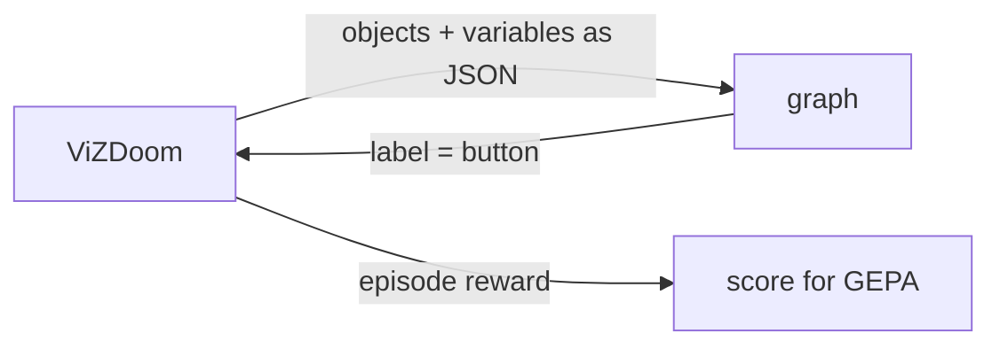
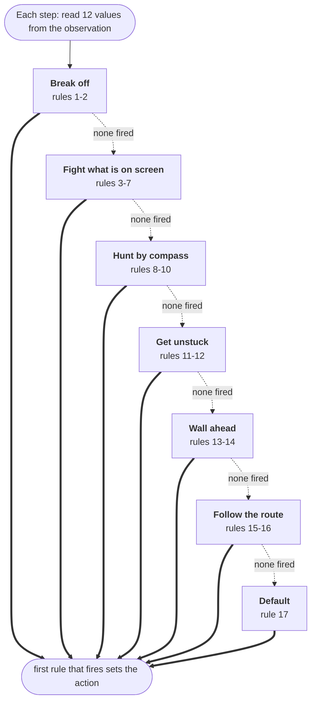

# Doom

decision-compose can optimize graphs that play [ViZDoom](https://github.com/Farama-Foundation/ViZDoom)
scenarios. The graph runs once per action, and search scores it by episode
reward instead of label accuracy.



## Task file

A Doom task replaces labeled examples with episode seeds. See
[examples/doom/basic.json](../examples/doom/basic.json):

```json
{
  "description": "Play ViZDoom's basic scenario ... label output is the next button to press ...",
  "scenario": "basic",
  "labels": ["MOVE_LEFT", "MOVE_RIGHT", "ATTACK"],
  "reward_range": [-500, 100],
  "tics_per_action": 4,
  "train": [1, 2, 3, 4, 5, 6],
  "validation": [7, 8, 9],
  "test": [10, 11, 12]
}
```

| Field | Meaning |
| --- | --- |
| `scenario` | A scenario bundled with ViZDoom: `basic`, `defend_the_center`, `health_gathering`, `deadly_corridor`, and others |
| `labels` | Actions the graph may choose: a Doom button, or buttons joined with `+` to press together, like `TURN_LEFT+ATTACK`. A button the scenario's own config leaves out is added for the task |
| `reward_range` | Lowest and highest possible episode reward, used to scale scores to 0–1 |
| `tics_per_action` | Game tics each chosen button is held (default 4) |
| `episode_timeout` | Tics before an episode ends (default: the scenario's own). Cap scenarios that otherwise run until death |
| `feedback_steps` | Final steps shown to the proposer per episode (default 8) |
| `deathmatch` | Arena-only: episodes are networked duels between graphs (default false) |
| `train`, `validation`, `test` | Distinct episode seeds |

## Scenarios

[examples/doom](../examples/doom) has a task for each scenario that suits
reactive, object-based play. Reward ranges come from ViZDoom's scenario rules and
configs, and a test plays every example to check them.

| Task | Goal | Reward range |
| --- | --- | --- |
| `basic`, `simpler_basic`, `rocket_basic` | Kill one monster quickly | [-500, 100] / [-500, 110] |
| `defend_the_center` | Kill approaching monsters with 26 rounds | [-1, 26] |
| `defend_the_line` | Kill advancing monsters with 79 rounds, capped at 2100 tics | [-1, 79] |
| `health_gathering`, `health_gathering_supreme` | Survive acid by collecting medkits | [-100, 2100] |
| `take_cover` | Dodge fireballs, capped at 2100 tics | [0, 2100] |
| `predict_position` | Lead a moving target with one slow rocket | [-0.35, 1] |

`deadly_corridor` and `my_way_home` need navigation around walls, which the
observations do not include, and the campaign and multiplayer configs are out of
scope.

A file with a `scenario` field is treated as a Doom task. The same commands
(`validate`, `evaluate`, `optimize`) work on it.

Write the `description` for the proposer: say what the observation contains and
how actions change it. That is all it knows about the game.

> [!WARNING]
> An episode reward outside `reward_range` stops the run instead of being clipped,
> because clipping would hide real differences between graphs.

## Observations

Each step, the graph's `{"type": "state"}` input is:

```json
{
  "objects": [
    {"name": "Cacodemon", "category": "Monster", "x": 0.203, "y": -0.013, "width": 0.078, "height": 0.129}
  ],
  "variables": {"AMMO2": 50.0}
}
```

`x` runs from -1 (left edge) to 1 (right edge) and `y` from -1 (top) to 1 (bottom),
measured at the object's center. Objects come from ViZDoom's labels buffer, which
lists what is on screen. The player's own weapon is left out. `variables` holds
the scenario's game variables.

`observe` adds more, each under its own key: `target` (the nearest live monster
or opponent on screen, with its map distance), `pose`, `rangefinder` (wall
distances along rays across the view), `memory` (recent actions and movement),
`route` (the way to a level's exit) and `compass`:

```json
{"compass": [{"name": "DoomPlayer", "bearing": -23.2, "distance": 244}]}
```

The compass reaches the whole map, not just the screen, and reports the objects
named in `compass_targets`. `bearing` is degrees from where the player faces,
positive to the left. It lists the nearest of each name first, then fills the
remaining `compass_size` slots by distance, so one distant opponent is never
crowded out by the pickups underfoot. The player's own body is never a bearing.

## Scoring

An episode's score is `(reward - low) / (high - low)`. A graph that fails to
produce a label mid-episode, or an invalid graph, scores 0, below any episode it
could have played. The proposer sees each episode's reward, its action counts,
and its last few steps.

## Watching

```sh
uv run decision-compose evaluate examples/doom/basic.json runs/doom/plan.json \
  --backend ruling --max-workers 1 --split test --visible --output runs/doom/test.json
```

The game waits for each decision, so play runs at the judge's speed.

## Arena

`arena` ranks graphs by playing them against each other:

```sh
uv run decision-compose arena examples/doom/duel.json a.json b.json c.json --output runs/arena.json
```

- Every pair plays one deathmatch per episode in the task's `--split` (default
  `test`). Each graph runs its own ViZDoom instance, joined over a local network
  game. The engines run in lockstep, so a graph that waits on judge calls slows
  the match rather than losing turns.
- The graph with more frags wins; equal frags is a draw. A graph that fails to
  produce an action forfeits. Some maps, ViZDoom's `multi_deathmatch` among
  them, end the round at the first kill, which makes every match first blood;
  others play on to the timeout.
- The joining player sometimes loses a tic to network latency, getting up to
  about 10% fewer turns. Hosting alternates between episodes, so each pair
  shares that handicap evenly when it plays an even number of episodes.
  The same timing makes matches vary slightly from run to run.
- Ratings are a Bradley–Terry fit to all results at once, reported on the Elo
  scale: a 400-point gap means 10:1 odds and the field averages 1500. The fit
  ignores match order. Every pair also shares one virtual draw, which keeps an
  unbeaten graph's rating finite.
- Entrants are named by file stem, so two entrants' files need different names.
- Screen seeds before trusting a ladder. On many of them two graphs never meet,
  and a match nobody turns up to scores the same whatever the graphs do.

Opponents appear in `objects` with category `Player`, and `target` reports the
nearest one on screen. [examples/doom/duel.json](../examples/doom/duel.json)
scores frags minus deaths, plus a smaller reward for damage dealt and taken so that
a graph that lands hits scores above one that never connects, and sets `deathmatch`: deathmatch maps have no
single-player start, so `evaluate` and `optimize` play each episode as a duel
against the graph given by `--opponent`, alternating hosts by seed. Searching
against the arena's current leader breeds a challenger:

```sh
uv run decision-compose optimize examples/doom/duel.json examples/doom/graphs/e1m1-exit.json \
  --opponent examples/doom/graphs/e1m1-exit.json --max-nodes 40 --max-depth 16 \
  --reflection-model "$REFLECTION_MODEL" --output runs/challenger
```

The proposer sees each duel's frags, deaths, the opponent's frags, and whether
the graph won. ZDoom's built-in bots are left out: under ViZDoom's
synchronous play they barely fire, even with perfect skill settings.

## Limits

- Graphs keep no memory between steps; each action sees only the current observation.
- The judge reads JSON, not pixels. Anything the labels buffer does not report,
  such as walls and doors, is invisible to it.
- Reactive scenarios fit best. Levels that need navigation or planning, like the
  campaign maps, are out of reach for now.
- Each step costs at least one judge call per call node, and episodes are
  evaluated one at a time.
- `rangefinder` crashes ViZDoom 1.3.0 on some maps, including E1M6 and the
  `cig` deathmatch maps, because it turns on sectors info. Leave it out there.

## The league

`--opponent` turns a search into a duel: every episode is played against a fixed
graph, scored from the candidate's own seat. Run that in a loop and it becomes a
league. Search a challenger against the champion, play it against everyone in the
pool, and hand over the title only when it wins the head-to-head.

```sh
uv run decision-compose optimize examples/doom/duel.json examples/doom/graphs/e1m1-exit.json \
  --opponent examples/doom/graphs/e1m1-exit.json --max-nodes 40 --max-depth 16 \
  --reflection-model "$REFLECTION_MODEL" --output runs/challenger
```

### Making the measurement mean something

Most of the work was in the task, not the search.

- **Screen seeds for contact.** On roughly a third of them the players never
  meet, and a match nobody turns up to scores the same whatever the graph does.
- **Pick the map deliberately.** ViZDoom's larger `cig` layouts produced no
  contact on any seed tried; the tiny `multi_duel` arena is small enough that
  both E1M1 graphs rocket themselves thirty-one times a match; on
  `multi_deathmatch` the first kill ends the round.
- **Make a match worth several frags.** Two minutes on a map where play
  continues after a kill gives three to five exchanges. On one-frag matches the
  run-to-run spread (0.004) was larger than the differences between candidates.
- **Crown on the head-to-head, not the ladder.** Two identical graphs once
  finished 117 Elo apart over six matches, and a clone took a 6.5-of-12 series
  on one stray frag. The title needs two clear wins over twelve paired matches.

### What it found

| Proposer | Generations | Outcome |
| --- | --- | --- |
| Qwen3.6-35B-A3B (mixture, 3B active) | 8 across two runs | No crown. Every candidate landed 0.01-0.03 below the champion, and three searches in four handed back their own seed. |
| Qwen3.8-27B (dense) | 2 | [duel-hunter](../examples/doom/graphs/duel-hunter.json) beat the champion 12-0, 44 frags to none. |

The difference was the proposer, not the harness. The mixture model edited the
champion's existing navigation rules and never touched the compass; the dense
model added three rules that read `compass.2.bearing` and `compass.2.distance`
and turn onto an opponent nobody can see, so it hunts between fights instead of
walking toward an exit a deathmatch does not have.


Its full rule list is [below](#the-duel-hunter), and the whole duel is
[here](../docs/assets/doom/duel-hunter.mp4). Note what it is not: no judge calls.
Every graph that won anything reads numbers out of the observation, because
`target.x < -0.12` is exact and free while a call costs a round trip each step.

## Graphs

Two graphs the search found, in full. Each checks its rules in order, and the
first whose conditions all hold sets the action.

### The E1M1 exit graph

[examples/doom/graphs/e1m1-exit.json](../examples/doom/graphs/e1m1-exit.json),
which exits E1M1 on 5 of 12 held-out seeds.

How the graph decides: each step it reads 10 values from the observation
(health · ammo · wall ahead · next on route · route bearing · waypoint distance · monster x · monster distance · recent movement · visits here), then checks 16 rules in order. The first rule whose
conditions all hold sets the action.


| # | Purpose | When | Action |
| ---: | --- | --- | --- |
| 1 | Survive | monster visible, ammo < 1, monster distance < 150 | back up |
| 2 | Survive | monster visible, health < 15, ammo < 5, monster distance < 150 | back up |
| 3 | Fight | monster visible, ammo ≥ 1, monster distance < 450, -0.15 ≤ monster x < 0.15 | fire |
| 4 | Fight | monster visible, ammo ≥ 1, monster distance < 450, monster x < -0.15 | turn left |
| 5 | Fight | monster visible, ammo ≥ 1, monster distance < 450, monster x ≥ 0.15 | turn right |
| 6 | Get unstuck | recent movement < 3, visits here ≥ 20 | back up |
| 7 | Get unstuck | recent movement < 3, visits here ≥ 6 | turn left if route bearing ≥ 0, else turn right |
| 8 | Doors and exit | next on route = exit, waypoint distance < 100, -20 ≤ route bearing < 20 | forward + use |
| 9 | Doors and exit | next on route = door, waypoint distance < 90, -20 ≤ route bearing < 20 | forward + use |
| 10 | Wall ahead | wall ahead < 64, route bearing ≥ 0 | turn left |
| 11 | Wall ahead | wall ahead < 64, route bearing < 0 | turn right |
| 12 | Follow the route | route bearing ≥ 35 | turn left |
| 13 | Follow the route | route bearing < -35 | turn right |
| 14 | Follow the route | 10 ≤ route bearing < 35 | forward + left |
| 15 | Follow the route | -35 ≤ route bearing < -10 | forward + right |
| 16 | Default | always | forward |

<details>
<summary>The graph as JSON</summary>

```json
{
  "nodes": {
    "read_health": {
      "type": "read",
      "path": [
        "variables",
        "HEALTH"
      ],
      "bounds": [
        0,
        200
      ]
    },
    "read_ammo": {
      "type": "read",
      "path": [
        "variables",
        "SELECTED_WEAPON_AMMO"
      ],
      "bounds": [
        0,
        400
      ]
    },
    "read_rf_mid": {
      "type": "read",
      "path": [
        "rangefinder",
        3
      ],
      "bounds": [
        0,
        2048
      ]
    },
    "read_route_next": {
      "type": "read",
      "path": [
        "route",
        "next"
      ],
      "categories": [
        "path",
        "door",
        "exit"
      ]
    },
    "read_route_bearing": {
      "type": "read",
      "path": [
        "route",
        "bearing"
      ],
      "bounds": [
        -180,
        180
      ]
    },
    "read_route_distance": {
      "type": "read",
      "path": [
        "route",
        "distance"
      ],
      "bounds": [
        0,
        6000
      ]
    },
    "read_target_x": {
      "type": "read",
      "path": [
        "target",
        "x"
      ],
      "bounds": [
        -1,
        1
      ]
    },
    "read_target_distance": {
      "type": "read",
      "path": [
        "target",
        "distance"
      ],
      "bounds": [
        0,
        6000
      ]
    },
    "read_memory_moved": {
      "type": "read",
      "path": [
        "memory",
        "distance_moved"
      ],
      "bounds": [
        0,
        600
      ]
    },
    "read_visits": {
      "type": "read",
      "path": [
        "memory",
        "visits_here"
      ],
      "bounds": [
        1,
        10000
      ]
    },
    "flee_no_ammo": {
      "type": "value",
      "when": {
        "type": "all",
        "conditions": [
          {
            "type": "present",
            "node": "read_target_x"
          },
          {
            "type": "compare",
            "node": "read_ammo",
            "op": "lt",
            "value": 1
          },
          {
            "type": "compare",
            "node": "read_target_distance",
            "op": "lt",
            "value": 150
          }
        ]
      },
      "value": "MOVE_BACKWARD"
    },
    "retreat_critical": {
      "type": "value",
      "when": {
        "type": "all",
        "conditions": [
          {
            "type": "present",
            "node": "read_target_x"
          },
          {
            "type": "compare",
            "node": "read_health",
            "op": "lt",
            "value": 15
          },
          {
            "type": "compare",
            "node": "read_ammo",
            "op": "lt",
            "value": 5
          },
          {
            "type": "compare",
            "node": "read_target_distance",
            "op": "lt",
            "value": 150
          }
        ]
      },
      "value": "MOVE_BACKWARD"
    },
    "combat_attack": {
      "type": "value",
      "when": {
        "type": "all",
        "conditions": [
          {
            "type": "present",
            "node": "read_target_x"
          },
          {
            "type": "compare",
            "node": "read_ammo",
            "op": "ge",
            "value": 1
          },
          {
            "type": "compare",
            "node": "read_target_distance",
            "op": "lt",
            "value": 450
          },
          {
            "type": "compare",
            "node": "read_target_x",
            "op": "ge",
            "value": -0.15
          },
          {
            "type": "compare",
            "node": "read_target_x",
            "op": "lt",
            "value": 0.15
          }
        ]
      },
      "value": "ATTACK"
    },
    "combat_aim_left": {
      "type": "value",
      "when": {
        "type": "all",
        "conditions": [
          {
            "type": "present",
            "node": "read_target_x"
          },
          {
            "type": "compare",
            "node": "read_ammo",
            "op": "ge",
            "value": 1
          },
          {
            "type": "compare",
            "node": "read_target_distance",
            "op": "lt",
            "value": 450
          },
          {
            "type": "compare",
            "node": "read_target_x",
            "op": "lt",
            "value": -0.15
          }
        ]
      },
      "value": "TURN_LEFT"
    },
    "combat_aim_right": {
      "type": "value",
      "when": {
        "type": "all",
        "conditions": [
          {
            "type": "present",
            "node": "read_target_x"
          },
          {
            "type": "compare",
            "node": "read_ammo",
            "op": "ge",
            "value": 1
          },
          {
            "type": "compare",
            "node": "read_target_distance",
            "op": "lt",
            "value": 450
          },
          {
            "type": "compare",
            "node": "read_target_x",
            "op": "ge",
            "value": 0.15
          }
        ]
      },
      "value": "TURN_RIGHT"
    },
    "very_stuck_backward": {
      "type": "value",
      "when": {
        "type": "all",
        "conditions": [
          {
            "type": "compare",
            "node": "read_memory_moved",
            "op": "lt",
            "value": 3
          },
          {
            "type": "compare",
            "node": "read_visits",
            "op": "ge",
            "value": 20
          }
        ]
      },
      "value": "MOVE_BACKWARD"
    },
    "stuck_turn": {
      "type": "threshold",
      "when": {
        "type": "all",
        "conditions": [
          {
            "type": "compare",
            "node": "read_memory_moved",
            "op": "lt",
            "value": 3
          },
          {
            "type": "compare",
            "node": "read_visits",
            "op": "ge",
            "value": 6
          }
        ]
      },
      "source": "read_route_bearing",
      "cutoff": 0,
      "below": "TURN_RIGHT",
      "above": "TURN_LEFT"
    },
    "route_exit_use": {
      "type": "value",
      "when": {
        "type": "all",
        "conditions": [
          {
            "type": "compare",
            "node": "read_route_next",
            "op": "eq",
            "value": "exit"
          },
          {
            "type": "compare",
            "node": "read_route_distance",
            "op": "lt",
            "value": 100
          },
          {
            "type": "compare",
            "node": "read_route_bearing",
            "op": "ge",
            "value": -20
          },
          {
            "type": "compare",
            "node": "read_route_bearing",
            "op": "lt",
            "value": 20
          }
        ]
      },
      "value": "MOVE_FORWARD+USE"
    },
    "route_door_use": {
      "type": "value",
      "when": {
        "type": "all",
        "conditions": [
          {
            "type": "compare",
            "node": "read_route_next",
            "op": "eq",
            "value": "door"
          },
          {
            "type": "compare",
            "node": "read_route_distance",
            "op": "lt",
            "value": 90
          },
          {
            "type": "compare",
            "node": "read_route_bearing",
            "op": "ge",
            "value": -20
          },
          {
            "type": "compare",
            "node": "read_route_bearing",
            "op": "lt",
            "value": 20
          }
        ]
      },
      "value": "MOVE_FORWARD+USE"
    },
    "blocked_turn_left": {
      "type": "value",
      "when": {
        "type": "all",
        "conditions": [
          {
            "type": "compare",
            "node": "read_rf_mid",
            "op": "lt",
            "value": 64
          },
          {
            "type": "compare",
            "node": "read_route_bearing",
            "op": "ge",
            "value": 0
          }
        ]
      },
      "value": "TURN_LEFT"
    },
    "blocked_turn_right": {
      "type": "value",
      "when": {
        "type": "all",
        "conditions": [
          {
            "type": "compare",
            "node": "read_rf_mid",
            "op": "lt",
            "value": 64
          },
          {
            "type": "compare",
            "node": "read_route_bearing",
            "op": "lt",
            "value": 0
          }
        ]
      },
      "value": "TURN_RIGHT"
    },
    "route_turn_left": {
      "type": "value",
      "when": {
        "type": "compare",
        "node": "read_route_bearing",
        "op": "ge",
        "value": 35
      },
      "value": "TURN_LEFT"
    },
    "route_turn_right": {
      "type": "value",
      "when": {
        "type": "compare",
        "node": "read_route_bearing",
        "op": "lt",
        "value": -35
      },
      "value": "TURN_RIGHT"
    },
    "route_forward_left": {
      "type": "value",
      "when": {
        "type": "all",
        "conditions": [
          {
            "type": "compare",
            "node": "read_route_bearing",
            "op": "ge",
            "value": 10
          },
          {
            "type": "compare",
            "node": "read_route_bearing",
            "op": "lt",
            "value": 35
          }
        ]
      },
      "value": "MOVE_FORWARD+TURN_LEFT"
    },
    "route_forward_right": {
      "type": "value",
      "when": {
        "type": "all",
        "conditions": [
          {
            "type": "compare",
            "node": "read_route_bearing",
            "op": "ge",
            "value": -35
          },
          {
            "type": "compare",
            "node": "read_route_bearing",
            "op": "lt",
            "value": -10
          }
        ]
      },
      "value": "MOVE_FORWARD+TURN_RIGHT"
    },
    "default_forward": {
      "type": "value",
      "value": "MOVE_FORWARD"
    },
    "decision": {
      "type": "coalesce",
      "sources": [
        "flee_no_ammo",
        "retreat_critical",
        "combat_attack",
        "combat_aim_left",
        "combat_aim_right",
        "very_stuck_backward",
        "stuck_turn",
        "route_exit_use",
        "route_door_use",
        "blocked_turn_left",
        "blocked_turn_right",
        "route_turn_left",
        "route_turn_right",
        "route_forward_left",
        "route_forward_right",
        "default_forward"
      ]
    }
  },
  "outputs": {
    "label": {
      "type": "node",
      "node": "decision",
      "view": "value"
    }
  }
}
```

</details>


### The duel hunter

[examples/doom/graphs/duel-hunter.json](../examples/doom/graphs/duel-hunter.json),
which a self-play league bred from the graph above, and which then beat it 12-0.

How it decides: each step it reads 12 values from the observation, then checks
17 rules in order. The first rule whose conditions all hold sets the action.
Rules 8-10 are the ones no other graph has: with nobody on screen, the compass
still gives a bearing to the opponent, and the graph turns onto it.



| # | Purpose | When | Action |
| ---: | --- | --- | --- |
| 1 | Break off | opponent on screen, ammo < 1, distance < 300 | back up |
| 2 | Break off | opponent on screen, health < 20 | back up |
| 3 | Fight | on screen, ammo ≥ 1, health ≥ 25, distance < 250, -0.12 ≤ x < 0.12 | fire |
| 4 | Fight | same, x < -0.12 | turn left |
| 5 | Fight | same, x ≥ 0.12 | turn right |
| 6 | Close in | on screen, ammo ≥ 1, health ≥ 25, distance ≥ 250, x < -0.05 | forward + left |
| 7 | Close in | same, x ≥ 0.05 | forward + right |
| 8 | Hunt | nobody on screen, compass bearing ≥ 45° | turn left |
| 9 | Hunt | nobody on screen, compass bearing < -45° | turn right |
| 10 | Hunt | nobody on screen, bearing within 45°, compass distance ≥ 300 | forward |
| 11 | Get unstuck | recent movement < 3, visits here ≥ 20 | back up |
| 12 | Get unstuck | recent movement < 3, visits here ≥ 6 | turn toward the route |
| 13 | Wall ahead | wall ahead < 64, route bearing ≥ 0 | turn left |
| 14 | Wall ahead | wall ahead < 64, route bearing < 0 | turn right |
| 15 | Follow the route | route bearing beyond ±35° | turn that way |
| 16 | Follow the route | route bearing 10° to 35° either side | forward + that way |
| 17 | Default | always | forward |

Rules 13-16 read `route`, which a deathmatch never fills in, so they are skipped
every step: inherited scaffolding the search kept but the map never exercises.

<details>
<summary>The winning graph as JSON</summary>

```json
{
  "nodes": {
    "read_health": {
      "when": null,
      "type": "read",
      "path": [
        "variables",
        "HEALTH"
      ],
      "bounds": [
        0.0,
        200.0
      ],
      "categories": null
    },
    "read_ammo": {
      "when": null,
      "type": "read",
      "path": [
        "variables",
        "SELECTED_WEAPON_AMMO"
      ],
      "bounds": [
        0.0,
        400.0
      ],
      "categories": null
    },
    "read_rf_mid": {
      "when": null,
      "type": "read",
      "path": [
        "rangefinder",
        3
      ],
      "bounds": [
        0.0,
        2048.0
      ],
      "categories": null
    },
    "read_route_next": {
      "when": null,
      "type": "read",
      "path": [
        "route",
        "next"
      ],
      "bounds": null,
      "categories": [
        "path",
        "door",
        "exit"
      ]
    },
    "read_route_bearing": {
      "when": null,
      "type": "read",
      "path": [
        "route",
        "bearing"
      ],
      "bounds": [
        -180.0,
        180.0
      ],
      "categories": null
    },
    "read_route_distance": {
      "when": null,
      "type": "read",
      "path": [
        "route",
        "distance"
      ],
      "bounds": [
        0.0,
        6000.0
      ],
      "categories": null
    },
    "read_target_x": {
      "when": null,
      "type": "read",
      "path": [
        "target",
        "x"
      ],
      "bounds": [
        -1.0,
        1.0
      ],
      "categories": null
    },
    "read_target_distance": {
      "when": null,
      "type": "read",
      "path": [
        "target",
        "distance"
      ],
      "bounds": [
        0.0,
        6000.0
      ],
      "categories": null
    },
    "read_enemy_compass_bearing": {
      "when": null,
      "type": "read",
      "path": [
        "compass",
        2,
        "bearing"
      ],
      "bounds": [
        -180.0,
        180.0
      ],
      "categories": null
    },
    "read_enemy_compass_distance": {
      "when": null,
      "type": "read",
      "path": [
        "compass",
        2,
        "distance"
      ],
      "bounds": [
        0.0,
        6000.0
      ],
      "categories": null
    },
    "read_memory_moved": {
      "when": null,
      "type": "read",
      "path": [
        "memory",
        "distance_moved"
      ],
      "bounds": [
        0.0,
        600.0
      ],
      "categories": null
    },
    "read_visits": {
      "when": null,
      "type": "read",
      "path": [
        "memory",
        "visits_here"
      ],
      "bounds": [
        1.0,
        10000.0
      ],
      "categories": null
    },
    "flee_no_ammo": {
      "when": {
        "type": "all",
        "conditions": [
          {
            "type": "present",
            "node": "read_target_x"
          },
          {
            "type": "compare",
            "node": "read_ammo",
            "op": "lt",
            "value": 1.0
          },
          {
            "type": "compare",
            "node": "read_target_distance",
            "op": "lt",
            "value": 300.0
          }
        ]
      },
      "type": "value",
      "value": "MOVE_BACKWARD"
    },
    "retreat_critical": {
      "when": {
        "type": "all",
        "conditions": [
          {
            "type": "present",
            "node": "read_target_x"
          },
          {
            "type": "compare",
            "node": "read_health",
            "op": "lt",
            "value": 20.0
          }
        ]
      },
      "type": "value",
      "value": "MOVE_BACKWARD"
    },
    "combat_strafe_left": {
      "when": {
        "type": "all",
        "conditions": [
          {
            "type": "present",
            "node": "read_target_x"
          },
          {
            "type": "compare",
            "node": "read_ammo",
            "op": "ge",
            "value": 1.0
          },
          {
            "type": "compare",
            "node": "read_health",
            "op": "ge",
            "value": 25.0
          },
          {
            "type": "compare",
            "node": "read_target_distance",
            "op": "ge",
            "value": 250.0
          },
          {
            "type": "compare",
            "node": "read_target_x",
            "op": "lt",
            "value": -0.05
          }
        ]
      },
      "type": "value",
      "value": "MOVE_FORWARD+TURN_LEFT"
    },
    "combat_strafe_right": {
      "when": {
        "type": "all",
        "conditions": [
          {
            "type": "present",
            "node": "read_target_x"
          },
          {
            "type": "compare",
            "node": "read_ammo",
            "op": "ge",
            "value": 1.0
          },
          {
            "type": "compare",
            "node": "read_health",
            "op": "ge",
            "value": 25.0
          },
          {
            "type": "compare",
            "node": "read_target_distance",
            "op": "ge",
            "value": 250.0
          },
          {
            "type": "compare",
            "node": "read_target_x",
            "op": "ge",
            "value": 0.05
          }
        ]
      },
      "type": "value",
      "value": "MOVE_FORWARD+TURN_RIGHT"
    },
    "combat_aim_left": {
      "when": {
        "type": "all",
        "conditions": [
          {
            "type": "present",
            "node": "read_target_x"
          },
          {
            "type": "compare",
            "node": "read_ammo",
            "op": "ge",
            "value": 1.0
          },
          {
            "type": "compare",
            "node": "read_health",
            "op": "ge",
            "value": 25.0
          },
          {
            "type": "compare",
            "node": "read_target_distance",
            "op": "lt",
            "value": 250.0
          },
          {
            "type": "compare",
            "node": "read_target_x",
            "op": "lt",
            "value": -0.12
          }
        ]
      },
      "type": "value",
      "value": "TURN_LEFT"
    },
    "combat_aim_right": {
      "when": {
        "type": "all",
        "conditions": [
          {
            "type": "present",
            "node": "read_target_x"
          },
          {
            "type": "compare",
            "node": "read_ammo",
            "op": "ge",
            "value": 1.0
          },
          {
            "type": "compare",
            "node": "read_health",
            "op": "ge",
            "value": 25.0
          },
          {
            "type": "compare",
            "node": "read_target_distance",
            "op": "lt",
            "value": 250.0
          },
          {
            "type": "compare",
            "node": "read_target_x",
            "op": "ge",
            "value": 0.12
          }
        ]
      },
      "type": "value",
      "value": "TURN_RIGHT"
    },
    "combat_attack": {
      "when": {
        "type": "all",
        "conditions": [
          {
            "type": "present",
            "node": "read_target_x"
          },
          {
            "type": "compare",
            "node": "read_ammo",
            "op": "ge",
            "value": 1.0
          },
          {
            "type": "compare",
            "node": "read_health",
            "op": "ge",
            "value": 25.0
          },
          {
            "type": "compare",
            "node": "read_target_distance",
            "op": "lt",
            "value": 250.0
          },
          {
            "type": "compare",
            "node": "read_target_x",
            "op": "ge",
            "value": -0.12
          },
          {
            "type": "compare",
            "node": "read_target_x",
            "op": "lt",
            "value": 0.12
          }
        ]
      },
      "type": "value",
      "value": "ATTACK"
    },
    "combat_combat_pick": {
      "when": {
        "type": "present",
        "node": "read_target_x"
      },
      "type": "coalesce",
      "sources": [
        "flee_no_ammo",
        "retreat_critical",
        "combat_attack",
        "combat_aim_left",
        "combat_aim_right",
        "combat_strafe_left",
        "combat_strafe_right"
      ]
    },
    "track_bearing_left": {
      "when": {
        "type": "all",
        "conditions": [
          {
            "type": "present",
            "node": "read_enemy_compass_bearing"
          },
          {
            "type": "not",
            "condition": {
              "type": "present",
              "node": "read_target_x"
            }
          },
          {
            "type": "compare",
            "node": "read_enemy_compass_bearing",
            "op": "ge",
            "value": 45.0
          }
        ]
      },
      "type": "value",
      "value": "TURN_LEFT"
    },
    "track_bearing_right": {
      "when": {
        "type": "all",
        "conditions": [
          {
            "type": "present",
            "node": "read_enemy_compass_bearing"
          },
          {
            "type": "not",
            "condition": {
              "type": "present",
              "node": "read_target_x"
            }
          },
          {
            "type": "compare",
            "node": "read_enemy_compass_bearing",
            "op": "lt",
            "value": -45.0
          }
        ]
      },
      "type": "value",
      "value": "TURN_RIGHT"
    },
    "track_bearing_forward": {
      "when": {
        "type": "all",
        "conditions": [
          {
            "type": "present",
            "node": "read_enemy_compass_bearing"
          },
          {
            "type": "not",
            "condition": {
              "type": "present",
              "node": "read_target_x"
            }
          },
          {
            "type": "compare",
            "node": "read_enemy_compass_bearing",
            "op": "ge",
            "value": -45.0
          },
          {
            "type": "compare",
            "node": "read_enemy_compass_bearing",
            "op": "lt",
            "value": 45.0
          },
          {
            "type": "compare",
            "node": "read_enemy_compass_distance",
            "op": "ge",
            "value": 300.0
          }
        ]
      },
      "type": "value",
      "value": "MOVE_FORWARD"
    },
    "tracking_combat_pick": {
      "when": {
        "type": "not",
        "condition": {
          "type": "present",
          "node": "read_target_x"
        }
      },
      "type": "coalesce",
      "sources": [
        "track_bearing_left",
        "track_bearing_right",
        "track_bearing_forward"
      ]
    },
    "blocked_turn_left": {
      "when": {
        "type": "all",
        "conditions": [
          {
            "type": "present",
            "node": "read_rf_mid"
          },
          {
            "type": "present",
            "node": "read_route_bearing"
          },
          {
            "type": "compare",
            "node": "read_rf_mid",
            "op": "lt",
            "value": 64.0
          },
          {
            "type": "compare",
            "node": "read_route_bearing",
            "op": "ge",
            "value": 0.0
          }
        ]
      },
      "type": "value",
      "value": "TURN_LEFT"
    },
    "blocked_turn_right": {
      "when": {
        "type": "all",
        "conditions": [
          {
            "type": "present",
            "node": "read_rf_mid"
          },
          {
            "type": "present",
            "node": "read_route_bearing"
          },
          {
            "type": "compare",
            "node": "read_rf_mid",
            "op": "lt",
            "value": 64.0
          },
          {
            "type": "compare",
            "node": "read_route_bearing",
            "op": "lt",
            "value": 0.0
          }
        ]
      },
      "type": "value",
      "value": "TURN_RIGHT"
    },
    "route_exit_use": {
      "when": {
        "type": "all",
        "conditions": [
          {
            "type": "compare",
            "node": "read_route_next",
            "op": "eq",
            "value": "exit"
          },
          {
            "type": "compare",
            "node": "read_route_distance",
            "op": "lt",
            "value": 100.0
          },
          {
            "type": "compare",
            "node": "read_route_bearing",
            "op": "ge",
            "value": -20.0
          },
          {
            "type": "compare",
            "node": "read_route_bearing",
            "op": "lt",
            "value": 20.0
          }
        ]
      },
      "type": "value",
      "value": "MOVE_FORWARD+USE"
    },
    "route_door_use": {
      "when": {
        "type": "all",
        "conditions": [
          {
            "type": "compare",
            "node": "read_route_next",
            "op": "eq",
            "value": "door"
          },
          {
            "type": "compare",
            "node": "read_route_distance",
            "op": "lt",
            "value": 90.0
          },
          {
            "type": "compare",
            "node": "read_route_bearing",
            "op": "ge",
            "value": -20.0
          },
          {
            "type": "compare",
            "node": "read_route_bearing",
            "op": "lt",
            "value": 20.0
          }
        ]
      },
      "type": "value",
      "value": "MOVE_FORWARD+USE"
    },
    "route_turn_left": {
      "when": {
        "type": "compare",
        "node": "read_route_bearing",
        "op": "ge",
        "value": 35.0
      },
      "type": "value",
      "value": "TURN_LEFT"
    },
    "route_turn_right": {
      "when": {
        "type": "compare",
        "node": "read_route_bearing",
        "op": "lt",
        "value": -35.0
      },
      "type": "value",
      "value": "TURN_RIGHT"
    },
    "route_forward_left": {
      "when": {
        "type": "all",
        "conditions": [
          {
            "type": "compare",
            "node": "read_route_bearing",
            "op": "ge",
            "value": 10.0
          },
          {
            "type": "compare",
            "node": "read_route_bearing",
            "op": "lt",
            "value": 35.0
          }
        ]
      },
      "type": "value",
      "value": "MOVE_FORWARD+TURN_LEFT"
    },
    "route_forward_right": {
      "when": {
        "type": "all",
        "conditions": [
          {
            "type": "compare",
            "node": "read_route_bearing",
            "op": "ge",
            "value": -35.0
          },
          {
            "type": "compare",
            "node": "read_route_bearing",
            "op": "lt",
            "value": -10.0
          }
        ]
      },
      "type": "value",
      "value": "MOVE_FORWARD+TURN_RIGHT"
    },
    "very_stuck_backward": {
      "when": {
        "type": "all",
        "conditions": [
          {
            "type": "compare",
            "node": "read_memory_moved",
            "op": "lt",
            "value": 3.0
          },
          {
            "type": "compare",
            "node": "read_visits",
            "op": "ge",
            "value": 20.0
          }
        ]
      },
      "type": "value",
      "value": "MOVE_BACKWARD"
    },
    "stuck_turn": {
      "when": {
        "type": "all",
        "conditions": [
          {
            "type": "compare",
            "node": "read_memory_moved",
            "op": "lt",
            "value": 3.0
          },
          {
            "type": "compare",
            "node": "read_visits",
            "op": "ge",
            "value": 6.0
          }
        ]
      },
      "type": "threshold",
      "source": "read_route_bearing",
      "cutoff": 0.0,
      "below": "TURN_RIGHT",
      "above": "TURN_LEFT"
    },
    "default_forward": {
      "when": null,
      "type": "value",
      "value": "MOVE_FORWARD"
    },
    "decision": {
      "when": null,
      "type": "coalesce",
      "sources": [
        "combat_combat_pick",
        "tracking_combat_pick",
        "very_stuck_backward",
        "stuck_turn",
        "blocked_turn_left",
        "blocked_turn_right",
        "route_exit_use",
        "route_door_use",
        "route_turn_left",
        "route_turn_right",
        "route_forward_left",
        "route_forward_right",
        "default_forward"
      ]
    }
  },
  "outputs": {
    "label": {
      "type": "node",
      "node": "decision",
      "view": "value",
      "optional": false
    }
  }
}
```

</details>

