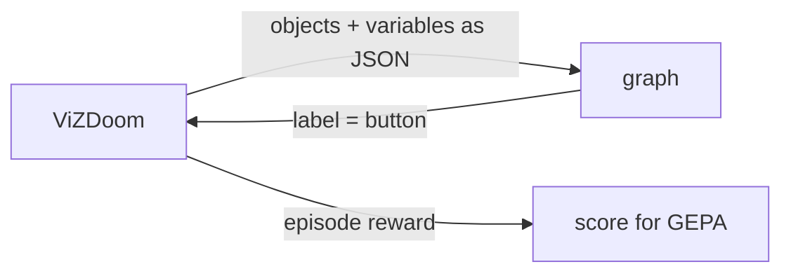

# Doom

decision-compose can optimize graphs that play [ViZDoom](https://github.com/Farama-Foundation/ViZDoom)
scenarios. The graph runs once per action, and search scores it by episode
reward instead of label accuracy.



## Task file

A Doom task replaces labeled examples with episode seeds. See
[examples/doom/basic.json](../examples/doom/basic.json):

```json
{
  "description": "Play ViZDoom's basic scenario ... label output is the next button to press ...",
  "scenario": "basic",
  "labels": ["MOVE_LEFT", "MOVE_RIGHT", "ATTACK"],
  "reward_range": [-500, 100],
  "tics_per_action": 4,
  "train": [1, 2, 3, 4, 5, 6],
  "validation": [7, 8, 9],
  "test": [10, 11, 12]
}
```

| Field | Meaning |
| --- | --- |
| `scenario` | A scenario bundled with ViZDoom: `basic`, `defend_the_center`, `health_gathering`, `deadly_corridor`, and others |
| `labels` | Actions the graph may choose: a scenario button, or buttons joined with `+` to press together, like `TURN_LEFT+ATTACK` |
| `reward_range` | Lowest and highest possible episode reward, used to scale scores to 0–1 |
| `tics_per_action` | Game tics each chosen button is held (default 4) |
| `episode_timeout` | Tics before an episode ends (default: the scenario's own). Cap scenarios that otherwise run until death |
| `feedback_steps` | Final steps shown to the proposer per episode (default 8) |
| `deathmatch` | Arena-only: episodes are networked duels between graphs (default false) |
| `train`, `validation`, `test` | Distinct episode seeds |

## Scenarios

[examples/doom](../examples/doom) has a task for each scenario that suits
reactive, object-based play. Reward ranges come from ViZDoom's scenario rules and
configs, and a test plays every example to check them.

| Task | Goal | Reward range |
| --- | --- | --- |
| `basic`, `simpler_basic`, `rocket_basic` | Kill one monster quickly | [-500, 100] / [-500, 110] |
| `defend_the_center` | Kill approaching monsters with 26 rounds | [-1, 26] |
| `defend_the_line` | Kill advancing monsters with 79 rounds, capped at 2100 tics | [-1, 79] |
| `health_gathering`, `health_gathering_supreme` | Survive acid by collecting medkits | [-100, 2100] |
| `take_cover` | Dodge fireballs, capped at 2100 tics | [0, 2100] |
| `predict_position` | Lead a moving target with one slow rocket | [-0.35, 1] |

`deadly_corridor` and `my_way_home` need navigation around walls, which the
observations do not include, and the campaign and multiplayer configs are out of
scope.

A file with a `scenario` field is treated as a Doom task. The same commands
(`validate`, `evaluate`, `optimize`) work on it.

Write the `description` for the proposer: say what the observation contains and
how actions change it. That is all it knows about the game.

> [!WARNING]
> An episode reward outside `reward_range` stops the run instead of being clipped,
> because clipping would hide real differences between graphs.

## Observations

Each step, the graph's `{"type": "state"}` input is:

```json
{
  "objects": [
    {"name": "Cacodemon", "category": "Monster", "x": 0.203, "y": -0.013, "width": 0.078, "height": 0.129}
  ],
  "variables": {"AMMO2": 50.0}
}
```

`x` runs from -1 (left edge) to 1 (right edge) and `y` from -1 (top) to 1 (bottom),
measured at the object's center. Objects come from ViZDoom's labels buffer, which
lists what is on screen. The player's own weapon is left out. `variables` holds
the scenario's game variables.

`observe` adds more, each under its own key: `target` (the nearest live monster
or opponent on screen, with its map distance), `pose`, `rangefinder` (wall
distances along rays across the view), `memory` (recent actions and movement),
`route` (the way to a level's exit) and `compass`:

```json
{"compass": [{"name": "DoomPlayer", "bearing": -23.2, "distance": 244}]}
```

The compass reaches the whole map, not just the screen, and reports the objects
named in `compass_targets`. `bearing` is degrees from where the player faces,
positive to the left. It lists the nearest of each name first, then fills the
remaining `compass_size` slots by distance, so one distant opponent is never
crowded out by the pickups underfoot. The player's own body is never a bearing.

## Scoring

An episode's score is `(reward - low) / (high - low)`. A graph that fails to
produce a label mid-episode, or an invalid graph, scores 0, below any episode it
could have played. The proposer sees each episode's reward, its action counts,
and its last few steps.

## Watching

```sh
uv run decision-compose evaluate examples/doom/basic.json runs/doom/plan.json \
  --backend ruling --max-workers 1 --split test --visible --output runs/doom/test.json
```

The game waits for each decision, so play runs at the judge's speed.

## Arena

`arena` ranks graphs by playing them against each other:

```sh
uv run decision-compose arena examples/doom/duel.json a.json b.json c.json --output runs/arena.json
```

- Every pair plays one deathmatch per episode in the task's `--split` (default
  `test`). Each graph runs its own ViZDoom instance, joined over a local network
  game. The engines run in lockstep, so a graph that waits on judge calls slows
  the match rather than losing turns.
- The graph with more frags wins; equal frags is a draw. A graph that fails to
  produce an action forfeits.
- The joining player sometimes loses a tic to network latency, getting up to
  about 10% fewer turns. Hosting alternates between episodes, so each pair
  shares that handicap evenly when it plays an even number of episodes.
  The same timing makes matches vary slightly from run to run.
- Ratings are a Bradley–Terry fit to all results at once, reported on the Elo
  scale: a 400-point gap means 10:1 odds and the field averages 1500. The fit
  ignores match order. Every pair also shares one virtual draw, which keeps an
  unbeaten graph's rating finite.
- Entrants are named by file stem, so two entrants' files need different names.

Opponents appear in `objects` with category `Player`, and `target` reports the
nearest one on screen. [examples/doom/duel.json](../examples/doom/duel.json)
scores frags minus deaths, plus a smaller reward for damage dealt and taken so that
a graph that lands hits scores above one that never connects, and sets `deathmatch`: deathmatch maps have no
single-player start, so `evaluate` and `optimize` play each episode as a duel
against the graph given by `--opponent`, alternating hosts by seed. Searching
against the arena's current leader breeds a challenger:

```sh
uv run decision-compose optimize examples/doom/duel.json examples/doom/graphs/e1m1-exit.json \
  --opponent examples/doom/graphs/e1m1-exit.json --max-nodes 40 --max-depth 16 \
  --reflection-model "$REFLECTION_MODEL" --output runs/challenger
```

The proposer sees each duel's frags, deaths, the opponent's frags, and whether
the graph won. ZDoom's built-in bots are left out: under ViZDoom's
synchronous play they barely fire, even with perfect skill settings.

## Limits

- Graphs keep no memory between steps; each action sees only the current observation.
- The judge reads JSON, not pixels. Anything the labels buffer does not report,
  such as walls and doors, is invisible to it.
- Reactive scenarios fit best. Levels that need navigation or planning, like the
  campaign maps, are out of reach for now.
- Each step costs at least one judge call per call node, and episodes are
  evaluated one at a time.
- `rangefinder` crashes ViZDoom 1.3.0 on some maps, including E1M6 and the
  `cig` deathmatch maps, because it turns on sectors info. Leave it out there.
