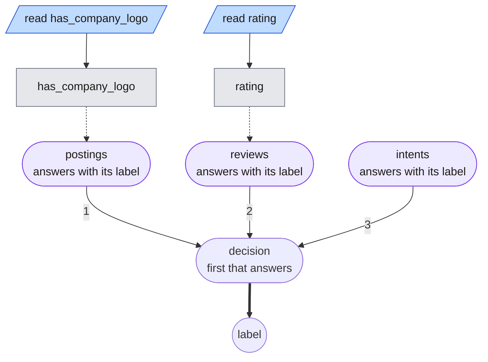

# A map of decisions

The composition pieces, [units](graphs.md#composing-graphs), units in files,
search per unit and scoring the whole, exist to build maps of many decisions.
This page is the first map, built from public data only, so every number in it
can be rerun: three decisions of a marketplace's trust-and-safety work, each a
unit that search found on one of the [benchmark](benchmarks.md) datasets, behind
a router that costs nothing.

`benchmarks/map.py build` writes it to [examples/map](../examples/map): the
graph search found on the jobs, clothing and Banking77 benchmarks (seed 0 of
each) as [three unit files](../examples/map/units), the map
[trust-safety.json](../examples/map/trust-safety.json) that hands a job posting
to the scam unit, a review to the recommendation unit and anything else to the
intent unit, and a [task](../examples/map/task.json) of held-out rows from all
three datasets with all 81 of their labels.



The router reads nothing a model needs: a posting has `has_company_logo`, a
review has `rating`, and a message has neither, so the first two units are
gated on a field being present and the third is the fallback, asked only when
neither of the others answered. The units are the searched graphs as they were
found:

```
# postings, from the jobs benchmark
read has_company_logo in [0, 1]
read length of company_profile in [0, 10000]
when has_company_logo == 0 and length of company_profile == 0: fraudulent
always: ask "Is this job posting a scam?" [fraudulent: "fraudulent"] [genuine: "genuine"]
```

```
# reviews, from the clothing benchmark
read rating in [-3, 9]
when rating >= 4: recommended
when rating < 3 or rating == 3: not_recommended
```

The intent unit is one judge question over Banking77's 77 intents, which is what
search kept there.

## Results

| Unit | Rows | Accuracy in the map | Judge calls per row | Alone, on its benchmark (300 rows) |
| --- | --- | --- | --- | --- |
| postings, from jobs | 40 | 0.83 | 0.60 | 0.80 |
| reviews, from clothing | 40 | 0.95 | 0.00 | 0.93 |
| intents, from Banking77 | 40 | 0.75 | 1.00 | 0.64 |
| **the map** | **120** | **0.84** | **0.53** | |

Scored with `rulesmith evaluate` on the task's test split, 40 held-out rows
from each dataset, against a local Ruling judge (`Qwen3.5-4B-4bit`, one option
ordering per question); the output is in
[benchmarks/results/map.json](../benchmarks/results/map.json) and
`benchmarks/map.py summarize` reads it. Each row is credited to the unit that
decided it, from `decided_by`.

Every row reached the unit for its kind, since the router reads which fields an
input has, and each unit did in the map about what it did alone; the gaps are
what 40 rows against 300 look like. The map's cost is its units' cost, 0.53 judge
calls per row over the three: the reviews unit asks nothing, the postings unit
asks about 60% of postings, and the intent unit asks about every message. The
run took 54 seconds for 120 rows on the local judge.

## What this shows, and what it does not

It shows composition working end to end on real inputs: three graphs searched
separately, placed in one map, validated across the hand-offs, run through one
engine on one judge, with every decision traceable to the unit and rule that
made it. The router adds no model calls, so the map costs what its units cost.

It does not show an organization. The three decisions are unrelated, the router
dispatches on field presence rather than on anything an organization would
have to judge, and each unit was scored on its own benchmark before it was
placed here. A real map's units share inputs, hand cases to each other, and
disagree; that is what [`--unit` and `--map-task`](optimization.md#settings)
are for, and this map is the fixture to try them on.

## Rebuilding it

```sh
uv run python3 benchmarks/map.py build
uv run rulesmith validate examples/map/task.json examples/map/trust-safety.json --max-nodes 40 --max-depth 16
uv run rulesmith evaluate examples/map/task.json examples/map/trust-safety.json --split test \
  --backend ruling --max-workers 1 --max-nodes 40 --max-depth 16 --output benchmarks/results/map.json
uv run python3 benchmarks/map.py summarize benchmarks/results/map.json
```
