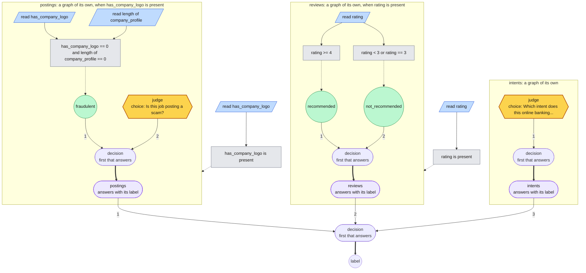

# Maps

A map is a graph whose nodes can be other graphs. Each inner graph is a **unit**:
a complete graph in a file of its own, with its own reads, judgments and rules,
answering with one output. The map hands cases to its units and decides from
what they answer, and it runs as one graph on one judge: a unit runs through the
same engine, gated and lazy like a judge call, and every answer is traced to the
unit and the rule inside it that made it. Units can hold units, so a map nests
as deep as the decisions do.

In the vocabulary of DMN, the decision-management standard, a map is a decision
model, a unit a decision that other decisions depend on, and the drawing a
decision requirements diagram. The words here are plainer because "model"
already names the judge and the proposer in this repo.

## Working with a map

A unit is a `graph` node that names its file; the node format is in
[Composing graphs](graphs.md#composing-graphs).

```json
"billing": {
  "type": "graph",
  "path": "units/billing.rules",
  "when": {"type": "compare", "node": "team", "op": "eq", "value": "billing"}
}
```

| To | Run |
| --- | --- |
| Check every hand-off across the files | `rulesmith validate task.json map.json`, which lists the units it loaded and names any hand-off a unit cannot meet |
| See the map | `rulesmith draw map.json --closed` for one box per unit; without `--closed`, each unit is opened |
| Run it | `rulesmith run map.json input.json`; the result's `decided_by` names the unit and rule, and its judgments are listed under the unit's name |
| Improve one unit | `rulesmith optimize unit-task.json map.json --unit billing`: search starts from that unit's graph, with the rest frozen, and the winner is refused if the map's hand-offs no longer hold |
| Keep the whole honest | add `--map-task map-task.json`: the map is scored on its own examples before and after the swap, and a unit that is better alone and worse for the map is refused |

Search revises a unit's own rules, so a map is improved one decision at a time,
and each unit is scored on its own task; the map task scores the hand-off end
to end. Loading, validating and drawing work the same from Python through
`rulesmith.maps.load(path)`.

## The first map

Three decisions of a marketplace's trust-and-safety work, built from public
data only so every number can be rerun. Each unit is the graph search found on
one of the [benchmark](benchmarks.md) datasets, and the router costs nothing: a
posting has `has_company_logo`, a review has `rating`, and a message has
neither, so the first two units are gated on a field being present and the
third is the fallback, asked only when neither of the others answered. Drawn
with `rulesmith draw`, each unit opened; `--closed` would show each as one box:



The files are in [examples/map](../examples/map): the map
[trust-safety.json](../examples/map/trust-safety.json), the
[three unit files](../examples/map/units), and a [task](../examples/map/task.json)
of held-out rows from all three datasets with all 81 of their labels. The units
are the searched graphs as they were found:

```
# postings, from the jobs benchmark
read has_company_logo in [0, 1]
read length of company_profile in [0, 10000]
when has_company_logo == 0 and length of company_profile == 0: fraudulent
always: ask "Is this job posting a scam?" [fraudulent: "fraudulent"] [genuine: "genuine"]
```

```
# reviews, from the clothing benchmark
read rating in [-3, 9]
when rating >= 4: recommended
when rating < 3 or rating == 3: not_recommended
```

The intent unit is one judge question over Banking77's 77 intents, which is what
search kept there.

### Results

Scored with `rulesmith evaluate` on the task's test split, 40 held-out rows
from each dataset, against a local Ruling judge (`Qwen3.5-4B-4bit`, one option
ordering per question). Each row is credited to the unit that decided it, from
`decided_by`; the output is in
[benchmarks/results/map.json](../benchmarks/results/map.json).

| Unit | Rows | Accuracy in the map | Judge calls per row | Alone, on its benchmark (300 rows) |
| --- | --- | --- | --- | --- |
| postings, from jobs | 40 | 0.83 | 0.60 | 0.80 |
| reviews, from clothing | 40 | 0.95 | 0.00 | 0.93 |
| intents, from Banking77 | 40 | 0.75 | 1.00 | 0.64 |
| **the map** | **120** | **0.84** | **0.53** | |

Every row reached the unit for its kind, and each unit did in the map about
what it did alone; the gaps are what 40 rows against 300 look like. The map's
cost is its units' cost, 0.53 judge calls per row: the reviews unit asks
nothing, the postings unit asks about 60% of postings, and the intent unit asks
about every message. The run took 54 seconds for 120 rows on the local judge.

### What this shows, and what it does not

It shows composition working end to end on real inputs: three graphs searched
separately, placed in one map, validated across the hand-offs, run through one
engine on one judge, with every decision traceable to the unit and rule that
made it. The router adds no model calls, so the map costs what its units cost.

It does not show an organization. The three decisions are unrelated, the router
dispatches on field presence rather than on anything an organization would
have to judge, and each unit was scored on its own benchmark before it was
placed here. A real map's units share inputs, hand cases to each other, and
disagree; that is what `--unit` and `--map-task` are for, and this map is the
fixture to try them on.

### Rebuilding it

`benchmarks/map.py build` writes the map, its units and its task from the
benchmark results (seed 0 of each search); `summarize` reads an evaluation
into the table above.

```sh
uv run python3 benchmarks/map.py build
uv run rulesmith validate examples/map/task.json examples/map/trust-safety.json --max-nodes 40 --max-depth 16
uv run rulesmith evaluate examples/map/task.json examples/map/trust-safety.json --split test \
  --backend ruling --max-workers 1 --max-nodes 40 --max-depth 16 --output benchmarks/results/map.json
uv run python3 benchmarks/map.py summarize benchmarks/results/map.json
```
