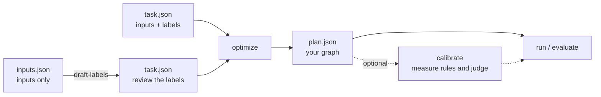

# Quickstart

The walk-through from a task file to a running graph, with every command's real
output; the README keeps the short form.

You need example inputs. Expected outputs (labels) are optional: if you don't
have them, a strong model drafts them for you to review.



**1. Pick a judge.** The judge answers the graph's typed questions. Use
TypeSafe's hosted Jev, or run Ruling on your own machine; every command takes
either, and the examples below use Ruling.

<details open>
<summary><b>Jev, hosted</b></summary>

Jev runs on TypeSafe's servers, so it works on any machine and answers many
requests at once. It needs an API key from [TypeSafe](https://typesafe.ai), and
its calls are billed:

```sh
export TYPESAFE_API_KEY=<your key>
```

Jev is the default backend, so with the key set, leave `--backend ruling
--max-workers 1` off the commands below. The model defaults to `jev-latest`;
pass `--model` with a pinned version for results you want to reproduce.

</details>

<details>
<summary><b>Ruling, local</b></summary>

[Ruling](https://github.com/bradAGI/ruling) runs on an Apple Silicon Mac and
needs no account. In a separate terminal, starting from your `rulesmith`
checkout:

```sh
git clone https://github.com/bradAGI/ruling.git ../ruling
uv sync --directory ../ruling
uv run --directory ../ruling ruling serve
```

Leave that server running and run the remaining commands from `rulesmith` in
your original terminal. Ruling downloads its model on first use and answers one
request at a time, hence `--max-workers 1`.

</details>

**2. Configure a proposer**, the model that writes graphs, using a
[DSPy model identifier](https://dspy.ai/learn/programming/language_models/).
The example below assumes you have separately started an OpenAI-compatible
model server at `http://127.0.0.1:8080/v1`. Replace `<served-model-id>` with its
model ID; Ruling provides the judge, not this generative endpoint:

```sh
export REFLECTION_MODEL="openai/<served-model-id>"
export REFLECTION_BASE_URL=http://127.0.0.1:8080/v1
export OPENAI_API_KEY=local-no-auth
```

**3. Describe the task.** Start with the complete labeled sample, or write
`task.json` in this shape:

```sh
cp examples/task.json task.json
```

```json
{
  "description": "Route each support ticket to billing, technical, or sales.",
  "labels": ["billing", "technical", "sales"],
  "train": [{"id": "t1", "state": "I was charged twice.", "label": "billing"}],
  "validation": [{"id": "v1", "state": "The app crashes.", "label": "technical"}],
  "test": [{"id": "e1", "state": "Can I get a price quote?", "label": "sales"}]
}
```

`train` drives proposals, `validation` picks the winner, and `test` is scored once at the end.

No labels yet? `rulesmith draft-labels` has a strong model draft them for you
to review. Inputs with structure, mistakes that cost more than others, more than
one right answer, or a grader instead of labels: see [Tasks](tasks.md).

**4. Build the graph.**

```sh
uv run rulesmith optimize task.json \
  --backend ruling --max-workers 1 \
  --reflection-model "$REFLECTION_MODEL" \
  --reflection-base-url "$REFLECTION_BASE_URL" \
  --output runs/my-task
```

Output (trimmed; with `REFLECTION_MODEL=openrouter/qwen/qwen3.8-27b`):

```text
Iteration 0: Base program full valset score: 0.3333333333333333 over 3 / 3 examples
Iteration 1: Proposed new text for readings: ask intent = "Route each support ticket to billing, technical, or sales based on its primary request. ..."
...
{
  "resolved_models": ["mlx-community/Qwen3.5-4B-4bit"],
  ...
  "seed_validation_score": 0.3333333333333333,
  "validation_score": 1.0,
  "improvement_p": 0.25,
  "kept_seed": false,
  "candidates": 2,
  "reflection_calls": 3,
  "metric_calls": 102,
  "backend": "ruling",
  "reflection_model": "openrouter/qwen/qwen3.8-27b",
  "scored_by": "labels"
}
```

This writes `runs/my-task/plan.json` (the graph), `plan.rules` (the same
graph as the rules search wrote, which you can edit, and which every command
accepts in place of the JSON) and `report.json` (scores). Compare
`validation_score` with `seed_validation_score`. Search checkpoints as it goes:
an interrupted run continues with `--resume`, and a larger `--max-metric-calls`
on a resumed run searches further.

**5. Evaluate and run it.** The proposer is not needed from here on.

```sh
uv run rulesmith evaluate task.json runs/my-task/plan.json \
  --backend ruling --max-workers 1 --split test --output runs/my-task/test.json

uv run rulesmith run runs/my-task/plan.json examples/state.json \
  --backend ruling --max-workers 1
```

Output (trimmed):

```text
{
  "score": 1.0,
  "output": "runs/my-task/test.json"
}
{
  "outputs": {"label": "billing"},
  ...
  "answers": {
    "intent": {
      "type": "choice",
      "value": "billing",
      "probabilities": {"billing": 0.991, "technical": 0.009, "sales": 0.00007},
      "confidence": 0.987
    }
  },
  "skipped": ["rule_2", "rule_3"],
  ...
  "input_tokens": 166,
  "output_tokens": 0,
  "label": "billing",
  "decided_by": "rule_1",
  "confidence": 0.991
}
```
