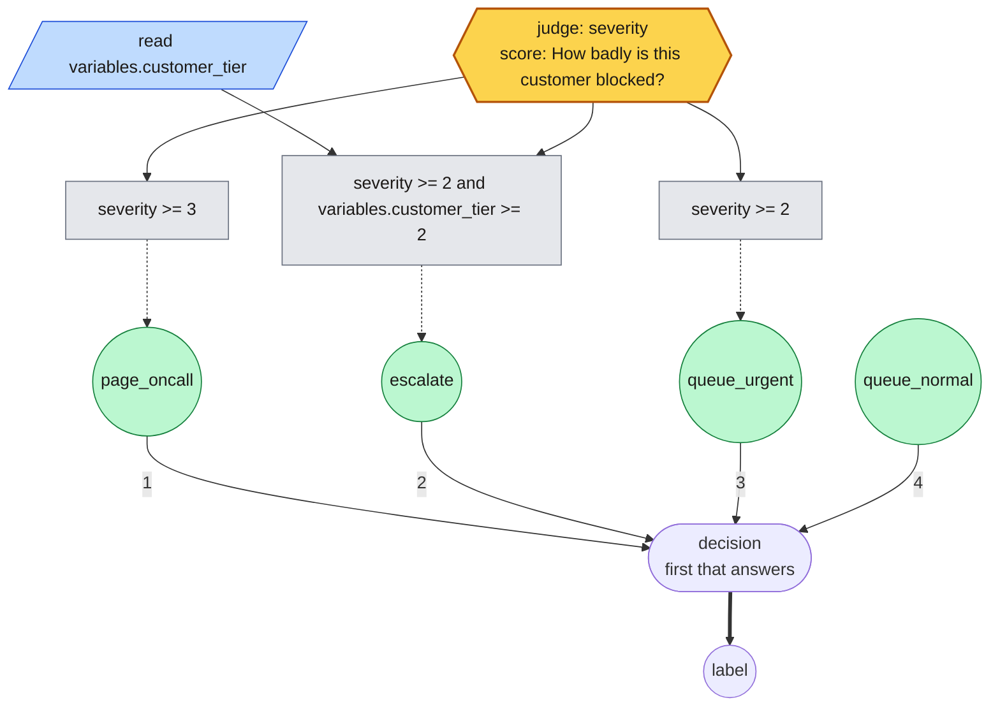
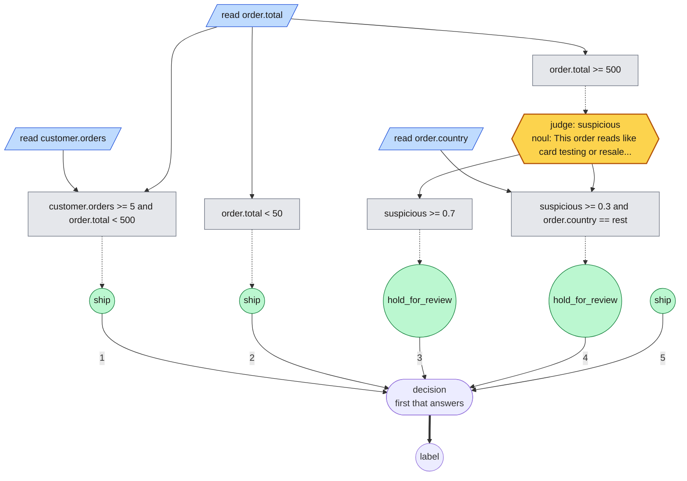
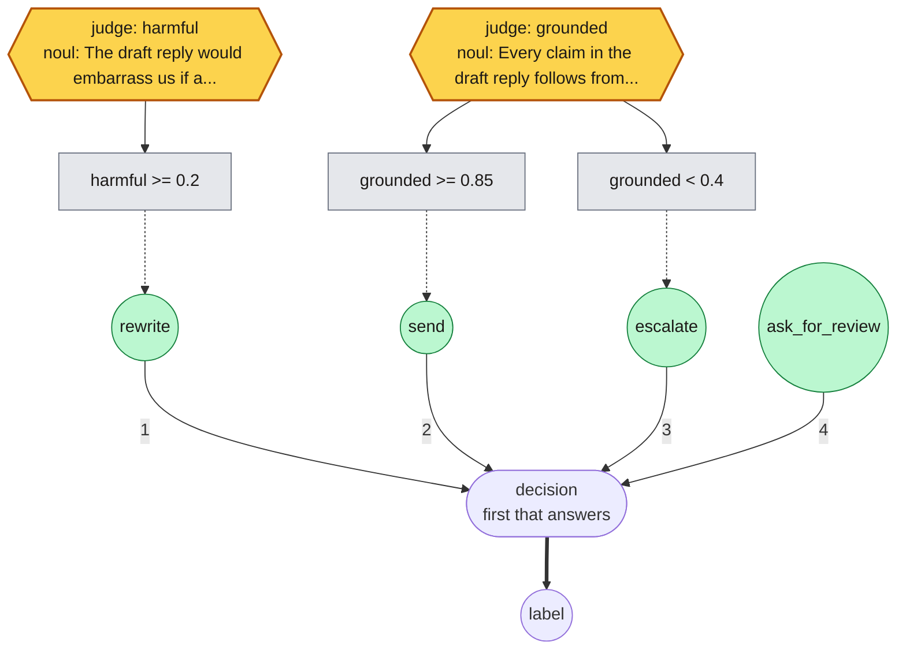
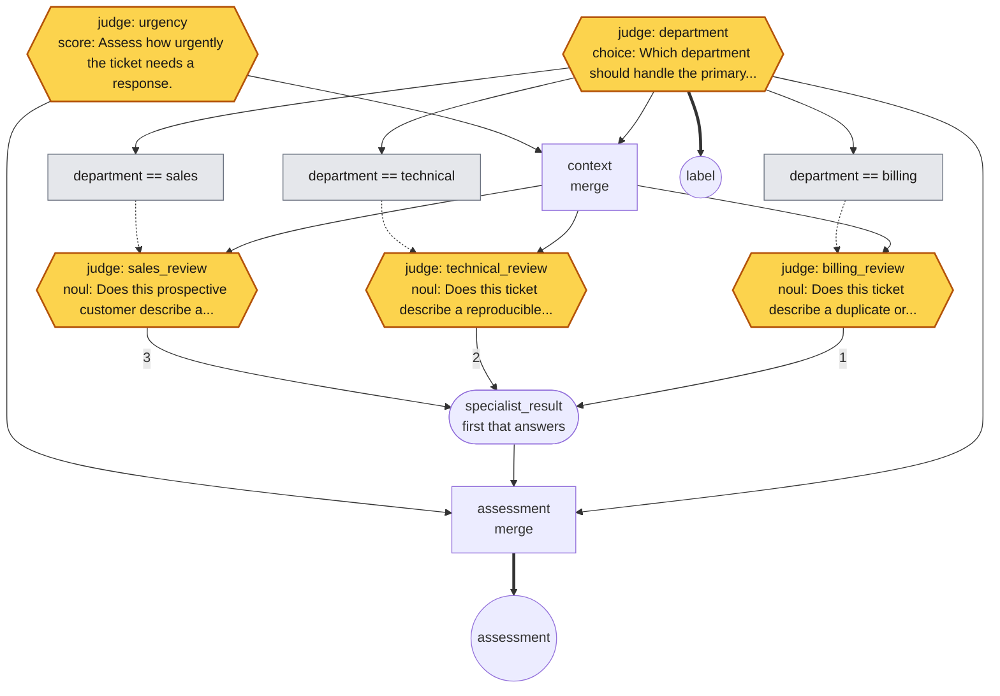
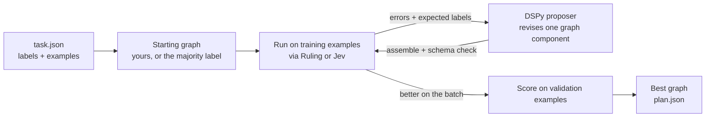

# Rules

Search does not write graph JSON. It writes rules, which compile to the graph
language and render back from it, so the runtime, the validators and the saved
`plan.json` are unchanged: only the surface a proposer writes is different, and
you can edit what search wrote.

```
read target.x in [-1, 1]
ask threat = "Is this worth fighting?" [fight: "A live opponent is in view."] [clear: "Nothing is."]
when target.x and threat == "fight": ATTACK
always: MOVE_FORWARD
```

Rules are tried in order and the first whose condition holds decides. A judgment
can sit behind a cheap read, so the judge is asked only where a number cannot
settle it. Conditions join with `and` and `or`, group with parentheses, invert
with `not`, name a reading to test that it has a value, or compare one with `>=`,
`>`, `<=`, `<` or `==` against a number, a label, or another reading.

`let` names a condition so the rules can test it by name, or computes a number
from readings with `+`, `-` and a constant weight:

```
read ammo in [0, 50]
read health in [0, 200]
read enemy.health in [0, 200]
let armed = ammo >= 1 and health >= 25
let lead = health - enemy.health
when armed and lead >= 20: ATTACK
when not armed or health < enemy.health: MOVE_BACKWARD
always: MOVE_FORWARD
```

A reading can be named the same way, `read health = variables.HEALTH in [0, 200]`,
and the rules then say `health`. `read length of company_profile in [0, 10000]`
reads how long a text or list is, so `when length of company_profile < 20` can
settle an empty field without asking anyone. A name is a node in the graph, so it survives the
round trip: search reads and rewrites `armed`, not the condition spelled out in
every rule, and `draw` shows it as a box of its own.

Rules decide the label, and `output <name>:` starts another list that decides
something else from the same readings and judgments, asked once for both:

```
read severity in [0, 3]
read account.vip one of [yes, no]
when severity >= 2: review
always: accept
output priority:
when severity >= 3 or account.vip == "yes": high
always: low
```

Programs that rules cannot express, such as two judgments merged into one input,
are proposed as whole-graph JSON instead.

## What a judgment can be

A judge answers three kinds of question, and only the first is classification:

| Kind | Answer | Written as | Tested with |
| --- | --- | --- | --- |
| `choice` | one of the labels you name | `ask route = "Which team?" [billing: "..."] [technical: "..."]` | `route == "billing"` |
| `score` | a position on the rubric, ordered | `ask severity = "How bad is this?" [minor] [major] [critical]` | `severity >= 2` |
| `noul` | the probability its statement is true | `ask grounded = "The reply follows from the context."` | `grounded >= 0.85` |

A judgment reads the whole input unless you say what it is shown. `given` hands
it named values instead, which is less to read and keeps it on the question:

```
read health = variables.HEALTH in [0, 200]
read enemy.distance in [0, 4096]
ask close = "The enemy is close enough to fight." given [enemy.distance, health]
```

`given [observation, first]` shows it the whole input and another judgment's
answer, which is how one judgment checks another's work.

A choice over every label the task has need not list them.
`ask intent = "Which intent is this?" [task labels]` asks over the task's
labels, each described by the task's `descriptions` (`"descriptions":
{"card_arrival": "The customer is waiting for a card to arrive."}`) or, where
it has none, by its own words with underscores read as spaces. Search writes
such a question this way, so a proposer revising a 77-label question rewrites one
line, not 77. The form needs a task, so `rulesmith draw` and `run` refuse it.

Two things a rule can say about a judgment besides what it answered.

**How sure it was.** A choice or a score comes back with a confidence, and
`<name>.confidence` puts it where a condition can test it, so an answer the judge
hedged on falls through to the cheap rule instead of being acted on:

```
ask threat = "Fight or fall back?" [ATTACK: "Ammo and health allow it."] [MOVE_BACKWARD: "They do not."]
when threat.confidence >= 0.7 and threat == "ATTACK": ATTACK
always: MOVE_FORWARD
```

A threshold like that only means something if the judge's probabilities do: a
small model that says 0.97 and is right three times in five is overconfident.
`rulesmith calibrate task.json plan.rules --output calibrated.rules` fits one
temperature per choice question over the task's labels, from its answers on the
training examples, and writes it into the question (`... [ATTACK: "..."]
calibrated 1.8`). The answers stay the same; how sure they read changes.

## How sure a rule is

Every decision reports `decided_by`, the rule or judgment that settled it, and a
`confidence`: the least sure of the judgments asked and, once the rule is
measured, how often that rule is right. Until then a rule claims nothing, and a
decision it settles without asking reads as 1.0. `calibrate` also measures
every rule on the labeled training and validation examples and writes the count
after it:

```
when rating >= 4: recommended calibrated 37/40 of 100
```

That rule decided 40 of 100 examples and was right on 37, so its decisions read
as (37 + 1) / (40 + 2) = 0.90 sure. The smoothing keeps a rule seen twice from
claiming certainty. These are examples search saw, so the counts flatter a
searched graph; calibrate against a task of fresh examples for an honest figure.

`evaluate` checks the counts against the inputs it scores. A rule that decides
far more or less often than it did when measured (at `--drift`, default 0.01,
by an exact binomial test) is reported under `drift` in the output and warned
about. The inputs have moved, and so may how often the rule is right: a
scam-posting rule measured on balanced data decides 40% of postings, and at the
real scam rate 14%.

Where a rule over a field anyone can set is a way around the judge, as in fraud,
`optimize --keep-judge 0.99` keeps only graphs whose rules, wherever they answer
without the judge, are right at least that often; see
[optimization settings](optimization.md#settings).

## Second opinions and probabilities

**What several of them agree on.** A vote settles two or more judgments into
one value: `agree` reports whether they all said the same, which is how a second
opinion verifies the first, and `majority` takes the answer most of them gave.

```
ask first = "Is this order fraudulent?" [yes: "It is."] [no: "It is not."]
ask second = "Reading it again, is this order fraudulent?" [yes: "It is."] [no: "It is not."]
vote checked = agree of [first, second]
when checked == "yes" and first == "yes": review
always: accept
```

Each judgment in a vote is a separate model call, so a second opinion costs a
second question. Everything measured in this repo says calls are the expensive
part and rarely the deciding one, so reach for this where being wrong is costly,
not by default.

A probability is a number, so it composes like any read:

```
ask grounded = "The reply follows from the retrieved context."
when grounded >= 0.85: send
when grounded < 0.4: escalate
always: ask_for_review
```

That covers uses a classifier has no form for: gating an action on confidence,
verifying a generated answer before it goes out, ranking candidates by asking
which is better, or serving as the metric a search optimizes against rather than
the policy it searches. What a judge will not do is extract or compute: if the
answer is already a value in the input, read it.

## Worked examples

One worked example of each, runnable from
[examples/rules](../examples/rules):

**Route a ticket** ([routing.rules](../examples/rules/routing.rules)) — a choice is
a label, and the rules act on it:

```
# choice: pick one of the labels you named, the classic classification.
ask team = "Which team should answer this ticket?" [billing: "Charges, invoices, refunds."] [technical: "Errors, outages, anything broken."] [sales: "Pricing, plans, buying more."]
when team == "billing": billing
when team == "technical": technical
always: sales
```

**Triage by how blocked the customer is**
([triage.rules](../examples/rules/triage.rules)) — a score is ordered, so one
judgment feeds several thresholds, and a read decides who jumps the queue:

```
# score: a position on a rubric, so it can be compared and thresholded.
read variables.customer_tier in [0, 3]
ask severity = "How badly is this customer blocked?" [annoyance] [degraded] [blocked] [outage]
when severity >= 3: page_oncall
when severity >= 2 and variables.customer_tier >= 2: escalate
when severity >= 2: queue_urgent
always: queue_normal
```

<details>
<summary>Drawn with <code>rulesmith draw</code></summary>



</details>

**Spend the judge only where it decides something**
([gating.rules](../examples/rules/gating.rules)) — readings settle the clear cases,
and the question is asked only about orders big enough to matter:

```
# Cheap readings decide the clear cases; the judge is asked only about the rest.
read order.total in [0, 1000000]
read order.country one of [domestic, eu, rest]
read customer.orders in [0, 10000]
ask suspicious = "This order reads like card testing or resale fraud." when order.total >= 500
when customer.orders >= 5 and order.total < 500: ship
when order.total < 50: ship
when suspicious >= 0.7: hold_for_review
when suspicious >= 0.3 and order.country == "rest": hold_for_review
always: ship
```

<details>
<summary>Drawn with <code>rulesmith draw</code></summary>



</details>

**Check a draft reply before sending it**
([grounding.rules](../examples/rules/grounding.rules)) — probabilities compose, so
two judgments set a floor and a ceiling with a human in between:

```
# noul: a probability, so the decision is a threshold on confidence.
ask grounded = "Every claim in the draft reply follows from the retrieved context."
ask harmful = "The draft reply would embarrass us if a customer read it."
when harmful >= 0.2: rewrite
when grounded >= 0.85: send
when grounded < 0.4: escalate
always: ask_for_review
```

<details>
<summary>Drawn with <code>rulesmith draw</code></summary>



</details>

## Beyond rules

The full DAG language is available. This hand-written example
([examples/dag.json](../examples/dag.json)) asks two questions in parallel, then
runs only the specialist that matches. Drawn with `rulesmith draw`:



The amber hexagons are judge calls, each a question to Jev or Ruling; the rest
runs without a model. Solid arrows carry values, a gray box is a condition, and
a dashed arrow leads from a condition to what it gates: each review is shown the
merged `context`, and asked only when `department` answered its team. The two
judgments nothing feeds are shown the whole ticket. `specialist_result` takes the first of its
three inputs that answered, in the numbered order, though here at most one ever
does. Thick arrows lead to the graph's two outputs.

## How search revises them



The proposer sees where the graph answered wrong and revises one part: the
readings it may look at, or the rules that decide. The revision is compiled with
the part it did not touch and validated as a complete graph. A proposal is kept
only if it beats its parent on the training batch; the best validation score
wins. The test split never reaches the optimizer.

## Reference

Every construct in one place, and a program that uses most of them:

```
read variables.HEALTH in [0, 200]
read compass.2.bearing in [-180, 180]
ask threat = "Fight or fall back?" [fight: "Ammo and health allow it."] [flee: "They do not."] when variables.HEALTH < 40
when variables.HEALTH >= 25 and threat == "fight": ATTACK
when compass.2.bearing >= 45: TURN_LEFT
always: MOVE_FORWARD
```

- **Readings** declare what the program may look at: `read <path> in [low, high]`,
  `read <path> one of [a, b]`, `read length of <path> in [low, high]` for how long a text or list is (tested as
  `length of <path> < 20`), `read <name> = <path> in [low, high]` to give a
  reading a name the rules use instead of its path, or `ask <name> = "question" [label: "when it applies"] ...`
  for a judgment, which may end `when <condition>` to be asked only then. A judgment
  reads the whole input unless it names what it is shown with `given [a, b]`;
  `observation` in that list is the whole input. `[task labels]` in place of the
  labels, as in `ask intent = "Which intent is this?" [task labels]`, asks over
  every task label as the task's `descriptions` describe it. A choice over exactly
  those, in the task's order, is shown to the proposer in this short form.
- **Rules** are `when <condition>: <action>` or `always: <action>`, tried in order.
  An action is a label, a conditional such as
  `route.bearing >= 0 ? TURN_LEFT : TURN_RIGHT`, or an ask without a name, whose
  answer is the label: `always: ask "Fight or fall back?" [ATTACK: "Ammo and health allow it."] [MOVE_BACKWARD: "They do not."]`.
- **Conditions** join with `and` and `or`, group with parentheses, invert with `not`,
  name a reading to test that it has a value, or compare one with `>=`, `>`, `<=`, `<`
  or `==`, against a number, a quoted label, or another reading
  (`capture.best_gain > hanging.worst`). The graph compares with three of those;
  `<=` and `>` compile to the same thing said longhand. `threat.confidence` is how
  sure the judgment `threat` was.
- **Names** stand for a condition the rules test more than once:
  `let armed = ammo >= 1 and health >= 25`, then `when armed: ATTACK`. A name is
  declared before the rules that use it and cannot reuse a reading's or judgment's
  name. It compiles to a node, so it comes back as `armed` when the graph is
  rendered, not as the condition written out again. `let` also computes a number:
  `let margin = 2 * gain - worst + 1` adds, subtracts and scales readings.
- **Votes** settle several choice judgments into one value:
  `vote verdict = agree of [first, second]` or `vote verdict = majority of [a, b, c]`.
- **Outputs** beyond the label each get a rule list of their own, after the
  label's, under an `output <name>:` heading. Search scores the label only.
- **Measurements** are what `rulesmith calibrate` writes and search never invents.
  A judgment may end `calibrated 1.8`, the temperature fitted to how sure it
  should read; a rule may end `calibrated 37/40 of 100`, how many of the labeled
  examples it decided and how many rightly. Search drops a starting graph's rule
  measurements, since they describe that graph and not its rewrites, and the
  proposer is told to keep a temperature as written.
- The two parts, readings and rules, are revised separately and may be merged
  between candidates. A rules part may declare any reading its rules need.
- A program beyond rules is proposed as whole-graph JSON, which is accepted as the
  complete program.

Why: in past runs, two fifths of proposals against a 36-node graph scored zero, not because the
graphs played badly but because the JSON came back malformed. Every searched graph
had the same shape anyway, so that shape became the surface.

See [Graph format](graphs.md) for the JSON behind each node, and
[Optimization](optimization.md) for how search runs and what it reports.
